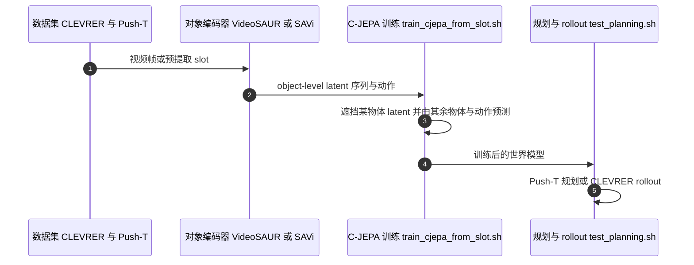

# Causal-JEPA（物体级潜空间干预）

**Causal-JEPA（C-JEPA）** 是把 JEPA 世界模型的学习单位从图像 patch 换成物体 slot 的方法：训练时遮挡某个物体的 latent，让模型只能依靠其他物体与动作推断它，从而学到物体之间的因果影响。

## 英文缩写速查

| 缩写 | 英文全称 | 简要说明 |
|------|----------|----------|
| JEPA | Joint-Embedding Predictive Architecture | 在潜空间预测未来表示、不重建像素的架构 |
| C-JEPA | Causal-JEPA | 本文方法名，物体级潜空间干预版 JEPA |
| WM | World Model | 预测动作后果并用于规划的内部模型 |
| slot | Object Slot | 从图像中提取出的单个物体表示（由 VideoSAUR / SAVi 等对象编码器给出） |

## 为什么重要

patch 级世界模型难以表达「杯子、球是一个整体」，也难以显式建模物体间交互。Causal-JEPA 把表示单位与干预单位对齐到物体，是 JEPA 路线从「预测潜变量」走向「理解物体关系」的一步。

## 核心信息

- 作者：Heejeong Nam（Brown）、Quentin Le Lidec\*（NYU）、Lucas Maes\*（Mila / UdeM）、Yann LeCun（NYU）、Randall Balestriero（Brown）
- 代码：<https://github.com/galilai-group/cjepa>（README 未声明许可证）
- 权重：<https://huggingface.co/HazelNam/CJEPA/tree/main>
- 项目页：<https://hazel-heejeong-nam.github.io/cjepa/>

## 核心原理（方法栈）

1. **对象编码**：用对象编码器把每帧分解为多个 slot（README 依赖 VideoSAUR、SAVi、ALOE）。
2. **object-level latent 干预**：随机选取某个物体的 latent 遮挡。
3. **预测**：由其余物体 latent 与动作预测被遮挡物体在未来的状态。
4. **规划**：在该物体级潜空间中做动作规划（Push-T 等控制任务）。

## 源码运行时序图

复现路径：按 `docs/ENV.md` 与 `docs/DATASET.md` 配环境与数据，先跑对象编码器，再跑 `train_cjepa_from_slot.sh`，最后用 `test_planning.sh` 评测。

## 实验与评测

- 文章转述：反事实视觉推理准确率比无遮挡版本高约 20 个百分点。
- 文章转述：控制任务中，仅使用 patch 型世界模型约 1% 的 latent 特征即可达到接近的规划表现。
- 上述数字来自文章转述，未逐一核对论文表格。

## 工程实践

- 依赖 Stable-WorldModel、Stable-Pretraining 与外部对象编码器仓库，环境搭建成本高于单仓库方法。
- 仓库提供预提取 slot 与 C-JEPA 权重，可跳过对象编码器训练直接评测（README 所述）。

## 局限与风险

- 效果依赖对象编码器质量；物体分解失败时，物体级干预会失效（推测，未在仓库中验证）。
- 评测场景集中在 CLEVRER 与 Push-T 等仿真或受控环境，未见真实机器人结果。

## 与其他工作对比

| 维度 | Causal-JEPA | [LeWM](./paper-lewm.md) |
|------|-------------|--------------------------|
| 学习单位 | 物体 slot | 整图潜变量（端到端像素） |
| 依赖 | 对象编码器 | 单一编码器，超参少 |

## 结论

**物体级干预是比 patch 级更有结构的世界模型学习信号，但代价是依赖对象分解。**

1. **学习单位决定可解释性** — 以物体为单位遮挡，迫使模型学习交互而非纹理相关。
2. **数字读法** — 文中的 20 pp 与 1% 特征均为仿真任务上的结果，迁移到真实场景需重新评测。
3. **工程代价** — 对象编码器与多仓库依赖使部署链路变长。
4. **可复现性** — 代码与权重公开，适合作为对象级世界模型的起点。

## 关联页面

- [LeWorldModel](./paper-lewm.md) — 对照：不依赖对象分解的端到端 JEPA 世界模型
- [LpWM](./paper-lpwm.md) — 同属 2026 年 JEPA 世界模型路线的表示结构研究
- [Value-Guided JEPA 规划](./paper-value-guided-jepa-planning.md) — 同为规划导向的 JEPA 工作
- [Model-Based RL](../methods/model-based-rl.md) — 世界模型在规划中的通用框架

## 参考来源

- [Causal-JEPA 论文归档](../../sources/papers/causal_jepa_arxiv_2602_11389.md)
- [galilai-group/cjepa 仓库归档](../../sources/repos/cjepa.md)
- [深蓝具身智能文章归档](../../sources/blogs/wechat_deepblue_lecun_jepa_11_papers_2026-10-20.md)

## 推荐继续阅读

- [Causal-JEPA 项目页](https://hazel-heejeong-nam.github.io/cjepa/)
- [arXiv:2602.11389](https://arxiv.org/abs/2602.11389)
