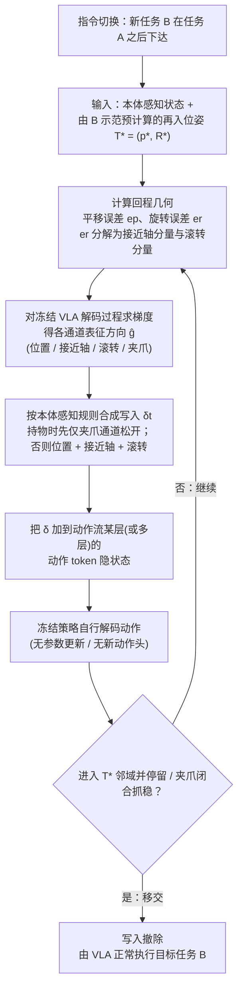

# Causeway: Restoring Task Accessibility for Instruction Switching in VLA Policies

Causeway恢复VLA执行中途切换指令时的任务可达性。

## 英文缩写速查

| 缩写 | 英文全称 | 简要说明 |
|---|---|---|
| VLA | Vision-Language-Action | 视觉与指令条件化的机器人动作策略。 |
| WM | World Model | 预测行动后的环境变化。 |
| WAM | World Action Model | 联合建模未来视觉和动作。 |

## 为什么重要

Causeway恢复VLA执行中途切换指令时的任务可达性。 评读时应将问题、观测条件与执行接口一并记录，避免从单个演示或指标外推能力。

## 流程总览

图依据：论文 §IV-A / §IV-B（式 4-16）；§IV 开头对 §III 设计选择的概述

## 方法栈

从目标任务示范取重新进入姿态，对冻结VLA动作流做状态定向干预，让VLA自身生成返回可执行区域的动作。

## 实验与评测

论文报告LIBERO-Goal切换成功率从3%–26%升至47%–65%，并在xArm 6上测试；效果依赖示范状态覆盖。

## 与其他工作对比

无需重训或外部动作生成器，但解决的是已覆盖状态邻域内的任务重接。

## 工程实践

当前归档仅核实到arXiv入口，未核实可运行官方代码。

## 源码运行时序图

**不适用**：当前没有核实到该论文的可运行官方训练、推理或部署入口。

## 结论

**一句话总判：** Causeway恢复VLA执行中途切换指令时的任务可达性。

1. 核对方法实际改变的是数据、表征、规划、控制还是评测。
2. 只把论文覆盖的任务、平台与扰动范围当作证据。
3. 复现前确认代码、权重、数据许可和硬件依赖状态。

## 局限与风险

无需重训或外部动作生成器，但解决的是已覆盖状态邻域内的任务重接。 当前导读以用户提供的文章和预印本题录为索引；详细配置与结果应核对论文全文。

## 关联页面

- [Day 5 导读](../overview/humanoid-motion-intelligence-day5-world-models-decision.md)
- [生成式世界模型](../methods/generative-world-models.md)

## 参考来源

- [Day 5 原文归档](../../sources/blogs/humanoid_motion_intelligence_day5_world_models_decision_2026_10_06.md)
- [arXiv:2609.30913](https://arxiv.org/abs/2609.30913)
- [arXiv PDF](https://arxiv.org/pdf/2609.30913)：已通读方法部分（实验与附录以略读为准）：摘要、§IV Bridging Task Islands by Representation Steering（A 表征写入、B 介入与移交）；§III 仅略读

## 推荐继续阅读

- [Day 5 导读](../overview/humanoid-motion-intelligence-day5-world-models-decision.md)
