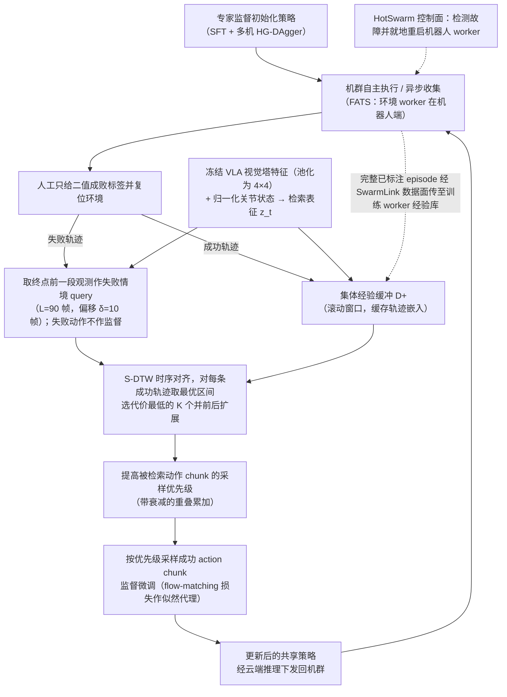

# CEL Fleet Experience（arXiv:2610.25736）

**CEL Fleet Experience**（*Learning from Fleet Experience: A Collective Learning Paradigm for Robots*，[arXiv:2610.25736](https://arxiv.org/abs/2610.25736)，[项目页](https://cel-robot-learning.github.io)，[资源](https://github.com/RLinf/RLinf)）来自 [具身智能小站 2026-10-31 盘点](../../sources/blogs/wechat_embodied_station_50_papers_scenerig_photo_to_sim_2026-10-31.md)，属「策略学习与 VLA」组。

## 一句话定义

**CEL用失败情境检索机群成功片段，配合异步系统更新共享策略；真实多任务与机群规模实验支持收益，免新增人工纠错不等于初始策略无需人工数据。**

## 英文缩写速查

| 缩写 | 英文全称 | 简要说明 |
|------|----------|----------|
| CEL Fleet Experience | Learning from Fleet Experience: A Collective Learning Paradigm for Robots | 本文方法 / 基准的简称 |

## 为什么重要

- 从机群失败中，检索可复用的成功经验。
- 开源结论：**部分开源**（步骤 2.5，2026-10-31）。公众号只给 RLinf 通用框架仓库（git ls-remote 可达）与项目页；项目页仅链接该框架，未确认含 CEL 专属代码，不当作完整开源。
- 同期同组工作见 [单图重建仿真、VLA 适配评测与跨形态世界模型：具身智能小站 10-31 期 50 篇阅读坐标](../overview/embodied-station-2026-10-31-50-papers-technology-map.md)。

## 流程总览

图依据：论文 §3.1 FERT（Fig.3、式 (2)–(12)）、§3.2 FATS（Fig.4）。

## 核心机制

| 项 | 内容 |
|----|------|
| **arXiv** | [2610.25736](https://arxiv.org/abs/2610.25736) |
| **开源** | **部分开源** |
| **要点** | CEL用失败情境检索机群成功片段，配合异步系统更新共享策略；真实多任务与机群规模实验支持收益，免新增人工纠错不等于初始策略无需人工数据。 |
| **文内指标** | 公众号未给具体数字，本页不引用。 |

## 源码运行时序图

**部分开源** — 公众号只给 RLinf 通用框架仓库（git ls-remote 可达）与项目页；项目页仅链接该框架，未确认含 CEL 专属代码，不当作完整开源。 待可运行代码公开后补图。

## 实验与评测

- 公众号未给具体数字，本页不引用。
- **读法：** 本页为索引级摘要，依据公众号转述的官方摘要与仓库信息整理；逐项数字与 baseline 以原文 PDF 为准。

## 与其他工作对比

- 横向索引见 [单图重建仿真、VLA 适配评测与跨形态世界模型：具身智能小站 10-31 期 50 篇阅读坐标](../overview/embodied-station-2026-10-31-50-papers-technology-map.md)；同 arXiv 不重复造页。

## 结论

**从机群失败中，检索可复用的成功经验：CEL用失败情境检索机群成功片段，配合异步系统更新共享策略；真实多任务与机群规模实验支持收益，免新增人工纠错不等于初始策略无需人工数据。**

1. 开源边界：**部分开源** — 公众号只给 RLinf 通用框架仓库（git ls-remote 可达）与项目页；项目页仅链接该框架，未确认含 CEL 专属代码，不当作完整开源。
2. 核心机制：CEL用失败情境检索机群成功片段，配合异步系统更新共享策略；真实多任务与机群规模实验支持收益，免新增人工纠错不等于初始策略无需人工数据。
3. 复现与选型前核对任务协议、硬件与基准口径，勿直接横比公众号摘录数字。

## 关联页面

- [vla](../methods/vla.md)
- [imitation-learning](../methods/imitation-learning.md)
- [reinforcement-learning](../methods/reinforcement-learning.md)
- [embodied-station-2026-10-31-50-papers-technology-map](../overview/embodied-station-2026-10-31-50-papers-technology-map.md)

## 参考来源

- [cel_fleet_experience_arxiv_2610_25736.md](../../sources/papers/cel_fleet_experience_arxiv_2610_25736.md)
- [wechat_embodied_station_50_papers_scenerig_photo_to_sim_2026-10-31.md](../../sources/blogs/wechat_embodied_station_50_papers_scenerig_photo_to_sim_2026-10-31.md)
- [arXiv:2610.25736](https://arxiv.org/abs/2610.25736)
- [arXiv PDF](https://arxiv.org/pdf/2610.25736)：已通读方法部分（实验与附录以略读为准）：§1 引言、§3 CEL 概览、§3.1 FERT 四步（含式 (2)–(13)）、§3.2 FATS 架构与 3.2.1–3.2.2 概览；§3.2.3 HotSwarm 控制面细节及 §3.1.5 理论分析以略读为准

## 推荐继续阅读

- [arXiv PDF](https://arxiv.org/pdf/2610.25736)
- [项目页](https://cel-robot-learning.github.io)
- [https://github.com/RLinf/RLinf](https://github.com/RLinf/RLinf)
