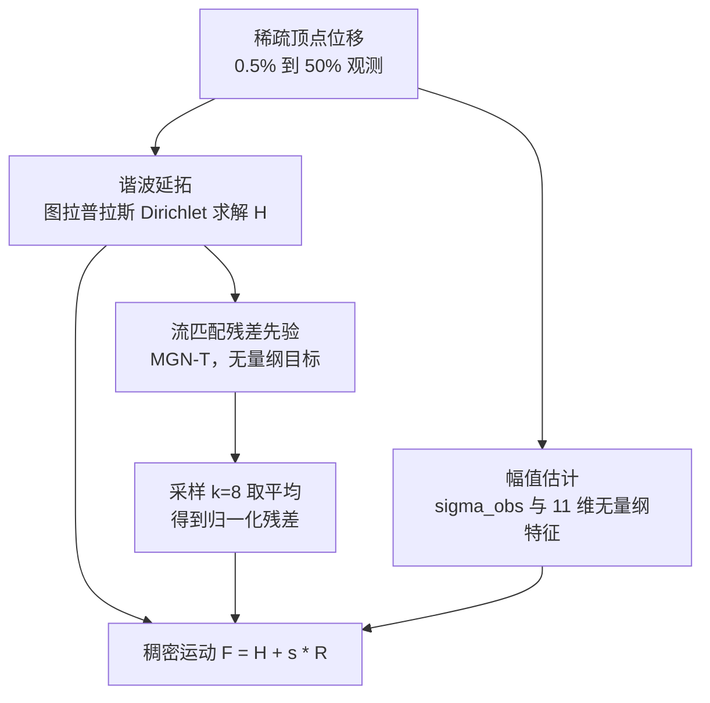
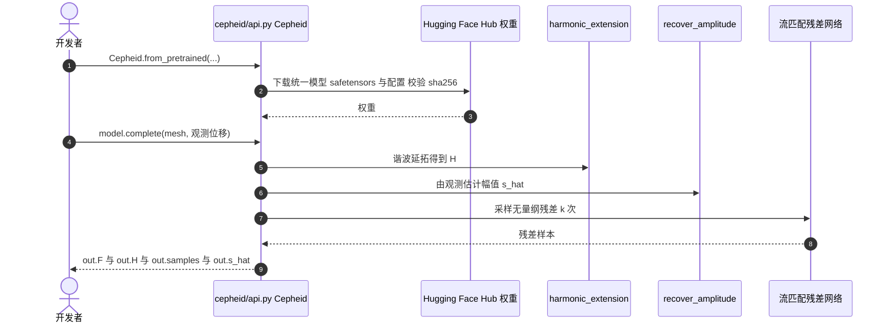

# Cepheid：把尺度与结构解耦的跨几何族运动补全

**Cepheid 在谐波延拓基线上只学「无量纲的残差结构」，残差幅值由可观测量经一个轻量校正单独估计，二者相乘后补回稠密网格运动，从而让同一先验跨几何族可用。**

论文 *Cepheid: Decoupling Scale from Structure for Cross-Family Motion Completion*（[arXiv:2610.18871](https://arxiv.org/abs/2610.18871)，[代码](https://github.com/Su-Terry/cepheid)，[项目页](https://su-terry.github.io/cepheid-website/)）。本文主体是运动重建，机器人软体抓取只是迁移检验。

## 英文缩写速查

| 缩写 | 英文全称 | 简要说明 |
|------|----------|----------|
| MGN-T | MeshGraphNet-Transformer | 骨干网络：两个消息传递块之间夹一个 Transformer 注意力块，12 近邻图 |
| OT-CFM | Optimal-Transport Conditional Flow Matching | 残差先验的训练目标，采样用 30 步 Euler |
| DT4D | DeformingThings4D | 训练族之一：艺术家动画的动物与人形 |
| AMASS | Archive of Motion Capture as Surface Shapes | 训练族之一：人体动捕 |
| RH20T | — | 附录引用的真实机器人操作数据集（仅为论文附录提及） |

## 为什么重要

- 同一几何族内训练的先验，在别的族上常不如无参数的谐波延拓；论文给出转移矩阵中 12 个跨族单族格有 7 个不优于谐波。
- 残差幅值跨族相差十倍以上，且随观测变密而缩小，又取决于未知的目标运动；把它从结构里剥离是统一训练可行的前提。
- 补全无需骨架、配准、跨网格对应，适合点跟踪视频与机器人软体交互这类稀疏观测。

## 核心信息

| 项 | 内容 |
|----|------|
| **机构** | 国立阳明交通大学（National Yang Ming Chiao Tung University，Chih-Hai Su、Yu-Lun Liu）；国立台湾大学计算机科学与信息工程系（Tsung-Wei Ke） |
| **输入** | 网格顶点坐标 + 稀疏子集的顶点位移（观测密度 0.5%–50%） |
| **训练族** | DT4D、AMASS、Franka（刚性运动链，随机关节轨迹的正运动学） |
| **留出族** | 布料（仿真）、9 个 8–30 自由度程序化腿式体（仿真） |
| **开源** | **已开源**（2026-10-17 核查）：代码 [Su-Terry/cepheid](https://github.com/Su-Terry/cepheid) MIT；Hugging Face 上有统一模型与 11 个论文检查点；权重仅限非商用研究；数据集不再分发，见 `DATA.md`；DOMA / NSDP 基线与 GenBot1K 回放不含 |

## 核心原理

### 流程总览

先对观测顶点做谐波延拓得到基底 H；真值运动减去 H 得残差 R。残差除以估计幅值 ŝ 得到无量纲目标，用流匹配网络学习其分布；推理时采样 k=8 次取平均，乘回 ŝ 加到 H 上。ŝ = σ_obs · exp(b + wᵀz)，σ_obs 为观测位移的稳健标准差，z 为 11 维无量纲特征，系数由岭回归在 DT4D、AMASS、Franka 上拟合后冻结。

## 源码运行时序图

仓库提供包 API 与论文复现脚本；时序对齐 README 的 `Cepheid.from_pretrained` / `complete()` 调用（本次未实际运行，依据 README 与 `REPRODUCE.md`）。

- **训练：** `scripts/train.py` 读取 `configs/xm2_unified.yaml` 等 YAML。
- **复现表格：** `scripts/run_matrix.py` 的 `run` / `table` 子命令；`tools/verify_release.py` 对照论文数值校验发布物。
- README 称默认设置下约 100 s（CPU）/ 约 3 s（RTX 4090）；PyTorch 需自行安装。

## 与其他工作对比

| 维度 | Cepheid（本文） | [cRVAE 可变形操作](./paper-crvae-deformable-manipulation-partial-obs.md) | [ClothTransformer](./paper-clothtransformer-unified-latent-cloth-simulation.md) | [运动重定向](../concepts/motion-retargeting.md) |
|------|------|------|------|------|
| 输入 → 输出 | 稀疏顶点位移 → 稠密网格运动补全 | 少量 corner nodes → 绳 / 布全形状 | 布料网格当前状态 → 下一帧（自回归仿真） | 源形态运动 → 目标形态运动 |
| 先验形式 | 谐波延拓基底 + 流匹配无量纲残差 + 单独幅值估计 | 条件循环 VAE | 潜空间 Transformer，可微 CCD 训练 | 依赖跨形态对应关系 |
| 跨几何族 | 统一模型覆盖 DT4D / AMASS / Franka，并在布料、腿式留出族上检验 | 面向绳 / 布等可变形物体 | 单模型覆盖人体着装、抓布、刚体碰撞三类布料场景 | 依具体方法而定 |
| 机器人闭环 | 仅 Isaac Lab 软棒抓取定性演示，无定量误差 | 驱动 MPC，含 Go2 协作避绳实验 | 定位为仿真器，非控制闭环 | 常用于人形动作数据生成 |

- **相对 cRVAE：** 二者都从稀疏观测推全形状，但 cRVAE 针对具体可变形物体并接入 MPC 控制，Cepheid 追求跨几何族通用的补全先验，机器人部分只是定性检验。
- **相对 ClothTransformer：** ClothTransformer 学的是布料动力学的时序推进，Cepheid 不预测未来，而是在同一时刻由部分观测补全运动。
- **相对运动重定向：** 重定向需要跨形态对应，Cepheid 明确不需要骨架、配准或跨网格对应。
- 各文数据集与误差指标不同（Cepheid 报相对误差，ClothTransformer 报 MVE），数字不可横比。

## 工程实践

| 项 | 说明 |
|----|------|
| 快速试用 | `pip` 安装后 `Cepheid.from_pretrained` + `complete()`；也可单独调用 `harmonic_extension`、`recover_amplitude` |
| 许可 | 代码 MIT；Hub 权重非商用；`NOTICE` 列出第三方代码与数据条款 |
| 输入假设 | 位移须为精确顶点位移；噪声、丢轨迹、深度畸变与扫描几何均未在定量评测中覆盖 |
| 训练掩码 | 仅随机掩码；固定三点布局需微调（论文所述） |
| 机器人用法 | Isaac Lab 中 Franka 抓起软棒：臂、底座与载荷共 5,525 点，12 近邻图，无面、无接触约束；仅观测 8 个本体点（夹爪 4 + 底座 4），载荷点观测为零 |

## 实验与评测

- **DT4D 相对误差（0.5%/2%/5%/10%/50% 观测）：** 谐波 0.6255/0.3533/0.2257/0.1598/0.0754；统一模型 0.3533/0.1116/0.0485/0.0300/0.0180，较谐波低 44%–81%；DOMA 在 50% 观测时低 67%；NSDP 在各密度均高于谐波。
- **转移矩阵（DT4D/AMASS/Franka/布料/腿式）：** 谐波 0.2685/0.0693/0.1011/0.4377/0.2474；统一 0.1243/0.0214/0.0201/0.3692/0.2225，布料低 15.6%、腿式低 10.1%。AMASS 先验在布料上比谐波差 25.5%。
- **幅值恢复（布料）：** 2% 观测 0.4087、10% 观测 0.1513、50% 观测 0.0548，距不可部署的目标知情 oracle 1.4%–8.1%；原始观测尺度（无校正）在 10%/50% 观测高达 1.1599/1.3197。
- **消融（布料/腿式）：** 完整 0.369/0.222；去谐波延拓 1.047/0.585；去幅值恢复 0.391/0.409（腿式高于谐波）；读权重 k=1 代价 8%–13%。
- **动物视频：** CoTracker3 取 12 条顶点轨迹，补全远侧 120 点；无真值，仅示范可接入跟踪器。
- **软棒抓取：** 5 次独立补全呈合理耦合运动，无定量误差。

## 结论

**Cepheid 的可迁移收益来自「谐波基底 + 无量纲先验 + 单独估幅值」三件套缺一不可，而机器人软体抓取只是定性检验，不能当作操作性能证据。**

1. **谐波延拓不可省** — 去掉后误差约 2.4 倍于谐波。
2. **幅值恢复决定能否跨族** — 去掉后腿式留出族误差 0.409，超过谐波 0.2474。
3. **单族先验有害** — 12 个跨族单族格中 7 个不优于谐波，需统一多族训练。
4. **采样次数有成本收益** — k=8 比 k=1 好 8%–13%，推理时间随之增加。
5. **机器人读法** — 8 个本体点推全身 5,525 点是可行性演示，无定量误差；落到抓取控制还需噪声与接触验证。

## 局限与风险

- **精确位移假设：** 定量评测未含噪声、丢轨迹、深度畸变与扫描几何（论文所述）。
- **数据来源偏仿真：** 仅 AMASS 与 RH20T 为实录；DT4D 为艺术家动画，其余为仿真。
- **随机掩码训练：** 固定标记布局需微调。
- **权重许可：** Hub 权重仅限非商用。
- **视频例子无真值：** 离拟合帧越远叠加越差。

## 关联页面

- [扩散模型](../concepts/diffusion-model.md) — 流匹配 / 扩散类生成先验背景
- [接触丰富操作](../concepts/contact-rich-manipulation.md) — 软体与接触交互的任务背景
- [操作任务](../tasks/manipulation.md) — 软体抓取在任务谱中的位置
- [运动重定向](../concepts/motion-retargeting.md) — 同样处理跨形态运动，但前提是对应关系

## 参考来源

- [cepheid_arxiv_2610_18871.md](../../sources/papers/cepheid_arxiv_2610_18871.md) — 论文摘录与开源核查
- [cepheid-project.md](../../sources/sites/cepheid-project.md) — 项目页归档
- [cepheid.md](../../sources/repos/cepheid.md) — 官方仓库归档
- [arXiv:2610.18871](https://arxiv.org/abs/2610.18871) — 原文

## 推荐继续阅读

- [Cepheid 项目页](https://su-terry.github.io/cepheid-website/)
- [Cepheid 论文 HTML](https://arxiv.org/html/2610.18871v1)
