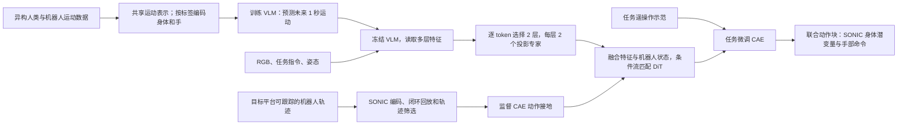

# CHAMP：以全身运动先验协调人形移动操作 / CHAMP: Coordinated Humanoid Loco-Manipulation with Whole-Body Motion Priors

## 一句话定义

CHAMP 先让视觉语言模型学习身体和手部怎样一起运动，再用 SONIC 闭环回放和动作示范训练策略，把视觉、指令和机器人状态转成可执行的身体与手部动作块。

## 英文缩写速查

| 缩写 | 英文全称 | 简要说明 |
|---|---|---|
| VLM | Vision-Language Model | 预训练视觉语言骨干，提供多层运动特征 |
| CAE | Coordination-oriented Action Expert | 逐 token 选择 VLM 层与投影专家，再生成动作 |
| MoE | Mixture of Experts | 不同 VLM 深度分别对应一组投影专家 |
| DiT | Diffusion Transformer | 在 CAE 中用条件流匹配生成联合动作块 |
| FAST | Frequency-space Action Sequence Tokenization | 分别把身体与手的未来连续运动编码为 token |

## 为什么重要

身体和手在弯腰抓取、开门装衣服或端物行走时会互相约束，而异构数据通常只提供部分观测。CHAMP 将跨形态运动表示和目标机器人接口分开学习，因此可利用只标注身体或手的样本，同时用目标控制器回放淘汰不稳定或过度漂移的轨迹。

## 核心信息

| 项目 | 内容 |
|---|---|
| 机构 | 地瓜机器人（D-Robotics）、中国科学院自动化研究所（CASIA） |
| 日期 | 2026-11-23，arXiv v1 |
| 目标平台 | Unitree G1 + Dex3；仿真使用 SIMPLE |
| 作者 | Lijun Han、Muyuan Ma、Zichen Wang、Siyuan Liu、Yuxi Liu、Yutong Wang、Bohao Zhang、Heng Zhou、Wei Sui |

## 流程总览

## 方法

1. **运动预训练（§3.2、附录 A）**。九个数据集约 2,298 小时，有完整身体与手部标注的时长占 56.4%，只有手部或身体标注各占 29.0% 与 14.6%。模型从单帧 RGB、指令和可用姿态预测 5 个未来时刻（间隔 0.2 秒）；身体和手各用独立 FAST 词表，只监督已标注项。这是运动学预测，而非显式学习物体动力学。
2. **闭环动作接地（§3.3、附录 A.3）**。将机器人身体轨迹编码成 64 维 SONIC 潜变量，在仿真 G1 上闭环回放，检查跌倒与根漂移，留下 40,016 段、约 254.5 小时。监督含潜变量和来源对应的末端命令，不把全部 2,298 小时当作 G1 动作示范。
3. **跨层动作专家（§3.3、附录 B）**。冻结 Qwen3-VL-2B-Instruct，读取第 4、12、20、28 层；逐 token 先在每层挑两个专家，再从四层挑两层，对保留四个层–专家对统一归一化。投影融合特征与独立机器人状态一起输入动作 DiT。任务遥操作用于微调 CAE，VLM 保持冻结。

## 工程实践

- 区分预训练的 5 Hz 运动标签和接地/任务数据的 30 Hz 时间轴；最终 G1 接口每步 78 维，即 64 维 SONIC 潜变量及两手各 7 个命令，任务动作块为 30 帧。这些帧数和标注频率不等于真机的推理吞吐或低层伺服频率。
- 复现时先核对图像、状态和动作的帧级对齐、不同末端接口的 padding/mask、SONIC 回放后的稳定性筛选，再对比固定层与稀疏路由。
- **源码运行时序图：不适用。** 截至 2026-11-25，作者项目页网页源码可读，但没有找到可运行的 CHAMP 训练/推理实现、权重或其整理后数据的下载入口。独立 SONIC 实现不等于 CHAMP。

## 评测

作者给每个方法每任务同样 100 条示范和训练步数；下表非独立复现。

| 场景 | CHAMP | 论文内最佳对照 |
|---|---:|---:|
| SIMPLE 七任务（每任务 30 试次，三种随机化级别） | 178/210（84.8%） | GR00T N1.6：130/210（61.9%） |
| G1 真机七任务（每任务 10 试次） | 64/70（91.4%） | GR00T N1.6：52/70（74.3%） |
| 长程爆米花服务（已含在真机七任务中） | 7/10（70%） | GR00T N1.6：4/10（40%） |

OpenTrashcan 是仿真反例：CHAMP 为 21/30，低于 GR00T N1.6 的 25/30。附录 C 的真机成功条件为无需人工介入完成，无强制任务时限，不能据此推算生产节拍。

## 对比

- SIMPLE 消融：移除运动预训练 71.9%，跳过动作接地 73.8%，固定最佳第 4 层 78.6%，固定最终第 28 层 62.4%；完整 CHAMP 84.8%。固定层变体也去掉专家组与路由，差值不能单独证明逐 token 选层的独立因果贡献。
- [Kimodo-Policy](./paper-kimodo-policy.md) 也将视觉条件高层策略接到 SONIC；它改造运动学生成骨干，CHAMP 则先做异构身体与手运动预测，再用 CAE 融合 VLM 多层特征。
- [WholeBodyWAM](./paper-wholebodywam.md) 在模型内联合建模视觉未来、运动与动作；CHAMP 把未来运动监督放在预训练，执行时生成 SONIC 身体潜变量和手部指令。不同任务与口径不直接横比成功率。

## 结论

CHAMP 展示了异构运动先验、控制器接地与多层读出的互补性，但证据限于任务微调后的 G1。
- 把异构预训练时长、目标平台回放时长和每任务遥操作量分开报告。
- 先用闭环回放验证运动能否被目标控制器执行，再谈人类数据迁移。
- 同时核对绝对成功/试次和逐任务失败，不把单平台结果当作跨形态零样本泛化。
- 要评估物体动态和接触力时另加数据与指标；论文没有显式监督这两项。

## 局限与风险

只测试了一个人形平台、任务专用微调和有限真机试次；训练运动监督不包含物体动力学或接触力。演示不能替代未见任务、跨形态、节拍与恢复能力验证。

## 关联页面

- [移动操作](../tasks/loco-manipulation.md) 与 [视觉语言动作模型](../methods/vla.md)
- [SONIC](./nvidia-sonic.md)：共享的目标身体轨迹执行接口。
- [移动操作纵深路线 Stage 4](../../roadmap/depth-loco-manipulation.md#stage-4-统一模型生成式vla-与-wam)

## 参考来源

- [论文原始归档](../../sources/papers/champ_arxiv_2611_30449.md)
- [项目页开放核查](../../sources/sites/champ-2611-30449.md)

## 推荐继续阅读

- [arXiv 全文与附录](https://arxiv.org/html/2611.30449v1)。
