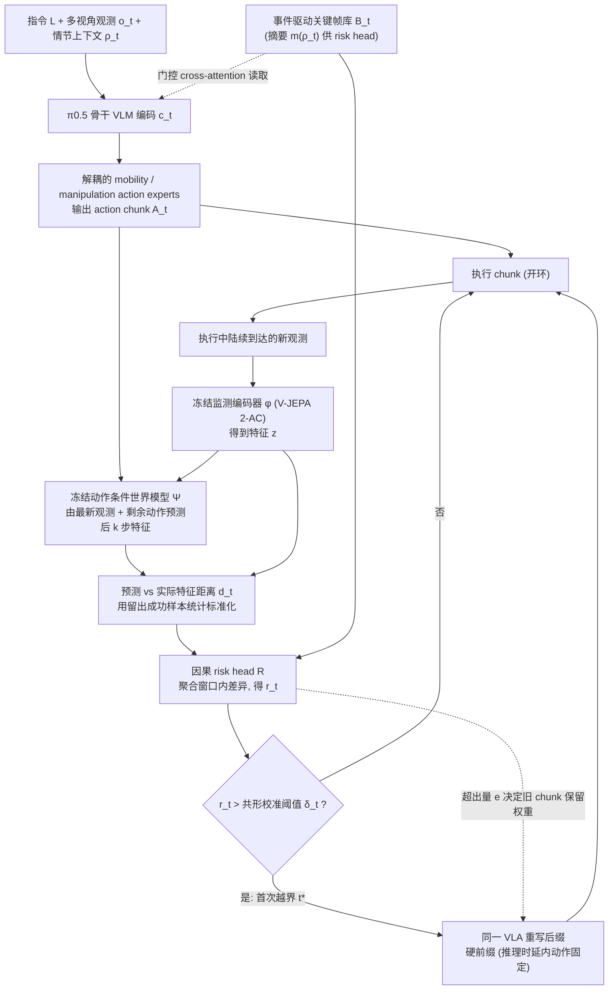

# CheckVLA

**CheckVLA** 收录于 [具身智能研究室 · 具身世界模型六路线综述](https://mp.weixin.qq.com/s/mmIJRp9g6NqblMCjd9D5GQ) **规划主导型** 段。本页为知识库 **策展编译** 详情节点；量化指标以原文 PDF / 项目页为准。

## 一句话定义

执行时用动作条件 WM 比较预测与真实观测，风险越界则改写后续动作。

## 英文缩写速查

| 缩写 | 英文全称 | 简要说明 |
|------|----------|----------|
| WM | World Model | 根据状态与动作预测未来观测/状态 |
| WAM | World Action Model | 联合未来与动作生成的具身策略 |
| MPC | Model Predictive Control | 滚动时域优化选动作 |
| VLA | Vision-Language-Action | 视觉–语言–动作策略 |

## 为什么重要

- 属于六路线 taxonomy 的 **规划主导型**：预测结果被用于 **执行时在模型中试走，外部规划/验证裁决动作。**
- 与 [六路线技术地图](../overview/embodied-wm-six-routes-technology-map.md) 中同段工作对照阅读，避免与 WAM/评估/记忆类节点混淆。

## 流程总览

图依据：论文 Method 各小节与 Fig. 2（Rolling Prediction / Calibrated Risk Triggering / Suffix Rewriting / Episodic Context；risk head 输入含 m(ρ_t) 见式 (5)）。

## 核心信息

| 项 | 内容 |
|----|------|
| **路线** | 规划主导型 |
| **出处** | [arXiv:2607.26789](https://arxiv.org/abs/2607.26789) |
| **文内角色** | 执行时用动作条件 WM 比较预测与真实观测，风险越界则改写后续动作。 |

## 结论

**CheckVLA 在六路线框架下的读法：先看预测输出被谁消费，再看是否改善真实行动——而非只看网络新旧或画面观感。**

- 归入 **规划主导型** 的判断标准是 **闭环职责**，不是模型架构标签。
- 与同路线邻接工作对照时，优先比较 **动作条件性、物理一致性与部署接口**。
- 细节数字与开源状态以原文为准；本页服务图谱导航与交叉引用。

## 实验与评测

- **本页无量化数字**：六路线综述只给出该工作在 taxonomy 中的定位，未转述实验表格；成功率、消融与实机协议以 [arXiv:2607.26789](https://arxiv.org/abs/2607.26789) 为准。
- **该路线该看的指标**：任务成功率、规划时延与 rollout 步数、模型误差随预测时域的放大速度。
- **综述的评价取向**：按文内判断「评价从画质转向行动效用」，读实验时先问预测是否改善了真实执行，再看画面观感（见 [六路线技术地图](../overview/embodied-wm-six-routes-technology-map.md)）。

## 与其他工作对比

- **同路线邻接工作**（综述 **规划主导型** 段）：[τ₀-VLA](./paper-tau0-vla.md)、[Foresight (PI)](./paper-foresight-action-conditioned-failure-monitoring.md)。
- **对照要点**：CheckVLA 在 **执行中** 用 WM 比对预测与真实观测并改写后续动作；Foresight 侧重 **只监测失败风险**；PETS/MuZero 一类则在 **动作发出前** 完成搜索——三者介入控制回路的时机不同。
- **跨路线区分**：规划主导型的闭环职责是「执行时预测后果、由外部规划或验证裁决动作」；与其他路线的分界是 **预测结果被谁消费**，不是模型架构或参数量。定量对照回到各自原文，本页不做跨论文数字拼接。

## 关联页面

- [具身世界模型六路线技术地图](../overview/embodied-wm-six-routes-technology-map.md)
- [规划主导型 分类 hub](../overview/embodied-wm-route-planning.md)
- [Generative World Models](../methods/generative-world-models.md)
- [World Action Models](../concepts/world-action-models.md)

## 参考来源

- [wechat_embodied_ai_lab_wm_six_routes_survey_2026-08-25.md](../../sources/blogs/wechat_embodied_ai_lab_wm_six_routes_survey_2026-08-25.md)
- [arXiv PDF](https://arxiv.org/pdf/2607.26789)：已通读方法部分（实验与附录以略读为准）：摘要、Introduction、Method（Problem Formulation 至 Implementation）、Fig. 1–2、Table 3；补充材料未读

## 推荐继续阅读

- [arXiv:2607.26789](https://arxiv.org/abs/2607.26789)
