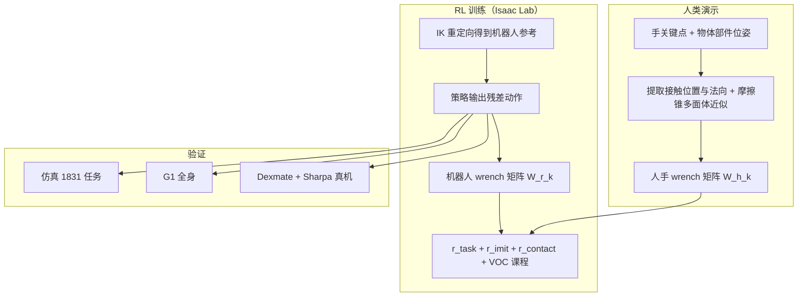

# CHORD（Contact Wrench Guidance for Dexterous Manipulation）

## 一句话定义

**CHORD**（*Contact Wrench Guidance from Human Demonstration in Robotic Dexterous Manipulation*，NVIDIA，[arXiv:2607.00033](https://arxiv.org/abs/2607.00033)）把人类演示里的接触表示成 **物体中心的接触力旋量（wrench）空间**，用「接触能在物体上诱导出的力-矩」而不是「接触位置」去比较人和机器人，并以此作为 RL 的接触奖励，训练灵巧手策略跟踪人类演示的物体轨迹（摘要、§1）。

## 英文缩写速查

| 缩写 | 英文全称 | 简要说明 |
|------|----------|----------|
| CHORD | Contact Wrench Guidance from Human Demonstration in Robotic Dexterous Manipulation | 本文框架全称（摘要） |
| CWS | Contact Wrench Space / contact-wrench-support | 物体中心力-矩空间；§4.3 把 CWS reward 当训练信号与代理指标 |
| VOC | Virtual Object Controller | 训练早期对物体施加辅助 wrench 沿参考轨迹推动，随课程退火（§2、§3.2，沿用 DexMachina） |
| RL | Reinforcement Learning | 仿真中训练策略；论文未在正文写具体算法名（附录 B 只给观测、动作、重置设置） |
| FC | Force Closure | 视频重建噪声大时用的简化奖励 r_fc（§3.2） |
| TPV | Third-Person View | 第三人称视频重建的全身参考（§4.5） |
| AUC | Area Under the (object-tracking-error) Curve | DexMachina 的物体跟踪指标，Table 1 用 |
| SR | Success Rate | MT-SR / SP-SR 分别沿用 ManipTrans / SPIDER 的成功率口径 |
| DM / MT / SP | DexMachina / ManipTrans / SPIDER | Table 1 的三个基线任务套件 |

## 为什么重要

- **指出位置匹配的物理歧义（作者论点，§2、§3.1）：** 同一物体区域，接触法向和力方向不同会产生不同物体运动；位置型接触奖励（DexMachina、SPIDER）可能选出「空间上接近、物理上不对」的接触。§3.1 以开盖案例的热图说明：位置奖励下优化出的接触法向与演示几乎垂直。
- **规模化评测（作者自述，§4.1）：** 在 1,831 个 benchmark 任务上用同一套超参（VOC 增益、课程、奖励权重）评测，平均成功率 82.12%；作者称据其所知是首个在此规模上评测的 RL 灵巧操作方法。
- **跨具身（§4.5）：** 同一 wrench 表述被用于 G1 + Dex3 三指手的全身操作，并在 Dexmate + 双 Sharpa 手上做了真机部署（§4.6）。
- **与 wiki 现有页面的衔接：** 是 [DexMachina](./paper-dexmachina.md)、[SPIDER](../methods/spider-physics-informed-dexterous-retargeting.md) 一类接触引导方法的 wrench 空间对照。

## 核心原理与流程总览

输入是人类参考轨迹 τ_ref（人手 3D 关键点 + 各物体部件 SE(3) 位姿）；先用 IK 把手关键点重定向到机器人构型 x_robot，策略输出残差动作，目标是让 rollout 物体位姿跟踪参考（§3）。

### 奖励（§3.1）

- 总奖励 r = r_task + r_imit + r_contact。r_task 是物体各部件 SE(3) 位姿的指数核跟踪，多物体任务再加相对位姿项 r_relative（只在演示中物体相互作用阶段激活，附录 B）；r_imit 把机器人状态正则到重定向参考。
- 接触：对每个物体部件 k，从演示取接触位置与法向，把库仑摩擦锥近似为含 d 条单位边力的多面体，每条边力诱导一个 6 维基元 wrench，拼成 W^{h,k}（式 1）。
- 用 b 个预采样单位方向 B 的支撑函数 σ = max_col(Bᵀ W)（式 2）比较人和机器人，避免两边列数、顺序不同的问题；r_cws 用相对容差 β 的上下双侧平方惩罚的指数核（式 3）。
- 因指数核恒为正，另外惩罚「无意接触」（人 σ=0 而机器人 σ>0）与「漏接触」（人 σ>0 而机器人 σ=0）。

### 训练稳健化（§3.2、附录 B、E）

- 从参考轨迹任意帧重置，并让 VOC 在短稳定窗内全开，之后再退火；论文 §4.1 观察到需要先让接触 wrench 奖励收敛再衰减 VOC。
- 用从 W^{h,k} 采样的 wrench 扰动物体；残差动作空间（附录 B：腕位置 0.05 m、腕姿态 0.15 rad、手指 0.15 rad 的动作尺度，EMA 系数 0.3）。
- 接触估计噪声大（如 RGB 视频重建）时退化为 r_fc：奖励在每个基方向上有正支撑，最大化时等价于力闭合。
- 全身扩展（§3.2、附录 E）：仅有手部参考时训练 inpainting 模块补全全身运动，在预训练全身控制器上学残差；有全身参考（TPV 重建）时手指重建不准，改用 r_fc。

### Benchmark（§3.3、附录 D）

- 汇集 ARCTIC、TACO、HOT3D、OakInk2、DexYCB、GRAB、H2O 七个动捕数据集，经 IK 重定向到 Sharpa-Wave 手，筛选后得 4,739 个可仿真任务，另加自研视频重建；HOT3D 约 294 段长录像切成约 4,045 个原子片段（附录 D）。
- 与 DexMachina、ManipTrans、SPIDER 的任务库比，作者称时长更长、接触事件更密（Fig.3，Ferrari-Canny epsilon 也给出分布）。

## 工程实践

- **环境与手型：** 训练在 Isaac Lab 中进行（§3.3），主手为 Sharpa；真机为 Dexmate 机器人 + 两只 Sharpa 手，每只 22 个主动关节，部署命令向量 61 维（附录 F）。
- **真机观测：** Vicon 六相机动捕提供机器人与物体位姿；策略导出为 ONNX，在 20 Hz 推理环中运行，状态机含 Hold/Play/Safety/Done（附录 F）。开环 action chunk 与闭环推理都做了（§4.6）。
- **观测噪声：** 大规模实验关闭观测扰动，真机闭环训练时开启（附录 B）。
- **成功判据（§4.1）：** 物体位置误差超过 15 cm 或旋转误差超过 40 度即终止；完成比例（成功 rollout 占比）大于 0.7 记为任务成功。
- **基线复现（附录 G）：** 三个基线都被移植到 Sharpa 手上复现；DexMachina 跑 4 种变体各 5 个种子，只报最好的一种；SPIDER 用的是 CHORD 的 IK 重定向，作者称尝试过其他 IK 但没有稳定可用的结果。

## 评测证据与清单说法的对比核对

清单（Glen Berseth 的 CoRL 2026 阅读清单第 067 项，P1）一句话摘要为：「Object-centric contact-wrench guidance from human demonstrations makes dexterous RL scale, with a 4,739-task bimanual benchmark.」按论文逐项核对：

| 清单说法 | 论文情况 | 判断 |
|----------|----------|------|
| 物体中心接触力旋量引导 | 摘要与 §3.1 即此 | 一致 |
| 使灵巧 RL「scale」 | 摘要写 "more scalable"；证据是 1,831 任务、统一超参、平均成功率 82.12%（§4.1） | 一致，但这是**仿真**结果 |
| 4,739 任务的双手 benchmark | 摘要与 §3.3 均为 4,739 个双手任务；评测只用其中采样的 1,831 个 | 一致；注意 4,739 是训练库规模，不是都评测了 |
| 清单未提的事项 | 真机只有定性展示（Fig.9），没有给成功率；真机依赖动捕位姿，非视觉（§6）；Table 1 的 SPIDER 套件上只是 0.333 对 0.359 的小幅差 | 摘要级说法会让人高估真机与对 SPIDER 的优势 |

## 结论

CHORD 支持以物体中心接触力旋量组织灵巧操作奖励，其规模化证据主要来自仿真。

- 复现实验应区分 4,739 项任务库与 1,831 项评测集，并按套件报告指标。
- 先核验演示接触质量；噪声较大时对照力闭合引导，不能预设 wrench 引导始终更好。
- 部署前补做目标位姿观测与重复真机成功率测试，动捕支持的定性案例不能等同视觉闭环可靠性。

## 局限

**论文自己承认（§6）：**
1. 真机部署目前依赖状态型观测（动捕位姿），不是视觉。
2. 有效的接触引导需要较干净的人类演示，噪声接触会降低奖励质量，需要退到力闭合假设。
3. 物体位姿误差是不完美的评测指标：有的任务无需精确摆放，有的任务小位姿误差就功能失败。

**阅读时看到的未验证之处（我的判断）：**
- 真机（§4.6、Fig.9）只展示成功案例，没有重复次数或成功率，难以评估 sim-to-real 的可靠性。
- Table 1 的比较在 Sharpa 手上重新复现基线，且各行任务套件与指标不同，分数只行内可比（Table 1 注）；DexMachina 复现只报四种变体里最好的一种（附录 G.1），属于对基线较友好的口径。
- SP 套件仅 3 个任务，0.359 对 0.333 的差距在标准差（0.48）内。
- 消融（Table 2）只在 ARCTIC 的两个序列上，3 个种子；Table 3 的 12 个序列来自 §4.5 的全身手部参考任务，Position Only 的 Articulated 类为 0.000。
- 附录 A.1：噪声很大时，力闭合引导可以优于带噪的 wrench 引导，但会损失灵巧性；说明「wrench 引导总更好」并非无条件。
- 视频端到端验证（附录 C）只有一个刷子任务，AUC 0.647，是单例。
- 「首个」「前所未有的时间跨度」属作者自述。
- 90.77% 在摘要、引言与结论中出现，Fig.5 右对应 17 个子任务（12 个手部参考 + 5 个 TPV）；我没有在表格里找到它的逐任务分解，该数字的具体构成按图读，未核实。

## 关联页面

- [DexMachina](./paper-dexmachina.md) — 位置型接触引导 + VOC 的主要对照
- [SPIDER（物理感知灵巧重定向）](../methods/spider-physics-informed-dexterous-retargeting.md) — 另一类位置型引导与重定向基线
- [TopoRetarget](../methods/toporetarget-interaction-preserving-dexterous-retargeting.md) — 上游参考质量路线
- [Contact-Rich Manipulation](../concepts/contact-rich-manipulation.md)
- [Contact Wrench Cone](../formalizations/contact-wrench-cone.md) / [Friction Cone](../formalizations/friction-cone.md) — CWS 奖励的数学基础
- [Manipulation](../tasks/manipulation.md) / [Loco-Manipulation](../tasks/loco-manipulation.md)
- [灵巧操作数据管线](../queries/dexterous-manipulation-data-pipeline.md)
- [IL for Manipulation](../queries/il-for-manipulation.md)
- [Reinforcement Learning](../methods/reinforcement-learning.md)
- [Isaac Lab](./isaac-lab.md)
- [具身大模型评测基准选型闭环](../queries/embodied-eval-benchmark-selection-loop.md)

## 参考来源

- [chord_nvidia_video_to_data_2026.md](../../sources/papers/chord_nvidia_video_to_data_2026.md) — 论文全文通读归档（含核对范围）
- [nvidia-isaac-video-to-data-chord-github-io.md](../../sources/sites/nvidia-isaac-video-to-data-chord-github-io.md) — 项目页交互说明
- arXiv:2607.00033v1，Learning Dexterous Manipulation Using Contact Wrench Guidance From Human Demonstration

## 继续阅读

- arXiv：<https://arxiv.org/abs/2607.00033>
- 项目页：<https://nvidia-isaac.github.io/video_to_data/chord/>
- V2D 管线文档：<https://nvidia-isaac.github.io/video_to_data/>
- 代码仓库（来自既有归档，本次未能访问核实）：<https://github.com/nvidia-isaac/video_to_data>
