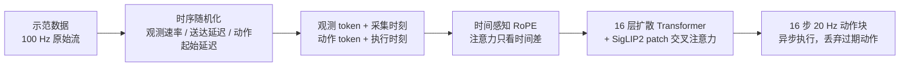

# Chronos Policy：在物理时间上学习机器人策略

**Chronos Policy**（*Chronos Policy: Learning Robot Policies on Physical Time*，[arXiv:2610.13929](https://arxiv.org/abs/2610.13929)，[项目页](https://changhaowang.github.io/chronospolicy/)）由 **Stanford University**（Changhao Wang、Jaden Clark、Shuran Song）提出：不再把“序列位置”当作时间，而是把每个观测的采集时刻与每个动作的执行时刻直接写进策略，使其在相机降帧、传感器异步或推理变慢时仍能读对时间关系。注意：它与站内 [Chronos（Mamba 长时程记忆）](./paper-chronos.md) 是不同论文。

## 一句话定义

**以观测采集时间和动作执行时间为条件，用相对时间驱动的 RoPE 注意力加上训练期时序随机化，让扩散策略对部署时的速率、延迟与推理耗时变化保持稳健。**

## 英文缩写速查

| 缩写 | 英文全称 | 简要说明 |
|------|----------|----------|
| RoPE | Rotary Position Embedding | 旋转位置编码；本文用时间戳而非 token 下标作为“位置” |
| DP | Diffusion Policy | 基线：固定序列位置的扩散策略 |
| RTC | Real-Time Chunking | 真机基线：处理推理延迟的动作块拼接方法 |
| DDIM | Denoising Diffusion Implicit Models | 本文仿真 8 步、真机 16 步推理采样器 |
| F/T | Force/Torque | Pivoting 任务的六维力/力矩流，速率与图像不同 |
| SigLIP2 | Sigmoid-loss Language-Image Pretraining 2 | 图像编码器（base 版） |

## 为什么重要

- **问题是部署真实存在的：** 训练数据常被重采样成统一频率，部署时相机丢帧、F/T 与图像不同步、大模型推理时间波动，都会让“第 k 个 token”失去固定时间含义。
- **统一而非逐项补丁：** 相对 [Real-Time Chunking](./paper-real-time-chunking.md) 主要解决推理延迟，Chronos 同时覆盖观测速率、送达延迟与推理延迟三类时序变化。
- **对多传感器接触任务尤其相关：** 论文的 Pivoting 与 Peg Insertion 均含高频力觉流，速率异质性是常态。

## 方法栈 / 流程总览

## 方法

- **条件形式：** A_{t_a} ~ π(· | O_{t_o}, t_o, t_a)；动作查询时刻为 t + d_t + jΔt_a（d_t 起始延迟，Δt_a 动作间隔，j=0…H−1）。
- **时间感知 RoPE：** 观测 token 用采集时刻，动作 token 用请求的执行时刻，均相对请求时刻；注意力得分只依赖 t_j − t_i，token 内容保持不变。
- **AddTime 对照：** 16 个 sin + 16 个 cos 傅里叶时间特征，经共享 32→512→512 GELU MLP 加到嵌入上。
- **时序随机化：** 按模态随机观测速率（12.5–33.33 Hz，延迟 0–50 ms；Pivoting 的力矩流 1–100 Hz、延迟 0–100 ms）并保留原始时间戳；动作起始延迟在仿真中一半为零、其余至多 100 ms。一条示范因此可产生多种时序组合。
- **网络与训练：** 16 层、宽度 512、8 头的扩散 Transformer；预训练 SigLIP2 base（256×256）；输出 16 个 20 Hz 动作（Pivoting 为 19 维自适应柔顺动作）。损失为干净动作预测的 ℓ1；AdamW，lr 3e-4，仿真 50 epoch、每策略 3 个种子。
- **部署：** 异步 chunk 执行；真机上 d_t 由已完成请求估计，已过期的动作直接丢弃。

## 源码运行时序图

不适用：截至 2026-10-14 官方未发布代码（项目页 Code 标 “Coming soon”，论文未给仓库），无可对齐的目录与脚本。

## 工程实践

- **自己落地时的读法（推测）：** 若已有扩散策略，改动集中在三处：给每个 token 保留时间戳、把位置编码换成按时间戳的 RoPE、训练数据管线加入速率/延迟随机化；不必改网络主体。
- **随机化要配时间戳：** 论文消融显示仅随机化会引入跨传感器歧义（Pivoting 上 DP 名义成功率 61.6%→29.8%）。
- **延迟估计：** 真机以已完成请求估计 d_t；动作需按“是否已过期”裁剪。
- **开源状态（2026-10-14 核查）：** 项目页已提供 arXiv 论文链接；Code 与 Twitter 仍标 “Coming soon”。截至核查日无官方代码、数据或权重链接。

## 实验与评测

- **Conveyor（成功率，三种子）：** DP 名义 73.1%，0–200 ms 推理延迟 1.8%，组合扰动 0.0%；Chronos 名义 82.0%，0–200 ms 76.4%，宽传感器范围 45.6%，组合 32.7%。AddTime 名义 85.8% 最高，但所有扰动条件都低于 RoPE。
- **Pivoting：** DP 名义 61.6%、组合 19.6%；Chronos 名义 69.3%、组合 38.4%（标准差 17.8，波动大）。
- **DexMimicGen 六任务：** 名义下与 DP 相当（如 Assembly 75.3 vs 68.7）；组合扰动下 Coffee 2.7%→60.0%、Pouring 2.7%→77.3%；五种扰动平均 59.7%→73.4%。
- **真机（成功 1 / 部分 0.5 / 失败 0，每场景 10 或 20 次）：** Dynamic Cup（名义/观测/推理/组合）DP 50/35/40/30、DP+RTC 60/40/50/25、Chronos 80/65/65/55；Peg Insertion Chronos 100/75/75/65；Pivoting Chronos 75/75/77.5/75。RTC 对推理延迟有帮助，但对观测扰动不稳定。
- 仿真数据集规模、GPU 与真机型号：原文提取中未报告。

## 结论

**Chronos 的价值在于把“时间”变成策略的显式输入：对速率与延迟变化的稳健性来自相对时间 RoPE 与时序随机化的组合，而不是任何单项。**

1. **用时间戳而非下标定位 token** — 相对时间 RoPE 在所有扰动条件下优于 AddTime。
2. **随机化与时间戳要一起用** — 单独随机化在多传感器任务上可能退化。
3. **一次训练覆盖三类变化** — 观测速率、送达延迟、推理延迟共享同一机制。
4. **名义性能基本不损失** — 六个 DexMimicGen 任务名义下与 DP 相当。
5. **复现暂不可行** — 代码未发布，细节（数据规模、算力、真机型号）缺失。

## 局限与风险

- 动作间隔固定，可变控制频率与时间缩放留待后续工作。
- 真机每场景仅 10–20 次试验，部分仿真条件标准差很大。
- 真机评分含半分，不可与二值成功率混比。
- 代码/数据未发布（截至 2026-10-14）；项目页现已链接论文，代码仍标 “Coming soon”。

## 与其他工作对比

| 对照 | 差异读法 |
|------|----------|
| [Diffusion Policy](./paper-diffusion-policy.md) | 基线；按固定序列位置处理时间，扰动下显著退化 |
| [Real-Time Chunking](./paper-real-time-chunking.md) | 针对推理延迟的 chunk 拼接；Chronos 另覆盖观测速率与送达延迟 |
| [Chronos（Mamba 记忆）](./paper-chronos.md) | 同名不同论文，关注长时程记忆而非物理时间 |
| [具身基础模型的延迟/泛化权衡](../concepts/embodied-fm-latency-generalization-tradeoff.md) | 站内对推理延迟的整体讨论背景 |

## 关联页面

- [34 篇空间落地技术地图（汇总页）](../overview/embodied-station-34-papers-spatial-grounding-technology-map.md)
- [操作任务](../tasks/manipulation.md)
- [Diffusion Policy 方法](../methods/diffusion-policy.md)
- [Real-Time Chunking](./paper-real-time-chunking.md)
- [具身基础模型延迟与泛化权衡](../concepts/embodied-fm-latency-generalization-tradeoff.md)

## 参考来源

- [具身智能小站 34 篇周报](../../sources/blogs/wechat_embodied_station_34_papers_spatial_grounding_2026-10-12.md) — 线索来源
- [chronos_policy_arxiv_2610_13929.md](../../sources/papers/chronos_policy_arxiv_2610_13929.md) — 论文摘录
- [chronospolicy-github-io.md](../../sources/sites/chronospolicy-github-io.md) — 项目页核查
- [arXiv:2610.13929](https://arxiv.org/abs/2610.13929)

## 推荐继续阅读

- [Chronos Policy 项目页](https://changhaowang.github.io/chronospolicy/)
- [arXiv HTML 全文](https://arxiv.org/html/2610.13929v1)
- [Real-Time Chunking（arXiv:2506.07339）](https://arxiv.org/abs/2506.07339)
