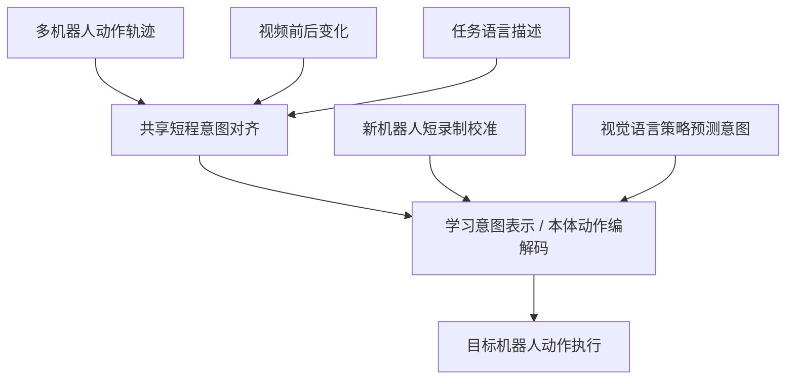

# CIALLO： 学习跨本体操作的共享意图表示

## 一句话定义

CIALLO 让不同机器人的动作先映射到共享短程意图空间，再利用本体条件动作解码器控制新机器人。

## 英文缩写速查

| 缩写 | 英文全称 | 简要说明 |
|---|---|---|
| VLA | Vision-Language-Action | 从视觉语言映射到动作的机器人模型 |
| InfoNCE | Information Noise-Contrastive Estimation | 对齐动作、视觉变化和文本意图的对比目标 |
| OOD | Out of Distribution | 未见本体/任务的分布偏移测试 |
| DINOv2 | DINO version 2 | 用于视觉变化特征提取的自监督表征 |

## 为什么重要

各机器人关节空间、末端定义、控制频率不同，直接混合动作标签困难；共享意图空间让策略先预测与本体无关的短程目的，再根据机器人特征解码。

## 核心原理

预训练阶段分别将机器人动作、视觉变化以及语言提示编码到相同短程意图表示，用动作重建和跨模态对比损失对齐；动作编解码器通过机器人/关节 embedding 区分本体。为新本体采集至多约 10 秒校准记录，只调整本体 essential 向量与 axis/arm embedding（共享 codec 权重不变，校准约需单 GPU 30 分钟），然后冻结 codec；策略模型据视觉语言预测意图，由目标本体的解码器转换为执行动作。

## 流程总览

> **注意：** 此图仅抽象论文所述方法模块与数据/控制流，非未公开代码的实际调用路径。

## 实验与评测

论文报告新本体至多 10 秒记录校准，真实 SO-101/Piper 测试每任务 20 条示范时平均成功率 76.7%（对比指定的 π0 微调基线 70%）；LIBERO 97.3%、LIBERO-Plus 80.8%，RoboTwin-2.0 52.7%。不同基准的训练数据与评测设置不相同，不应混作统一跨本体泛化率。

## 结论

**CIALLO 把跨本体泛化问题拆解成共享意图学习与本体动作解码两件事，降低适配所需的机器人校准成本。**

1. 区分 10 秒本体校准和 20 条任务示范。
2. 检查共享意图对不同动作空间的可辨识性与解码误差。
3. 跨基准引用成功率必须保留任务与对照条件。
4. 在没有公开代码时标注复现阻塞。

## 与其他工作对比

[MetaWAM](paper-metawam.md) 以频域元帧建立视频–动作统一输入，而 LaST0.5 通过交互中心潜变量连接世界与动作专家。

## 源码运行时序图

论文原始页面未核实到公开可运行的官方训练或推理仓库，无法基于真实入口画源码时序图。

## 工程实践

校准新本体 **≤10 秒记录**不等于 **≤10 秒训练**：附录说明对约 174k 本体参数执行 5,000 AdamW steps，单 H20 约 30 分钟。用于 Qwen-CIALLO 的目标任务仍需 20 demonstrations/task。作者报告在同一 H20 测试中 action head PyTorch 为 4.89ms、JAX 为 1.46ms（不含主干）。[原文归档](../../sources/papers/ciallo_arxiv_2611_13732.md)。

复现时要固定共享编码器，仅用本体校准样本调整本体嵌入或解码器，并明确校准与下游任务 20 条示范是两个不同环节。论文页面未核实到公开可运行仓库。

## 局限与风险

短程意图不必然覆盖力控、多指触觉和长期接触任务；新本体校准与 VLA 任务示范不能混称为零样本部署；真实机器人样本量和任务类型有限。

## 关联页面

- [DexSeed](paper-dexseed.md)
- [VLA](../methods/vla.md)
- [动作重定向](../concepts/motion-retargeting.md)
- [LaST0.5](paper-last05.md)

## 参考来源

- [arXiv:2611.13732 归档](../../sources/papers/ciallo_arxiv_2611_13732.md)

## 推荐继续阅读

- [论文原文](https://arxiv.org/abs/2611.13732)

> **复核状态（2026-11-12）：** 已通读并核对 arXiv v1 HTML 正文、实验与附录，数据均按作者论文口径记录；本次未独立复现其训练、推理、性能指标。
