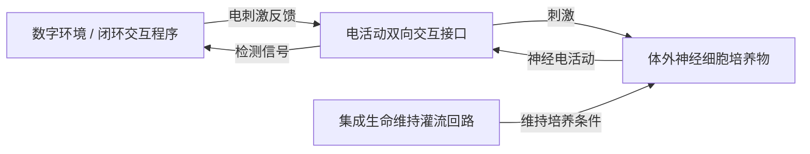

# The CL1 as a platform technology to leverage biological neural system functions｜CL1：利用生物神经系统功能的平台技术

## 一句话定义

**CL1** 是 Cortical Labs 的体外神经培养物交互平台，将**电活动的实时闭环交互**与**生命维持灌流系统**集成，使活体神经网络能在受控的数字环境中接受刺激并产生可记录响应。这里讲的是生物神经系统实验平台，并非人形机器人的控制器或已验证的机器人学习算法。

## 英文缩写速查

| 缩写 | 英文全称 | 简要说明 |
|------|----------|----------|
| CL1 | CL1 (Cortical Labs platform) | 本文讨论的生物神经计算与实验硬件平台型号 |
| BNN | Biological Neural Network | 体外培养的真实生物神经元网络，而非人工神经网络 |
| MEA | Microelectrode Array | 与培养神经元交换电信号的多电极阵列；在官方接口资料中使用 |
| SDK | Software Development Kit | 官方用于开发和模拟 CL1 接口应用的软件包 |
| API | Application Programming Interface | 用于采集神经事件、施加刺激及编排闭环程序的调用接口 |

## 核心信息

| 项 | 内容 |
|---|---|
| 作者 | Brett J. Kagan |
| 作者机构 | Cortical Labs（墨尔本）；墨尔本大学生物化学与药理学系 |
| 出版物 | *Nature Reviews Bioengineering*，3(9)，724–725（Down to Business） |
| 在线发表 / 卷期 | 2025-07-07 / 2025 年 9 月 |
| DOI | [10.1038/s44222-025-00340-3](https://doi.org/10.1038/s44222-025-00340-3) |
| 原文核对 | **未完成**。已核对期刊公开导语、题录、图 1 标题、引用与利益冲突；订阅正文不可读取 |
| 相关工程代码 | [官方 cl-sdk](https://github.com/Cortical-Labs/cl-sdk)，对应后续官方 CL API/Simulator；**不是本文实验代码** |

## 为什么重要

- **把培养物从离线观测推进到闭环交互：** 不是仅记录电活动，而是允许数字程序根据神经活动给予反馈；这是从静态体外模型走向交互式实验系统的关键能力。
- **区分计算接口与生物维持系统：** 培养物有活性所需的持续营养/环境支持与实时信号路径同样重要，不能只用「神经网络 + 软件」概括。
- **提供具身学习的跨学科参照：** 可以比较「环境 → 神经系统 → 行为/反馈」与机器强化学习闭环，但不应直接外推为机器人控制性能已得到验证。

## 核心原理与流程总览

Nature 期刊公开导语直接确认两种能力：通过电活动与体外培养物实时闭环交互，以及集成的生命维持灌流回路。下图仅画出这两条**已可核实的系统级联系**，不是不可访问的 Fig. 1 的重绘，也不代表完整电路实现。



**解读边界：** 闭环的应用逻辑、平台关键组件的完整清单、灌流回路性能及实际延迟仍需获得论文全文核对；2026 年 CL API 开发文档可帮助工程入门，但属于发表之后独立更新的资料。

## 实验与评测

这是期刊的 **Down to Business 平台介绍短文**，不是在公开页面上披露完整方法和实验表格的算法论文。就目前可读取的一手材料：

- 能直接核对的是设备的**功能定位**和**两种模块性能力**，而非 CL1 在任一具体任务上的成功率、学习速度或节能系数。
- 期刊公开页援引了先前体外神经元模拟游戏研究（Kagan 等，*Neuron*，2022）；**先前实验不是本文新实验**。
- 后续评测应优先检验实时记录/刺激是否稳定、活细胞维护与长期实验的可重复性，再开展任务特定的学习指标分析；这是一组**建议评测维度**，非本论文报告的测量结果。

## 与其他工作对比

| 对象 | 系统角色 | 不应混淆的结论 |
|---|---|---|
| 本文 CL1（2025） | 面向体外神经培养物的实时闭环与灌流平台 | 公开摘要不是详细性能验证 |
| DishBrain / Kagan 等（2022） | 早期体外神经网络与模拟游戏世界交互研究 | 该先例与 CL1 平台介绍为不同论文，不可复用其数值作为 CL1 评测 |
| 机器人 [强化学习](../methods/reinforcement-learning.md) | 人工策略通过奖励优化控制行为 | 闭环的形式有相似性，但生物培养物不是 PPO 网络，本文没有机器人 RL 基准测试 |
| [迭代学习控制](../methods/iterative-learning-control.md) | 利用重复任务误差更新控制输入的工程方法 | “发生学习”需要具体更新律和实验证据，不能从存在闭环接口直接推出 |

## 结论

**CL1 最值得记录的是「活体神经培养物 + 数字闭环电接口 + 灌流维持」的可编程实验平台组合，而不是尚未核实的生物智能性能宣传。**

1. **先分清两条系统链路：** 电活动闭环用于交互，灌流回路用于维持细胞培养条件。
2. **谨慎解释“学习”：** 是否学习、学到什么，以及相对于对照组的增益，必须用实验数据判断。
3. **区分论文与平台资料：** 2025 年短文和后续 2026 年官方 CL API 是两个不同时间点的材料。
4. **软件仿真不等于生物实验：** 公开 SDK 可验证应用代码/接口，但不能仅凭模拟数据证明神经元可塑性。
5. **后续阅读重点：** 获得完整两页正文后再核对图 1、各组件参数、应用举例和局限；目前保持待核状态。

## 源码运行时序图

该论文**没有可核对的论文专属实验仓库**。以下时序仅依据 Cortical Labs [官方 CL API 开发文档](https://docs.corticallabs.com/) 和 [cl-sdk 的 `src/cl/neurons.py`](https://github.com/Cortical-Labs/cl-sdk/blob/main/src/cl/neurons.py) 归纳**后续应用示例**，不冒充 2025 年论文的实际实验运行记录。

```mermaid
sequenceDiagram
  participant App as Python 应用
  participant API as cl.open / Neurons
  participant Data as CL SDK 数据源
  participant Runner as Neurons Loop
  App->>API: with cl.open() as neurons
  Note over API,Data: 本地模拟器生成随机数据或回放 HDF5
  API->>Data: 初始化数据来源
  App->>Runner: 启动迭代 ticks_per_second=1000
  loop 每次 tick
    Data-->>Runner: 神经信号模拟数据
    Loop-->>App: tick.analysis.spikes
    opt 根据 spike 进行反馈
      App->>API: stim(channel, StimDesign)
      API->>Data: 排队 / 提交刺激事件
    end
  end
  Note over App,Data: SDK 模拟信号不会因刺激而发生真实生物学习
```

设备实机的电极驱动、灌流控制和专有 CL API 内部实现不在该模拟器时序图中。官方文档建议通过 `cl.open()` 而非直接构造 `Neurons`。

## 工程实践

| 环节 | 可操作入口与核验重点 |
|---|---|
| 本地开发 | Python 3.12+；`pip install cl-sdk`；参照官方 [Quick start](https://docs.corticallabs.com/) 建立 `cl.open()` 会话 |
| 观测 | `neurons.loop()` 读取 `tick.analysis.spikes`，记录通道和时间戳；可用 `neurons.record()` 留存 HDF5 |
| 反馈 | 依据官方 `StimDesign` 约束构造电刺激并用 `neurons.stim()` 发送；真实装置必须遵守官方生物安全与硬件限制 |
| 测试边界 | SDK 随机/回放数据**不随电刺激进行真实神经学习**；只能用于程序接口、缓存与闭环逻辑的开发检验 |
| 实验复现 | 需有真实 CL1 与合规培养物、实验方案、对照数据；仅有 SDK 不构成该论文的完整复现 |

## 局限与风险

- **原文获取受限：** Nature 公开页面为订阅预览，全文未通读；论文内部方法、应用列表、Fig. 1 细节与定量结果待核，故本页标 `draft`，不可宣称健康度满分。
- **不应混淆“设备能力”与“生物系统学会任务”：** 可双向刺激/记录并不自动意味着持续学习、泛化或真实机器人控制能力。
- **软件接口的时间差：** cl-sdk / 官方开发文档在 2026 年持续演进，不能反证 2025 年论文含相同的函数、时序或性能。
- **真实实验条件未确认：** 生物批次差异、污染、细胞活性、刺激诱导效应、安全与伦理约束都需针对实际实验设计单独评估。
- **作者商业关系：** 期刊披露 Brett J. Kagan 任职并持股 Cortical Labs，公司对相关技术持有专利及商业利益，应结合独立重复研究评估。

## 关联页面

- [神经反馈控制器](../concepts/neural-feedback-controller.md) — 机器策略网络的状态反馈，与活体神经系统闭环做概念对照
- [强化学习](../methods/reinforcement-learning.md) — 区分算法奖励优化与体外生物神经网络学习
- [迭代学习控制](../methods/iterative-learning-control.md) — 区分闭环接口与明确的学习更新机制
- [具身性](../concepts/embodiment.md) — 理解生物神经网络与模拟环境交互的概念边界

## 参考来源

- [原始期刊论文归档](../../sources/papers/kagan_2025_cl1_biological_neural_platform.md)（正文未通读，核对范围已注明）
- [Nature Reviews Bioengineering 原始页面](https://www.nature.com/articles/s44222-025-00340-3)（2025-07-07）
- [Cortical Labs 官方 CL1 页面归档](../../sources/sites/cortical-labs-cl1.md)（[产品原页](https://corticallabs.com/cl1.html)）
- [官方 SDK 与运行入口归档](../../sources/repos/cortical-labs-cl-sdk.md)
- [CL API 开发文档](https://docs.corticallabs.com/)（包含 2026 年版本，时间与原文区分）

## 推荐继续阅读

- [Kagan et al., In vitro neurons learn and exhibit sentience when embodied in a simulated game-world (*Neuron*, 2022)](https://doi.org/10.1016/j.neuron.2022.09.001) — 论文引用的早期实验工作，不应等同 CL1 的性能结论
- [CL API: Real-Time Closed-Loop Interactions with Biological Neural Networks (arXiv:2602.11632)](https://arxiv.org/abs/2602.11632) — 后续的软件接口技术资料
