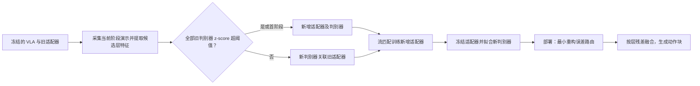
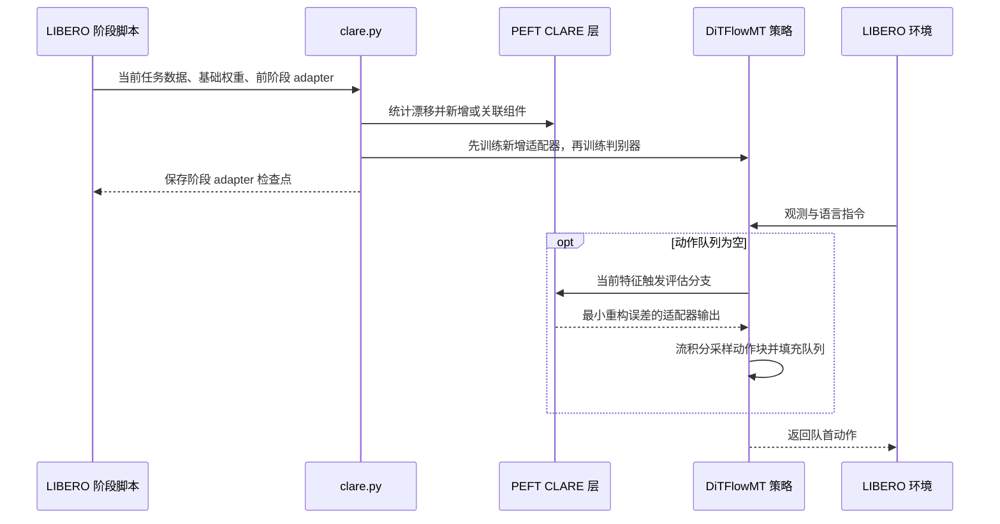

# CLARE：VLA 持续学习的自主适配器路由与扩展 / Continual Learning for Vision-Language-Action Models via Autonomous Adapter Routing and Expansion

## 一句话定义

每来一个新任务，用新演示判断冻结 VLA 的哪些层需要增加适配器；部署时按当前观测的自编码器重构误差挑选各层适配器，而不是交给外部任务标签。

## 英文缩写速查

| 缩写 | 英文全称 | 含义 |
|---|---|---|
| VLA | Vision-Language-Action | 从图像、语言和本体状态生成机器人动作 |
| DiT | Diffusion Transformer | 论文动作网络结构，此实现以流匹配训练 |
| AdaLN | Adaptive Layer Normalization | 以观测条件产生动作解码层的缩放和平移 |
| PEFT | Parameter-Efficient Fine-Tuning | 只训练新增的少量模块而非全量模型 |
| ER | Experience Replay | 将以往演示与新示范混合重训的对照 |
| AUC / FWT / NBT | Area Under the Curve / Forward Transfer / Negative Backward Transfer | 各任务已学习阶段总体表现、初学阶段表现和后续平均退化 |

## 为什么重要

顺序微调擅长学当前任务，但会改动先前任务共用的参数；保留历史演示重放又增加存储和治理成本。CLARE 将任务增量放在条件编码侧，把旧能力的参数与新任务的训练解耦。冻结不等于保留一定成功：路由选错、分布漂移或动作先验不足仍可能导致旧任务失败。

## 核心信息

| 项目 | 内容 |
|---|---|
| 机构 | 慕尼黑工业大学（TUM，LSY Lab / MIRMI）、Robotics Institute Germany、Munich Center for Machine Learning |
| 作者 | Ralf Römer、Yi Zhang（共同一作）、Yuming Li、Angela P. Schoellig |
| 论文 | [arXiv v2](https://arxiv.org/html/2601.09512v2)；[IEEE RA-L DOI](https://doi.org/10.1109/LRA.2026.3693992) |
| 基座 | 约 200M 参数的定制 DiT 流策略，DINOv2 图像、CLIP 语言和本体状态向量；仿真基座在 LIBERO-90 预训练 |
| 任务与执行 | 图像、语言、本体状态 → 16 步末端位移动作块 → 取前 8 步执行；真机 15 Hz，仿真 20 Hz |
| 开放状态 | 公开 LeRobot/PEFT 分支、部分模型和数据；确切基座快照与完整真机部署仍待复核 |

## 核心原理与方法

1. **首阶段启动：** 每个候选层先放一个函数适配器和一个自编码器判别器。函数适配器是残差分支，和冻结基础层输出相加，不等于把 LoRA 合回主干。
2. **逐层决定扩容：** 对当前阶段数据评估现存判别器；若每个判别器的重构误差相对自己训练统计的 z-score 均高于阈值，就新增适配器与判别器。否则只加判别器，连到重构误差最小的旧判别器对应的适配器。若没有层扩容，算法默认新增最浅层适配器，避免没有可更新容量。
3. **先适配，再拟合路由：** 先用新任务演示和条件流匹配优化新增适配器；固定已更新的条件通路，再用该阶段特征优化新判别器。两阶段切开以免浅层适配器变化使深层判别器输入分布移动。
4. **部署时按原始误差路由：** 候选层按样本算所有判别器重构误差，取最小误差判别器并按连接查出适配器；训练扩容的 z-score 与部署排序的重构误差不是同一信号。语言命令是输入，不是 oracle 任务索引。

若没有任何层满足扩容条件，训练在最浅候选层保留新适配器，代码中该回退层可配置。

## 官方源码运行时序

参照官方训练入口、PEFT 路由分支和 `DiTFlowMTPolicy.select_action` 静态核对。真实机械臂与环境的具体部署脚本不由这张仿真时序图推断。

## 评测结果与证据边界

| 评测 | CLARE | 参照或测量条件 |
|---|---|---|
| LIBERO-Long / Goal / Spatial | AUC 75.1 / 89.3 / 87.4；NBT 1.9 / 0.3 / 0.9 | 表 III；ER AUC 60.5 / 76.0 / 77.6；三随机种子，每任务每阶段 100 次 rollout |
| LIBERO-40 | AUC 83.6，FWT 82.9，NBT −1.0 | 图 4；四套各 10 项串联，ER AUC 66.1，NBT 23.2；每任务每阶段 10 次 rollout，不能与三套的次数混写 |
| Franka 五项真机 | AUC 63.3，FWT 62.0，NBT −2.9 | 表 IV；ER 为 51.1 / 60.0 / 17.1；逐任务逐阶段 10 次。负总体 NBT 不等于任务逐个无下降，例如表 V 的 BOWL 由 100% 到 90% |
| 扩容与延迟 | 图 7 报告真机实验的路由额外开销 <3 ms、显存约每任务 +2% | 不是端到端控制周期；图中第 6–10 阶段是外推，不是真机实测 |

AUC 对每个任务先平均从学习该任务起的各阶段成功率，再对任务平均；FWT 是任务初学阶段成功率的平均；NBT 比较初学与后续阶段表现，下行表示平均遗忘更小。相似场景中的切换案例是在试验中更改语言指令触发路由，未在线训练。

## 与其他工作对比

| 路线 | 优点或代价 | CLARE 的差异 |
|---|---|---|
| 顺序全量微调 / SeqLoRA | 更新或合并至共享主干，简单但容易覆盖旧能力 | 旧权重冻结，函数适配器不合并 |
| ER / LOTUS | 保留示例或回放训练选择器，可利用旧数据 | 无旧演示回放，代价是每候选层仍新增判别器 |
| DMPEL / MLR | 分别重放路由器 I/O 或保留旧示范的压缩表示 | 不需要保存旧样本或旧隐特征用于训练；公开表中部分对照沿用各作者协议，不将结果当成共享模型的完全受控消融 |
| 任务 ID 指定专家 | 有外部正确任务标签时容易查表 | 根据图像、状态和语言预测路由；对两个任务的输入不可区分时，不能假定路由可靠 |

## 结论

CLARE 把「扩哪一层」与「推理该用谁」分成两件事，以逐层统计判据和轻量判别器连接。表 II/图 5 提示优先验证扩展层位置，再调阈值：只改解码器明显弱于改观测条件路径，而在 DiT-EncDec 上提高阈值虽减少适配器，亦可能损失初学能力。实际使用应逐任务报成绩和切换错误，而非只看平均 NBT。

## 工程实践

- 先分清论文与仓库默认值：论文公式 (7) 对带符号的标准化残差求均值；公开源码的 `compute_z_score` 则取绝对值。论文表 I 的仿真阈值是 2.5，公开 LIBERO 脚本默认 1.0；照做前记下采用哪一套统计和阈值。
- 为每个阶段保持可回滚适配器版本。回归时分别记录新任务首次成绩、旧任务逐项损失、路由误选频率和端到端动作更新延迟，避免让平均表现掩盖单项故障。

## 局限与风险

- 新任务仍需收集分阶段演示并训练，且基座需要覆盖足够的动作先验。论文未证明无边界、无人监管的持续在线学习，也未在大型主流 VLA 及不同真机本体上做同等级验证。
- 代码在每个候选层增加判别器，评估仍需比较候选损失；在更长任务流或完全未知观测下，额外容量、路由误选与拒绝回退需另测。
- 官方仿真源代码和模型/数据示例可核实；精确下载基座与 W&B 占位、脚本的实际文件名见[仓库归档](../../sources/repos/clare-continual-vla.md)。本页不声称运行实验。

## 关联页面

- [VLA](../methods/vla.md) 与 [动作分块](../methods/action-chunking.md)
- [模仿学习](../methods/imitation-learning.md) 与 [机器人操作](../tasks/manipulation.md)
- [LIBERO 基准](./libero-benchmark.md) 与 [VLA 纵深路线](../../roadmap/depth-vla.md)

## 推荐继续阅读

- [LIBERO](https://libero-project.github.io/)：任务序列与阶段式评估设置。
- [CLARE 官方项目页](https://tum-lsy.github.io/clare/)：真机切换示例与仿真评估可视化。

## 参考来源

- [论文正文与附录归档](../../sources/papers/clare_arxiv_2601_09512.md)
- [官方代码与发布资产核对](../../sources/repos/clare-continual-vla.md)
- [TUM 项目页与演示](https://tum-lsy.github.io/clare/)
