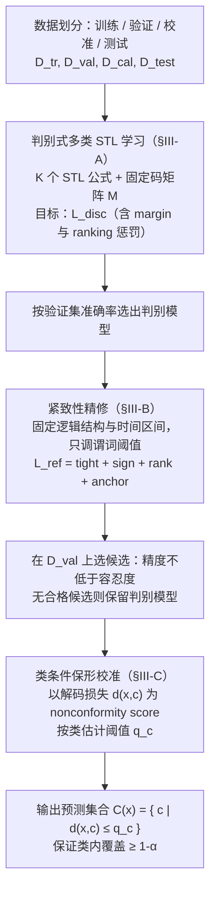

# 类条件保形 STL 推断（arXiv:2610.14352）

**类条件保形 STL 推断**（*Class-Conditional Conformal Prediction for Signal Temporal Logic Inference with Many Classes*，[arXiv:2610.14352](https://arxiv.org/abs/2610.14352)，[项目页](https://sites.google.com/ucr.edu/multiclasswithconditionalcp?usp=sharing)）来自 [具身智能小站 2026-10-14 盘点](../../sources/blogs/wechat_embodied_station_41_papers_streamingwam_2026-10-14.md)，属「多机器人协作与评测」组。

## 一句话定义

**指出时序逻辑分类的准确率与公式满足度错位，固定结构后调整谓词阈值并逐类校准预测集合。**

## 英文缩写速查

| 缩写 | 英文全称 | 简要说明 |
|------|----------|----------|
| STL | Signal Temporal Logic | 信号时序逻辑 |
| CP | Conformal Prediction | 保形预测 |
| UCR | UC Riverside | 加州大学河滨分校 |

## 为什么重要

- 分类正确不代表轨迹满足时序公式。
- 开源结论：**项目页未列 GitHub**（步骤 2.5，2026-10-14）。项目页（Google Sites）入库日未列 GitHub。
- 同期同组工作见 [流式动作块与世界模型记忆：具身智能小站 10-14 期 41 篇阅读坐标](../overview/embodied-station-2026-10-14-41-papers-technology-map.md)。

## 流程总览

图依据：论文 §III 方法 / Fig.1（判别学习、紧致性精修、类条件保形校准）

## 核心机制

| 项 | 内容 |
|----|------|
| **arXiv** | [2610.14352](https://arxiv.org/abs/2610.14352) |
| **开源** | **项目页未列 GitHub** |
| **要点** | 有限样本覆盖依赖类内可交换性。 |
| **文内指标** | 以原文为准。 |

## 源码运行时序图

**不适用（项目页未列 GitHub）** — 项目页（Google Sites）入库日未列 GitHub。 不编造运行脚本；代码公开后再补。

## 实验与评测

- 以原文为准。
- **读法：** 本页为索引级摘要，依据公众号转述的官方摘要与仓库信息整理；逐项数字与 baseline 以原文 PDF 为准。

## 与其他工作对比

- 横向索引见 [流式动作块与世界模型记忆：具身智能小站 10-14 期 41 篇阅读坐标](../overview/embodied-station-2026-10-14-41-papers-technology-map.md)；同 arXiv 不重复造页。

## 结论

**可解释轨迹分类要同时报告准确率与公式满足度。**

1. 开源边界：**项目页未列 GitHub** — 项目页（Google Sites）入库日未列 GitHub。
2. 核心机制：有限样本覆盖依赖类内可交换性。
3. 复现与选型前核对任务协议、硬件与基准口径，勿直接横比公众号摘录数字。

## 关联页面

- [safety-filter](../concepts/safety-filter.md)
- [control-barrier-function](../concepts/control-barrier-function.md)
- [embodied-station-2026-10-14-41-papers-technology-map](../overview/embodied-station-2026-10-14-41-papers-technology-map.md)

## 参考来源

- [class_conditional_conformal_stl_inference_arxiv_2610_14352.md](../../sources/papers/class_conditional_conformal_stl_inference_arxiv_2610_14352.md)
- [wechat_embodied_station_41_papers_streamingwam_2026-10-14.md](../../sources/blogs/wechat_embodied_station_41_papers_streamingwam_2026-10-14.md)
- [arXiv:2610.14352](https://arxiv.org/abs/2610.14352)
- [arXiv PDF](https://arxiv.org/pdf/2610.14352)：已通读方法部分（实验与附录以略读为准）：§II 问题设定、§III 方法（A 判别学习、B 紧致性精修、C 类条件保形校准）

## 推荐继续阅读

- [arXiv PDF](https://arxiv.org/pdf/2610.14352)
- [项目页](https://sites.google.com/ucr.edu/multiclasswithconditionalcp?usp=sharing)
