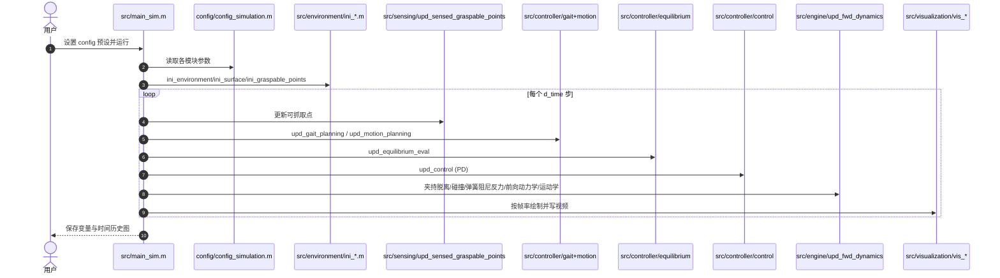

# ClimbLab：腿式攀爬机器人的 MATLAB 仿真平台

**ClimbLab**（[arXiv:2610.09315](https://arxiv.org/abs/2610.09315)，[代码](https://github.com/Space-Robotics-Laboratory/ClimbLab)）是东北大学（Tohoku）空间机器人实验室 Climbing Robotics Team 的开源 MATLAB 仿真器：把任意肢式机器人建成带浮动基座的多刚体，在可调坡度/重力/地面刚度与任意点云地形上仿真行走与攀爬，并内置步态规划、夹持脱离判据和稳定性裕度可视化。注意：论文本身是 **CLAWAR 2021** 会议工作，arXiv 于 2026-10-07 才上线。

## 一句话定义

**一个不依赖额外商业工具箱、可读可改的 MATLAB 腿式攀爬仿真器，用于教学、动力学分析和步态/控制原型验证，而非学习型训练环境。**

## 英文缩写速查

| 缩写 | 英文全称 | 简要说明 |
|------|----------|----------|
| TSM | Tumble Stability Margin | 倾翻稳定裕度（m），含夹持力时更适用于攀爬 |
| GIA | Gravito-Inertial Acceleration | 重力–惯性加速度裕度（m/s²） |
| COM | Center of Mass | 质心，支撑多边形判据的核心量 |
| SpaceDyn | Space Dynamics toolbox | 同组 MATLAB 浮动基座多体动力学工具箱 |
| CLAWAR | Climbing and Walking Robots conference | 论文发表的会议 |
| PD | Proportional–Derivative | 平台唯一提供的关节控制律 |

## 为什么重要

- 攀爬机器人涉及夹持、重力方向变化、悬垂面，通用 RL 仿真器（Isaac/MuJoCo）默认的单侧接触、平地假设不直接适用；ClimbLab 专门放开了单侧接触约束，用最大夹持力决定脱离。
- MATLAB 实现便于教学和看公式：每个阶段一个 `upd_*.m`，易于改动步态和稳定性判据。
- 可作为学习型攀爬策略之前的快速几何/稳定性可行性筛查。

## 方法栈总览

## 方法

- **动力学：** 浮动基座多刚体 H q̈ + c + g = u + JᵀF_r，经 Runge-Kutta 积分，SpaceDyn 求解。
- **接触：** 三向弹簧–阻尼 F_r = −K_s(x − x_c) − D_s ẋ；夹持器场景不强制单侧约束；超过最大夹持力或平衡判据失效则脱离。
- **感知：** 模拟相机视场内点云，按几何和夹持器设计确定可抓取点；也可用传感数据构成的攀岩岩点测试场地形。
- **步态：** 周期爬行步态；非周期对角步态（选可达抓取点 → 选下一肢 → 选下一抓取点 → 选基座 COM → 运动学可行性检查）；样条轨迹 + 解析 IK。
- **机器人：** 昆虫型与哺乳型四足已实现（仓库内有 HubRobo、ANYmal B、ALPHRED 的参数文件）。

## 实验与评测

均为仿真示例，无真机对比：

- **HubRobo 抓持悬崖：** 2.4 kg 四足，夹持力 13.0 N，坡度步进 10°；100° 悬垂不平坡面可保持，110° 失败。
- **ANYmal B 45° 陡坡（夹持力 200 N，T=8 s）：** 对角步态 vs 正常步态（占空比 0.75）：最小 TSM 0.104 m vs 0.000 m，最小 GIA 裕度 5.39 vs 1.10 m/s²，RMS 关节力矩 11.5 vs 13.3 N·m（约低 13.5%），均值裕度几乎相同。
- **ALPHRED 落脚点选择：** RealSense D435 下倾 60°，仅运动学验证局部落脚点能否朝目标推进；未验证动力学。

## 源码运行时序图

官方仓库 [Space-Robotics-Laboratory/ClimbLab](https://github.com/Space-Robotics-Laboratory/ClimbLab)（归档见 [sources/repos/climblab.md](../../sources/repos/climblab.md)）。2026-10-12 克隆核对，主脚本为 `src/main_sim.m`（README 提到的 `climb_main.m` 在该提交不存在）：

- 最短路径：打开 MATLAB → 选 `ClimbLab/` 为当前目录 → 修改 `main_sim.m` 里的 `config`（如 `clawar_2021_dynamic_climbing_demo`）→ 运行并按提示 add path。

## 工程实践

- 新机器人：参照 `src/robot/ini_*_LP.m` 写参数文件，再用 `config/USER` 模板接入。
- 稳定性判据：夹持器场景优先看 TSM 与 GIA，而不是纯支撑多边形。
- 若需 RL 训练或大规模并行，ClimbLab 不适用（单实例 MATLAB 循环）。
- 开源状态：已开源（BSD 3-Clause），SpaceDyn v2r0 随仓库提供；官方要求 MATLAB 2018b 及以上。

## 结论

**ClimbLab 是一个面向攀爬场景的透明、可改的 MATLAB 仿真基线：价值在夹持接触与稳定性评估，不在高保真或学习。**

1. 放开单侧接触、以最大夹持力决定脱离，是它区别于通用腿式仿真器的关键。
2. 对角步态在 45° 陡坡上用更低 RMS 力矩换到更高的最小稳定裕度，这类比较在仿真里一次即可得到。
3. 评估攀爬步态时应看最小裕度，而不是均值（均值 0.361 vs 0.359 几乎无差）。
4. 仅 PD、仅两类步态、基础接触模型，不要把结果当作硬件预测。
5. 入口以仓库实际 `src/main_sim.m` 为准。

## 局限与风险

- 论文是 2021 年初步报告；仅昆虫/哺乳型四足；仅 PD 控制；仅两类步态。
- 接触为基础弹簧阻尼，无真机验证对比；示例 3 无动力学。
- 全身运动规划（倾翻稳定、能耗、可操作度）未实现。
- 仓库自 2021-08 起无更新；README 与实际入口脚本不一致。

## 与其他工作对比

| 对照 | 差异读法 |
|---|---|
| [LadderMan（人形爬梯）](./paper-ladderman-humanoid-perceptive-ladder-climbing.md) | 学习型感知爬梯策略；ClimbLab 是几何/动力学仿真平台，无学习 |
| Isaac/MuJoCo 类仿真器 | 强项在并行 RL；ClimbLab 强项在夹持接触与稳定裕度可视化 |
| 本周同周报其他论文 | 见汇总页 |

## 关联页面

- [人形/四足前沿周报 2026-10-05~10-09](../overview/frontier-humanoid-quadruped-2026-10-05-10-09.md) — 本文所在周报汇总页
- [运动控制任务页](../tasks/locomotion.md)
- [全身控制](../concepts/whole-body-control.md)
- [LadderMan](./paper-ladderman-humanoid-perceptive-ladder-climbing.md)

## 参考来源

- [climblab_arxiv_2610_09315.md](../../sources/papers/climblab_arxiv_2610_09315.md) — 论文摘录
- [climblab.md](../../sources/repos/climblab.md) — 仓库核查
- [周报来源归档](../../sources/blogs/frontier_humanoid_quadruped_2026_10_05_10_09.md)
- [arXiv:2610.09315](https://arxiv.org/abs/2610.09315)

## 推荐继续阅读

- [ClimbLab GitHub](https://github.com/Space-Robotics-Laboratory/ClimbLab)
- [SpaceDyn 工具箱](http://www.astro.mech.tohoku.ac.jp/spacedyn/)
- [论文正式版 doi](https://doi.org/10.1007/978-3-030-86294-7_20)
