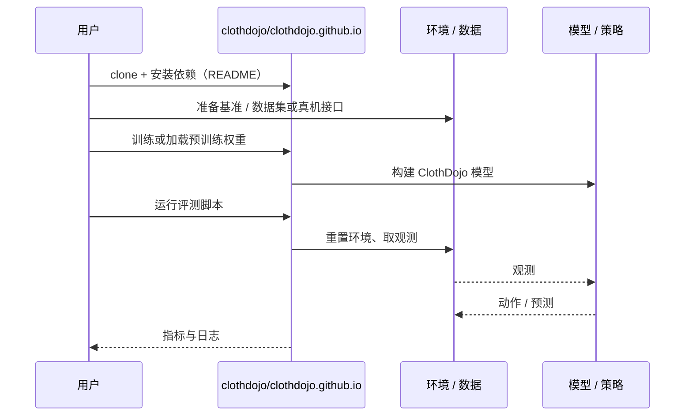

# ClothDojo（arXiv:2611.01190）

**ClothDojo**（*ClothDojo: Learned Data Generation and Benchmarking for Bimanual Garment Flattening and Folding*，[arXiv:2611.01190](https://arxiv.org/abs/2611.01190)，[项目页](https://clothdojo.github.io/)，[代码](https://github.com/clothdojo/clothdojo.github.io)）来自 [具身智能小站 2026-11-03 盘点](../../sources/blogs/wechat_embodied_station_49_papers_sacq_action_aware_quantization_2026-11-03.md)，属「评测、数据与基准」组。

## 一句话定义

**官方仓库提供衣物展平与折叠的仿真基准、固定初态和统一成功判据，并支持生成轨迹与随机化图像数据；本次未能读取论文全文，暂不转述性能数字。**

## 英文缩写速查

| 缩写 | 英文全称 | 简要说明 |
|------|----------|----------|
| ClothDojo | ClothDojo: Learned Data Generation and Benchmarking for Bimanual Garment Flattening and Folding | 本文方法 / 基准的简称 |

## 为什么重要

- 双臂衣物操作的统一评测。
- 开源结论：**部分开源**（步骤 2.5，2026-11-03）。公众号代码入口为 clothdojo/clothdojo.github.io（项目页站点仓库，git ls-remote 可达），不一定含完整训练 / 评测代码，内容未核对。
- 同期同组工作见 [动作感知量化、失败定位与可验证自主：具身智能小站 11-03 期 49 篇阅读坐标](../overview/embodied-station-2026-11-03-49-papers-technology-map.md)。

## 核心机制

| 项 | 内容 |
|----|------|
| **arXiv** | [2611.01190](https://arxiv.org/abs/2611.01190) |
| **开源** | **部分开源** |
| **要点** | 官方仓库提供衣物展平与折叠的仿真基准、固定初态和统一成功判据，并支持生成轨迹与随机化图像数据；本次未能读取论文全文，暂不转述性能数字。 |
| **文内指标** | 公众号未给具体数字，本页不引用。 |

## 源码运行时序图

以下为按仓库入口（`clothdojo/clothdojo.github.io`）推断的通用运行链路；入库日仅核实仓库可达，未逐文件阅读，具体脚本名以 README 为准。

## 实验与评测

- 公众号未给具体数字，本页不引用。
- **读法：** 本页为索引级摘要，依据公众号转述的官方摘要与仓库信息整理；逐项数字与 baseline 以原文 PDF 为准。

## 与其他工作对比

- 横向索引见 [动作感知量化、失败定位与可验证自主：具身智能小站 11-03 期 49 篇阅读坐标](../overview/embodied-station-2026-11-03-49-papers-technology-map.md)；同 arXiv 不重复造页。

## 结论

**双臂衣物操作的统一评测：官方仓库提供衣物展平与折叠的仿真基准、固定初态和统一成功判据，并支持生成轨迹与随机化图像数据；本次未能读取论文全文，暂不转述性能数字。**

1. 开源边界：**部分开源** — 公众号代码入口为 clothdojo/clothdojo.github.io（项目页站点仓库，git ls-remote 可达），不一定含完整训练 / 评测代码，内容未核对。
2. 核心机制：官方仓库提供衣物展平与折叠的仿真基准、固定初态和统一成功判据，并支持生成轨迹与随机化图像数据；本次未能读取论文全文，暂不转述性能数字。
3. 复现与选型前核对任务协议、硬件与基准口径，勿直接横比公众号摘录数字。

## 关联页面

- [simulation-evaluation-infrastructure](../concepts/simulation-evaluation-infrastructure.md)
- [vla](../methods/vla.md)
- [manipulation](../tasks/manipulation.md)
- [bimanual-manipulation](../tasks/bimanual-manipulation.md)
- [embodied-station-2026-11-03-49-papers-technology-map](../overview/embodied-station-2026-11-03-49-papers-technology-map.md)
- [具身大模型评测基准选型闭环](../queries/embodied-eval-benchmark-selection-loop.md) — 本页可归入其 ③ 策略任务成功率评测层（双臂衣物展平/折叠）：固定初态与统一成功判据，防止在初态与成功口径不一致的衣物实验之间跨论文直接比榜。

## 参考来源

- [clothdojo_arxiv_2611_01190.md](../../sources/papers/clothdojo_arxiv_2611_01190.md)
- [wechat_embodied_station_49_papers_sacq_action_aware_quantization_2026-11-03.md](../../sources/blogs/wechat_embodied_station_49_papers_sacq_action_aware_quantization_2026-11-03.md)
- [arXiv:2611.01190](https://arxiv.org/abs/2611.01190)

## 推荐继续阅读

- [arXiv PDF](https://arxiv.org/pdf/2611.01190)
- [项目页](https://clothdojo.github.io/)
- [https://github.com/clothdojo/clothdojo.github.io](https://github.com/clothdojo/clothdojo.github.io)
