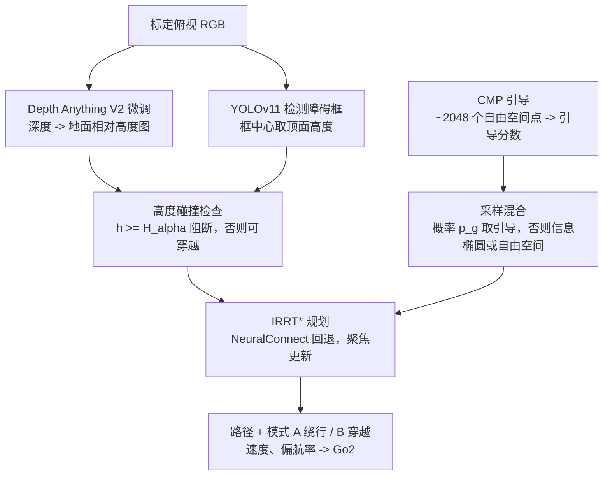
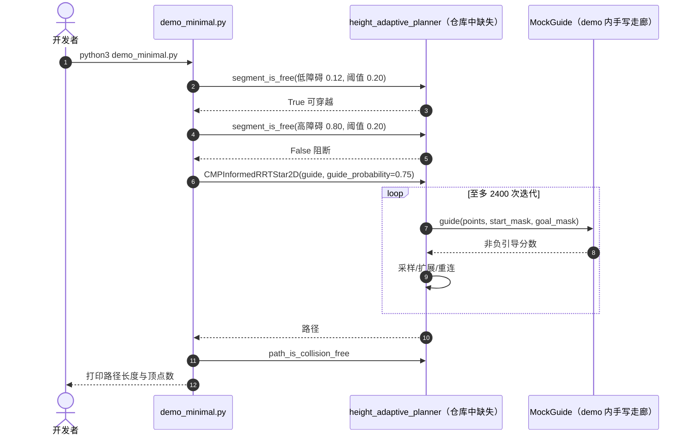

# CMP-IRRT*：感知辅助的四足高度自适应规划器

**论文：** *CMP-IRRT\*: A Perception-Assisted Height-Adaptive Planner for Quadruped Robots*（[arXiv:2610.10470](https://arxiv.org/abs/2610.10470)，cs.RO，2026-10-07，ACML 2026）。作者 Mingfan Zhao、Wendong Mao、Zhongfeng Wang；周报标注为中山大学深圳校区（arXiv 页面未列机构）。[代码](https://github.com/MingfanZhao/height-adaptive-planner)。

## 一句话定义

**从标定的俯视 RGB 图估计每个障碍相对地面的高度，规划器据此“高障碍绕行、低障碍可跨越”，并用 Channel Mamba PointNet（CMP）学到的采样引导加速 Informed RRT\*，同时保留传统自由空间/信息椭圆采样作为安全回退。**

## 英文缩写速查

| 缩写 | 英文全称 | 简要说明 |
|------|----------|----------|
| CMP | Channel Mamba PointNet | PointNet++ + 6 个 Mamba 块 + 通道注意力的采样引导网络 |
| IRRT* | Informed RRT-star | 找到首解后在信息椭圆内采样的渐近最优规划器 |
| NIRRT* | Neural Informed RRT-star | 神经引导的 IRRT*，本文主要对比对象 |
| H_α | Height threshold | min{P_foot·max cosθ, H_round}，决定障碍可否穿越 |
| P_foot / H_round | Foot clearance / Max crossing height | 最大足端抬升 / 机器人最大可跨越高度 |
| BFS | Breadth-First Search | NeuralConnect 检查引导连通性 |

## 为什么重要

- **利用四足的跨越能力：** 二维规划器把所有障碍当实心，无法穿越低障碍；高度条件规划在构造地图上缩短路径 7.7%–16.3%。
- **学习引导不取代规划保证：** 只改变采样分布，自由空间与信息椭圆采样仍在，规划完备性/渐近最优性来自 IRRT*。
- **有真机闭环验证：** Go2 固定混合障碍场景 18/20 完成，错误均为保守误阻断。

## 核心信息

| 项 | 内容 |
|----|------|
| **机构** | 周报标注中山大学深圳校区；arXiv 页面未列 |
| **平台** | 训练/评测 RTX 4090（Python 3.9.16，PyTorch 1.13.1）；真机 Unitree Go2（运动控制器与机载算力原文未指明） |
| **开源** | **部分**：MIT 许可的最小发布，但缺少 `height_adaptive_planner/` 包（详见局限） |

## 方法栈与流程总览

## 方法

- **感知：** 假设已知图像到地图的比例；Depth Anything V2 微调后输出深度，经地面参考平面标定为高度图；YOLOv11 提取障碍区域，每个障碍仅在框中心取一个代表顶面高度（对不规则/遮挡障碍不稳健）。
- **高度碰撞规则：** H_α = min{P_foot × max{cosθ}, H_round}，估计高度 ≥ H_α 即阻断，否则允许穿越；P_foot、H_round 的数值原文未给。
- **CMP 引导：** PointNet++ 风格主干得 128 维特征，6 个 Mamba 块，与通道注意力加权的 PointNet++ 分支融合；输入约 2048 个均匀采样自由空间点（z=0 三维点云）；训练用 1000 个随机世界，150 个测试，A* 参考路径 η 半径内为目标引导区（η 与损失原文未给）。
- **采样与回退：** 以概率 p_g 从引导集采样，否则在有解时从信息椭圆、无解时从自由空间采样；最优代价改善到阈值因子后在聚焦椭圆内重算引导；引导不连通时 NeuralConnect 建半径图并用 BFS 检查，最多重试 5 次。

## 实验与评测

基线：RRT\*、IRRT\*、NIRRT\*；基准 Center Block、2D Random World（沿用 NIRRT\* 设置）。

| 方法 | 首解时间 | 节点数 | 迭代数 | 18 s 最终代价 |
|---|---|---|---|---|
| RRT\* | 0.17 s | 241.86 | 299.04 | 233.01 |
| IRRT\* | 0.19 s | 251.61 | 312.75 | 232.63 |
| NIRRT\* | 1.81 s | 102.92 | 151.69 | 206.51 |
| CMP-IRRT\* | 1.37 s | **99.49** | **146.55** | **203.41** |

- **引导消融（相对 PointNet++）：** +Mamba 节点 0.984 / 迭代 0.980；完整 CMP 0.919 / 0.920（约少 8.1% 节点、8.0% 迭代）。
- **配对复评（150 图 × 3 种子 = 450 次）：** NIRRT\* 首解 1.813±0.770 s、代价 207.27±26.79；CMP-IRRT\* 1.380±0.650 s、204.11±25.73；成功率均 100%；差距小，未做显著性检验。
- **可穿越规划：** 4 张构造地图，1500 次迭代，10 次平均，至多两个可穿越障碍，路径缩短 7.7%–16.3%（论文归因于高度条件，而非 CMP 本身）。
- **Go2 演示：** Binary-CMP 10/10、8.56 m；Oracle 高度 10/10、7.25 m（短 15.3%）；预测高度 18/20、7.71 m（匹配的 10 次子集上短 9.9%），2/20 需干预，无摔倒和机身碰撞。阈值测试：0.7H_α 10/10，0.9H_α 9/10；高度判断可穿越 18/20、应阻断 20/20，错误均为保守误阻断。

## 源码运行时序图

官方仓库 [MingfanZhao/height-adaptive-planner](https://github.com/MingfanZhao/height-adaptive-planner)（归档见 [height-adaptive-planner.md](../../sources/repos/height-adaptive-planner.md)）只含 `demo_minimal.py` 与说明文件。下图对齐该 demo 的调用，**注意被导入的 `height_adaptive_planner` 包在该提交中缺失，demo 目前无法直接运行**：

## 工程实践

| 项 | 建议 |
|----|------|
| 阈值标定 | 为具体机器人标定 H_α（足端抬升、大腿角、最大跨越高度），仓库自述它只是规划抽象而非安全保证 |
| 感知前提 | 需要标定俯视图、静态或缓变场景；障碍近似平顶矩形 |
| 保守策略 | 高度误差导致的错误全为误阻断，可接受；若调大阈值需重测 0.9H_α 临界 |
| 部署 | 规划先于执行完成，无在线重规划；动态场景需外部重规划 |
| 环境 | CMP 需 PyTorch 与 `mamba_ssm`；demo 只需 NumPy |

## 结论

**高度条件碰撞检查是本文的主要收益（路径缩短 7.7%–16.3%），CMP 引导是小幅采样加速；工程可用性受限于标定俯视感知和不完整的代码发布。**

1. **看高度比看有无更重要** — 高度条件穿越带来的路径缩短远大于 CMP 对 NIRRT\* 的改进。
2. **CMP 相对 NIRRT\* 的提升小而稳定** — 首解快约 0.43 s、代价低约 3、节点少约 3%。
3. **引导网络内部有效** — Mamba + 通道注意力相对 PointNet++ 约少 8% 节点与迭代。
4. **高度估计误差应保守处理** — 20 次可穿越里 2 次误阻断，无误放行。
5. **复现前先核对仓库** — 核心包缺失，权重与训练脚本未发布。

## 与其他工作对比

| 对照 | 差异读法 |
|------|----------|
| NIRRT\* | 同类神经引导 IRRT\*；CMP 用 Mamba 与通道注意力替代纯 PointNet++，仓库也基于其 MIT 代码 |
| RRT\*/IRRT\* | 首解更快但节点/代价更差；本文用学习引导换更少节点 |
| [落脚点规划](../concepts/footstep-planning.md) | 后者是步级接触规划；本文是全局二维路径 + 高度可通过性 |
| [Mamba](../concepts/mamba.md) | 本文把 Mamba 用作点云序列建模的引导网络 |

## 局限与风险

- **开源状态：** 仓库为“最小发布”，只含 `demo_minimal.py` 与说明，README 提到的 `height_adaptive_planner/cmp_model.py` 不在提交 c71bcd0 中；无权重、训练脚本、感知管线和 Go2 部署代码。
- **感知：** 单目高度、框中心单点采样，不稳健；需标定俯视相机。
- **统计：** 复评差距小，无显著性检验；Center Block 数据仅在图中。
- **动态场景：** 不支持第一视角感知与在线重规划。

## 关联页面

- [人形/四足前沿周报（2026-10-05~10-09）](../overview/frontier-humanoid-quadruped-2026-10-05-10-09.md)
- [运动控制任务页](../tasks/locomotion.md)
- [Mamba](../concepts/mamba.md)
- [落脚点规划](../concepts/footstep-planning.md)
- [Unitree](./unitree.md)
- [机器人视觉感知栈选型闭环](../queries/robot-perception-stack-selection-loop.md) — 本页对应其 ①→③→④ 链路：只有俯视 RGB 时用 Depth Anything V2 补深度、YOLOv11 出障碍框，提升为地面相对高度后供 IRRT* 规划消费

## 参考来源

- [cmp_irrt_star_arxiv_2610_10470.md](../../sources/papers/cmp_irrt_star_arxiv_2610_10470.md) — 论文摘录与开源核查
- [height-adaptive-planner.md](../../sources/repos/height-adaptive-planner.md) — 仓库归档
- [周报来源归档](../../sources/blogs/frontier_humanoid_quadruped_2026_10_05_10_09.md)
- [arXiv:2610.10470](https://arxiv.org/abs/2610.10470) — 原文
- [MingfanZhao/height-adaptive-planner](https://github.com/MingfanZhao/height-adaptive-planner) — 官方仓库

## 推荐继续阅读

- [arXiv HTML 全文](https://arxiv.org/html/2610.10470v1)
- [NIRRT* 代码](https://github.com/tedhuang96/nirrt_star)
- [Mamba 官方实现](https://github.com/state-spaces/mamba)
