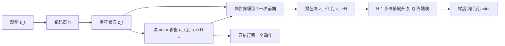

# CMPO：Chunk-wise Model-based Policy Optimization（arXiv:2610.14564）

## 一句话定义

**CMPO** 把 actor 与世界模型都改成「动作块」级：actor 输出 H 步动作块，块世界模型一次前向给出 H 步潜在状态，再对 (H-1) 步价值展开直接求梯度，因此训练时不需要循环调用模型，也没有跨 H 步的 BPTT（论文第 3.3 节）。

## 英文缩写速查

| 缩写 | 英文全称 | 简要说明 |
|------|----------|----------|
| CMPO | Chunk-wise Model-based Policy Optimization | 本文方法 |
| MBRL | Model-Based Reinforcement Learning | 学习环境模型来辅助策略优化 |
| BPTT | Backpropagation Through Time | 沿时间展开的反向传播，梯度含 Jacobian 连乘 |
| MPC | Model Predictive Control | 决策时在线规划 |
| MPPI | Model Predictive Path Integral | TD-MPC2 用的采样式规划器（第 4.3 节表 2 的 w MPC 变体） |
| MAAC | Model-Augmented Actor-Critic | 单步模型加梯度穿透的基线（第 4.1 节） |
| TD | Temporal Difference | 时序差分 |
| SAC | Soft Actor-Critic | 最大熵离策略算法，真机对照基线 |

## 为什么重要

- 基于模型梯度的 RL 要靠循环展开拿到多步信号，代价是 O(H) 次串行调用、误差累积与 BPTT 不稳定（第 1、3.2 节）。CMPO 用块级建模同时处理这三点。
- 推理时直接输出动作、无需测试时规划，表 1 报告单次推理约 1.3 到 1.4 ms，对 TD-MPC2 的约 40 ms。
- 把近期在无模型 RL 与离线 MBRL 中出现的动作块思想（论文引 Q-Chunking、Decoupled Q-Chunking、MAC）搬到在线、模型梯度式的策略优化上（第 1 节，作者自述）。

## 核心原理与流程总览

**作者自述的方法（第 3.3 节）：**

- 组件沿用 TD-MPC2：编码器 z=h(s)、块动力学 z_{t+1:t+H}=f(z_t, a_{t:t+H-1})、奖励 R、终端价值 Q、块策略 π(z_t)=a_{t:t+H-1}（式 5）。
- 模型损失（式 6）：潜在一致项（stop-gradient 目标）加奖励两-hot 交叉熵。critic（式 7）用单步动作 Q 与 1 步 TD，因为推理只执行块的第一个动作。
- actor 损失（式 8）：(H-1) 步价值展开加 SAC 式熵正则，不在 z_{t+H} 再查 actor。
- 理论动机（第 3.2 节、附录 A）：单步误差界 ε、动力学 L_f-Lipschitz 时，循环展开误差上界为 ε·Σ L_f^i。

## 工程实践

- 实现上只改 TD-MPC2 的输出与输入维度：策略输出扩成 动作维度乘 horizon，动力学输入扩成 latent 加 horizon 乘动作维度，输出扩成 latent 乘 horizon（附录 B.2）。
- 主实验统一 horizon=3，对齐 TD-MPC2；horizon 2 与 4 表现最好，5 退化（第 4.3 节，图 5a）。
- HumanoidBench：19 个任务，Unitree H1hand，动作维度 61，3 个种子（第 4.1 节、附录 C.1）。PPO、SAC、DreamerV3、TD-MPC2 直接取 HumanoidBench 原报告结果，MAAC 为作者在 TD-MPC2 架构上自实现（附录 C.2）。
- 耗时：单张 RTX 4090，未用 Torch Compile；200k 训练步 Walk 1.74 小时对 TD-MPC2 3.57 小时，Run 1.72 对 3.54；推理 1.4 与 1.3 ms 对 40.8 与 39.5 ms（表 1）。
- 真机：Isaac Gym 训练，12 关节残差位置指令加 PD，Go2 双足站立并跟踪速度；奖励项与权重见附录 C.3.1 表 3。对照用 SAC，因为 TD-MPC2 的迭代规划与同一 TorchScript 前馈部署接口不兼容（第 4.2 节）。
- 消融（第 4.3 节表 2）：w/o CM（块策略加单步模型）Walk 22.2、Run 9.6、Stair 37.1、Slide 36.1，对 CMPO 954.1、629.2、60.9、265.8；加 MPPI 为 931.1、864.5、71.9、391.2。作者称 MPC 在未饱和任务上有帮助，推测原因是采样带来额外探索（作者的推测）。

## 与清单说法的核对

清单（Glen Berseth 的 CoRL 2026 阅读清单，据摘要由 LLM 起草）一句话：「Model-based RL with a chunk world model as a differentiable evaluator for chunked actors, avoiding recurrent rollouts and BPTT.」

| 清单措辞 | 论文核对 |
|----------|----------|
| chunk world model as a differentiable evaluator for chunked actors | 吻合。摘要与第 3.3 节原话是 differentiable training-time evaluator；限定在训练时，推理时不规划 |
| avoiding recurrent rollouts | 吻合，限定为 actor 优化时用一次块前向生成 H 步轨迹（H=3 为主实验）。论文自己说这并未消除直接长程预测的难度，块越长误差越大（第 4.3 节） |
| avoiding BPTT | 吻合但略强。论文说的是梯度只穿过一次块级预测、深度缩短约 H 倍（第 3.3 节），不是完全没有反传；证据是 MAAC 梯度范数对比（图 4），梯度稳定性的证明部分是定性分析（式 3、4） |
| 清单未提 | 实验主体是仿真人形 HumanoidBench 19 任务；真机只有 Go2 双足站立一项，对照仅 SAC，10 次试验 7/10 对 4/10（第 4.2 节），无 TD-MPC2 真机对照；论文没有操作任务或视觉输入实验（推测：HumanoidBench 的全部任务用本体状态，论文未明说观测类型，未核实） |
| Spotlight 档位 | 论文文本不含评审档位信息，未核实 |

## 局限

**论文自认（Limitation 节）：** 架构基本继承 TD-MPC2，更适合块建模的架构未探索；只执行块首个动作，其余被丢弃；动态块长在 RL 中少有探索。

**读者观察到的未验证之处：**

- 基线数值来自 HumanoidBench 原报告而非同条件重跑（附录 C.2），MAAC 为自实现，对比公平性依赖该实现；只有 3 个种子。
- 第 4.1 节正文只称在「majority of the evaluated tasks」上超过基线，没有给出逐任务胜负计数；逐任务曲线只在图 7。
- 真机样本量小（10 次试验），且对照不是同类模型方法；真机任务是站立与速度跟踪，摘要写作 bipedal walking，图 3 标题写 standing locomotion，两处措辞不完全一致。
- 加 MPPI 的表 2 结果显示规划在 Run、Slide 上明显更好（629.2 对 864.5，265.8 对 391.2），说明纯梯度路线并非处处占优。
- 梯度范数稳定性的证据是训练曲线与范数图，未与最终回报做因果分离。

## 关联页面

- [Model-Based RL](../methods/model-based-rl.md)
- [Action Chunking](../methods/action-chunking.md)
- [BPTT](../concepts/bptt.md)
- [TD-MPC2](../entities/paper-td-mpc2.md)
- [HumanoidBench](../entities/humanoid-bench.md)
- [Dreamer 潜在想象](../entities/paper-dreamer-latent-imagination.md)
- [SAC](../methods/sac.md)
- [PPO](../methods/ppo.md)
- [有模型与无模型对比](../comparisons/model-based-vs-model-free.md)
- [MPC 与 RL 对比](../comparisons/mpc-vs-rl.md)
- [Sim2Real](../concepts/sim2real.md)

## 参考来源

- [来源归档](../../sources/papers/cmpo-chunk-wise-model-based-policy-optimization_arxiv_2610_14564.md)
- [arXiv:2610.14564](https://arxiv.org/abs/2610.14564)
- 本阅读清单出处：Glen Berseth，My CoRL 2026 Reading List（<https://www.fracturedplane.com/blog/2026/11/10/CoRL2026-Reading-List.html>），排序为作者兴趣打分，不是论文质量评价。

## 继续阅读

- [TD-MPC2 论文页](../entities/paper-td-mpc2.md)
- [arXiv PDF](https://arxiv.org/pdf/2610.14564)
