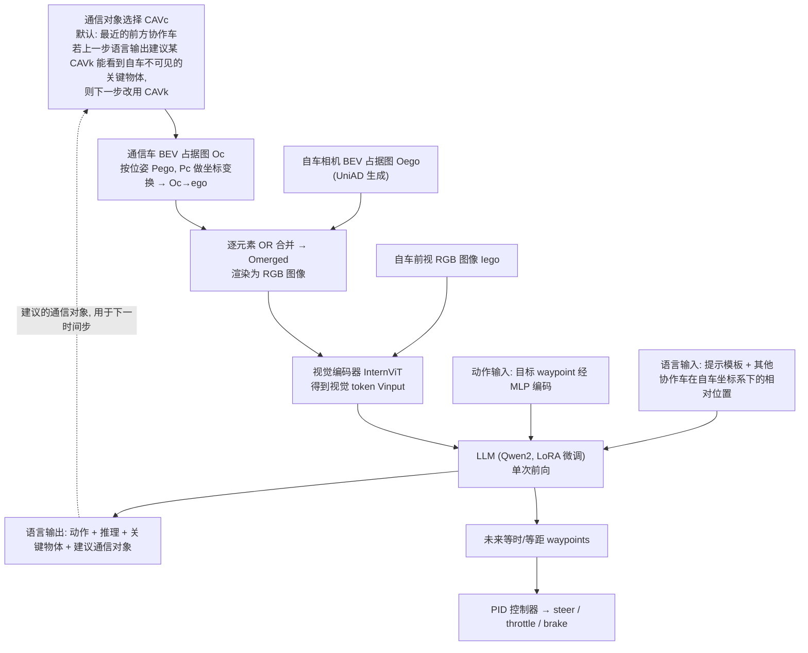

# CMU-Drive / V2V-VLA（arXiv:2608.07621）

**CMU-Drive / V2V-VLA**（[arXiv:2608.07621](https://arxiv.org/abs/2608.07621)）收录于 [多模空间 · 一周 VLA 研究趋势简析（2026.08.10–08.16）第一篇](../../sources/blogs/wechat_duomo_vla_weekly_trends_2026-08-10_part1.md) **架构模块、数采评估** 段。

## 一句话定义

**协作式多车 V2V-VLA 与 CMU-Drive 闭环基准：一次前向同时生成驾驶动作、未来轨迹、语言推理与通信策略。**

## 英文缩写速查

| 缩写 | 英文全称 | 简要说明 |
|------|----------|----------|
| VLA | Vision-Language-Action | 视觉–语言–动作策略 |
| VLM | Vision-Language Model | 视觉–语言多模态模型 |
| VLN | Vision-Language Navigation | 视觉–语言导航 |
| WAM | World Action Model | 联合未来与动作生成的具身策略 |
| TTT | Test-Time Training | 部署阶段无标注数据的在线适配 |

## 为什么重要

- 协作式多车 V2V-VLA 与 CMU-Drive 闭环基准：一次前向同时生成驾驶动作、未来轨迹、语言推理与通信策略。
- 开源状态：**待核实**（步骤 2.5，入库日 2026-09-19）。
- 与 [vla weekly trends 2026 08 10 part1 technology map](../overview/vla-weekly-trends-2026-08-10-part1-technology-map.md) 同批工作可横向对照。

## 流程总览

图依据：论文 §3.1–§3.2 / Fig.2、Eq.(7)–(10)（仅 V2V-VLA 模型，不含 CMU-Drive 基准）

## 核心机制

| 项 | 内容 |
|----|------|
| **arXiv** | [2608.07621](https://arxiv.org/abs/2608.07621) |
| **开源** | **待核实** |
| **文内评测** | CMU-Drive（自建） |

## 源码运行时序图

**不适用**（截至入库日未提供可运行官方代码入口，或仓库尚未公开）。

## 实验与评测

- **文内口径：** CMU-Drive（自建）
- **读法：** 本页为 [公众号策展](../../sources/blogs/wechat_duomo_vla_weekly_trends_2026-08-10_part1.md) 摘要；逐项指标以 **原文 PDF** 为准。

## 与其他工作对比

> 下表只做**定位对照**：本页与下列同批各页均为 [公众号策展](../../sources/blogs/wechat_duomo_vla_weekly_trends_2026-08-10_part1.md) 的索引级摘要，未逐条核对原文实验表，彼此**不共享同一评测协议**，不可据此横比数字。

| 对照 | 差异读法 |
|------|----------|
| [ActiveFly-Bench](./paper-activefly-bench.md) | 同批「评测 · 多智能体」段的另一条自建闭环基准：ActiveFly 是**单机纵向分层**（问答 / 观察规划 / 语言引导控制），CMU-Drive 是**多车横向协同**（动作 / 未来轨迹 / 语言推理 / 通信策略一次前向）。协作维度是本页独有的那一条 |
| [WAM-Diff2](./paper-wam-diff2.md) | 同批另一条智驾 VLA，分工不同：WAM-Diff2 改**解码方式**（AR→离散扩散并行解码），本文出的是**闭环基准 + 协作策略**。前者在既有榜上比速度与暴露偏差，后者得先把「多车协同该怎么测」定下来 |
| [Depth-Wise Probing Driving VLA](./paper-depth-wise-probing-driving-vla.md) | 同为智驾 VLA，方向相反：那条做**减法**（探针找冗余层再剪），本文做**加法**（一次前向多出语言推理与通信头）。同一栈上两条取舍，选型先看瓶颈在时延还是协同信息缺失 |
| [具身评测基准选型闭环](../queries/embodied-eval-benchmark-selection-loop.md) | CMU-Drive 属自建闭环基准，与 Bench2Drive / NAVSIM 等既有智驾榜不共享协议；按该页分层读，先确认测的是单车策略成功率还是多智能体通信带来的增量 |

## 结论

**CMU-Drive / V2V-VLA 适合作为本期「架构模块、数采评估」路线的快速索引页。**

1. 核心贡献：协作式多车 V2V-VLA 与 CMU-Drive 闭环基准：一次前向同时生成驾驶动作、未来轨迹、语言推理与通信策略。
2. 开源结论：**待核实** — 以项目页/仓库实际链接为准。
3. 横向对照见 [技术地图](../overview/vla-weekly-trends-2026-08-10-part1-technology-map.md)，避免与同 arXiv 重复造页。

## 关联页面

- [VLA（Vision-Language-Action）](../methods/vla.md)
- [一周 VLA 趋势技术地图](../overview/vla-weekly-trends-2026-08-10-part1-technology-map.md)
- [Generative World Models](../methods/generative-world-models.md)

## 参考来源

- [wechat_duomo_vla_weekly_trends_2026-08-10_part1.md](../../sources/blogs/wechat_duomo_vla_weekly_trends_2026-08-10_part1.md)
- [arXiv:2608.07621](https://arxiv.org/abs/2608.07621)
- [arXiv PDF](https://arxiv.org/pdf/2608.07621)：已通读方法部分（实验与附录以略读为准）：§1 Introduction、§2 CMU-Drive 基准构建与评测指标、§3.1 V2V 通信算法、§3.2 模型架构、§3.3–3.5 训练数据与训练细节、§4 实验结果

## 推荐继续阅读

- [VLA 方法页](../methods/vla.md)
- [arXiv PDF](https://arxiv.org/pdf/2608.07621)
