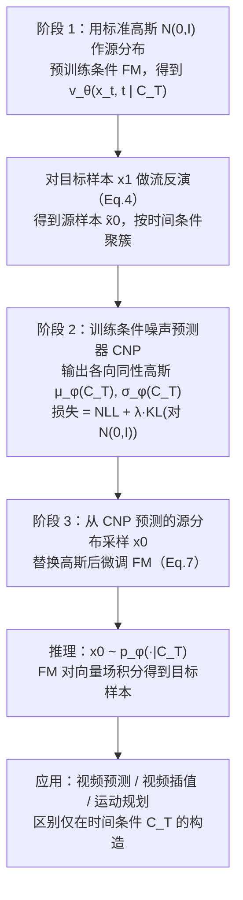

# CNP-Flow（arXiv:2610.05349）

**CNP-Flow**（*Learning Conditional Source Distribution via Flow Reversal for Temporal Flow Matching*，[arXiv:2610.05349](https://arxiv.org/abs/2610.05349)，[项目页](https://embodiedai-ntu.github.io/cnpflow/index.html)）来自 [具身智能小站 2026-10-13 盘点](../../sources/blogs/wechat_embodied_station_34_papers_mulligan_2026-10-13.md)，属「VLA 与动作生成」组。

## 一句话定义

**通过流反演监督条件噪声预测器再微调原流模型；视频生成与七自由度机械臂规划表明改进噪声起点可降采样开销。**

## 英文缩写速查

| 缩写 | 英文全称 | 简要说明 |
|------|----------|----------|
| CNP | Conditional Noise Predictor | 条件噪声预测器 |
| FM | Flow Matching | 流匹配 |
| 7-DoF | 7 Degrees of Freedom | 七自由度机械臂 |

## 为什么重要

- 改噪声起点是降低采样成本的另一杠杆。
- 开源结论：**项目页未列 GitHub**（步骤 2.5，2026-10-14）。项目页入库日未列 GitHub。
- 同期同组工作见 [失败导向采集与可组合世界动作模型：具身智能小站 10-13 期 34 篇阅读坐标](../overview/embodied-station-2026-10-13-34-papers-technology-map.md)。

## 流程总览

图依据：论文 §4.1 / Fig.3（三阶段训练流程）、§4.2、Algo.1–4

## 核心机制

| 项 | 内容 |
|----|------|
| **arXiv** | [2610.05349](https://arxiv.org/abs/2610.05349) |
| **开源** | **项目页未列 GitHub** |
| **要点** | 与 Δ-Flow 同属「改起点」路线。 |
| **文内指标** | 以原文为准。 |

## 源码运行时序图

**不适用（项目页未列 GitHub）** — 项目页入库日未列 GitHub。 不编造运行脚本；代码公开后再补。

## 实验与评测

- 以原文为准。
- **读法：** 本页为索引级摘要，依据公众号转述的官方摘要与仓库信息整理；逐项数字与 baseline 以原文 PDF 为准。

## 与其他工作对比

- 横向索引见 [失败导向采集与可组合世界动作模型：具身智能小站 10-13 期 34 篇阅读坐标](../overview/embodied-station-2026-10-13-34-papers-technology-map.md)；同 arXiv 不重复造页。

## 结论

**条件起点分布可学，且与 Δ-Flow 的历史起点互补。**

1. 开源边界：**项目页未列 GitHub** — 项目页入库日未列 GitHub。
2. 核心机制：与 Δ-Flow 同属「改起点」路线。
3. 复现与选型前核对任务协议、硬件与基准口径，勿直接横比公众号摘录数字。

## 关联页面

- [flow-matching-embodied-policy](../concepts/flow-matching-embodied-policy.md)
- [paper-delta-flow-matching-robot-foundation-models](./paper-delta-flow-matching-robot-foundation-models.md)
- [embodied-station-2026-10-13-34-papers-technology-map](../overview/embodied-station-2026-10-13-34-papers-technology-map.md)

## 参考来源

- [cnp_flow_conditional_source_distribution_arxiv_2610_05349.md](../../sources/papers/cnp_flow_conditional_source_distribution_arxiv_2610_05349.md)
- [wechat_embodied_station_34_papers_mulligan_2026-10-13.md](../../sources/blogs/wechat_embodied_station_34_papers_mulligan_2026-10-13.md)
- [arXiv:2610.05349](https://arxiv.org/abs/2610.05349)
- [arXiv PDF](https://arxiv.org/pdf/2610.05349)：已通读方法部分（实验与附录以略读为准）：§3 预备、§4 方法（4.1、4.2）、§5.1 实验设定、附录 A 算法

## 推荐继续阅读

- [arXiv PDF](https://arxiv.org/pdf/2610.05349)
- [项目页](https://embodiedai-ntu.github.io/cnpflow/index.html)
