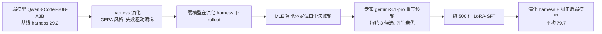

# Co-Evolving Harnesses and Models：在策略纠正

**Co-Evolving Harnesses and Models**（论文 *Co-Evolving Harnesses and Models: On-Policy Correction Helps Weaker Models Catch Up Where Imitation Fails*，[arXiv:2609.09134](https://arxiv.org/abs/2609.09134)）来自 Salesforce AI：先自动演化模型外围的 harness，再微调较弱模型；发现模仿专家完整轨迹反而有害，改用“只纠正自己失败的那一轮”。

## 一句话定义

**harness 演化提升弱模型后，再用专家只重写弱模型自身 rollout 中第一个失败轮的数据做 LoRA-SFT，保住弱模型的规划风格，叠加 harness 与微调两份收益。**

## 英文缩写速查

| 缩写 | 英文全称 | 简要说明 |
|------|----------|----------|
| SFT | Supervised Fine-Tuning | 监督微调，本文用 LoRA 形式 |
| LoRA | Low-Rank Adaptation | 低秩适配，rank 16 或 64 |
| GEPA | Genetic-Pareto prompt evolution | harness 演化的搜索风格（论文称 GEPA 风格） |
| MLE | Machine Learning Engineer (agent) | 定位失败轮的元智能体 |
| MCP | Model Context Protocol | 部分企业任务的工具接口 |

## 为什么重要

- 给出一个反直觉且可检验的结论：强专家在某个 harness 下的好轨迹，弱模型学了反而变差（平均 78.0 到 63.1）。
- 原因被归为弱模型采纳了自己执行不了的规划策略，与 harness 失配，对“蒸馏越多越好”的默认做法是提醒。
- 纠正数据量小（约 500 行），LoRA 不到一小时。

## 流程总览

## 方法

- **七项企业任务：** 工资考勤审计、预算审批、股票告警、IoT 异常检测、Playwright 浏览器自动化、Webarena 网站管理、代码重构。
- **harness 演化：** 对提示、工具、钩子、上下文管理、子智能体配置做失败驱动编辑，仅在验证集提升时保留；每任务三个种子、预算 20 美元、单 rollout 600 s。
- **模仿基线：** 用 Gemini 专家在演化 harness 下的完整轨迹做 SFT。
- **在策略纠正：** 收集弱模型自身 rollout，MLE 智能体找到第一个失败轮，专家只写一句策略加一次修正的工具调用；约 400 条纠正加 50 条自身通过样本。
- **训练设置：** LoRA rank 16 或 64（取最佳），2 epoch，lr 1e-4，bf16，有效 batch 8，序列长度 49,152（截断超 5% 时 98,304），H100/H200。

## 源码运行时序图

不适用：论文与 arXiv 页均未给出代码或数据链接（2026-10-12 核查），专家模型为闭源预览版。

## 实验与评测

测试成功率（%，七任务平均）：

| 设置 | 平均 |
|---|---|
| Qwen 基座，基线 harness | 29.2 |
| Qwen 基座，演化 harness | 78.0 |
| Gemini 专家，基线 / 演化 harness | 84.4 / 93.6 |
| Qwen 模仿 SFT，演化 harness | 63.1（-14.9） |
| Qwen 模仿 SFT，基线 harness | 35.5（+6.3） |
| Qwen 纠正 SFT，演化 harness | 79.7（+1.7） |

- 逐任务（Attn / Budget / Stock / Anom / Playwright / Web / Refactor）：基座演化 81.7 / 87.6 / 76.7 / 89.4 / 97.3 / 43.3 / 70.0；模仿 51.9 / 77.0 / 62.6 / 85.2 / 81.3 / 23.0 / 60.9；纠正 81.3 / 87.0 / 78.9 / 91.1 / 98.5 / 48.9 / 72.2。
- Gemma-4-26B-A4B 复现仅 Webarena：46.7 到 55.6（演化 harness），模仿降到 41.1。
- 摘要说的“下降 4 到 30 个百分点”是各任务降幅范围，与表内平均降幅 14.9 口径不同，本文只引用表内数字。
- 纠正 SFT 对基座只多 1.7 分，未追平 Gemini 专家的 93.6。

## 工程实践

- 开源核查：无代码、数据、项目页（2026-10-12）。
- 落地读法：先演化 harness 再微调；微调数据取自模型自己的失败轮，保持其风格；先看在哪个 harness 下评测，因为模仿 SFT 在基线 harness 下反而 +6.3。

## 与机器人学习的关系

这与机器人里的 DAgger 思路同构：学生按自己的状态分布执行，专家在学生出错处给纠正，而不是整段示教，可参考 [DAgger](../methods/dagger.md) 与 [模仿学习](../methods/imitation-learning.md)。论文本身未涉及机器人。

## 结论

**弱模型与 harness 是联合系统：与其复制专家整段行为，不如让专家只在弱模型自己犯错的地方纠正。**

- 先演化 harness，贡献了绝大部分提升（29.2 到 78.0）。
- 模仿专家完整轨迹在演化 harness 下平均降 14.9 分。
- 纠正数据约 500 行即可，平均 79.7。
- 评测必须固定 harness，否则模仿的收益与损失会互相掩盖。
- 单一弱模型家族为主，Gemma 复现只含一个任务。

## 局限与风险

- 无独立局限小节；纠正训练未追平专家（作者推测与 LoRA 有关）。
- 环境被作者修改（MCP 任务禁止直接改库、向优化器暴露工具错误），绝对值与先前工作不可直接比。
- Gemma 复现只覆盖 Webarena；无公开代码；附录未读到。

## 与其他工作对比

- 与完整轨迹蒸馏对比，见 [多专家蒸馏](../methods/multi-expert-distillation.md)；与 [DAgger](../methods/dagger.md) 同属“学生分布上取专家标签”。
- 同批 [Codebook Agent](./paper-codebook-agent-topology-design.md) 优化多智能体拓扑，本文优化单智能体 harness 与模型。

## 关联页面

- [WaytoAGI 本周顶级 AI 论文技术地图](../overview/waytoagi-top-ai-papers-2026-09-07-09-13-technology-map.md)
- [智能体编程软件基础](../concepts/agentic-coding-software-fundamentals.md)
- [AI 智能体评测](../concepts/ai-agent-evaluation.md)
- [DAgger](../methods/dagger.md)

## 参考来源

- [co_evolving_harness_models_arxiv_2609_09134.md](../../sources/papers/co_evolving_harness_models_arxiv_2609_09134.md) — 论文摘录
- [WaytoAGI 周报来源](../../sources/blogs/waytoagi_feishu_top_ai_papers_2026-09-07-09-13.md) — 线索来源
- [arXiv:2609.09134](https://arxiv.org/abs/2609.09134)

## 推荐继续阅读

- [arXiv HTML 全文](https://arxiv.org/html/2609.09134v1)
- [GEPA 论文](https://arxiv.org/abs/2507.19457)
