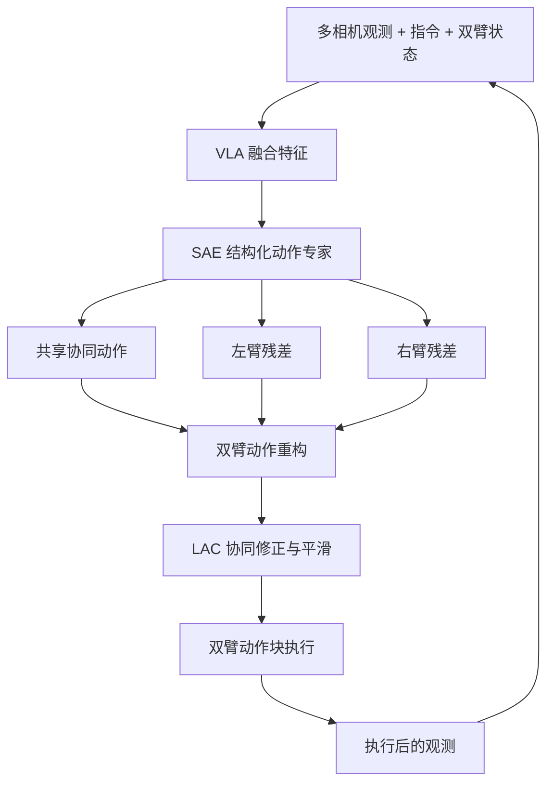

# Co-VLA：面向双臂系统的协同感知结构化动作建模

**Co-VLA: Coordination-Aware Structured Action Modeling for Dual-Arm Vision-Language-Action Systems**（[arXiv:2606.20285](https://arxiv.org/abs/2606.20285)）。

## 一句话定义

Co-VLA 用结构化动作专家将双臂动作分解为共享协同与左右臂残差，并利用执行期动作修正层减轻协同时间错位与轨迹不一致。

## 英文缩写速查

| 缩写 | 英文全称 | 简要说明 |
|---|---|---|
| VLA | Vision-Language-Action | 视觉语言动作策略 |
| SAE | Structured Action Expert | 共享/残差分解的双臂动作专家 |
| LAC | Latent Action Correction | 执行期结构化动作修正 |
| OOD | Out-of-Distribution | 分布外物体、布局和协同任务 |
| BC | Behavior Cloning | 根据示范拟合动作序列 |

## 为什么重要

- 双臂任务不只要求两个单臂轨迹都“看起来正确”，还需要握持/交接时的相对相位与角色一致。
- SAE 与 LAC 分离了**训练时的协同表示**与**推理时的动作修正**，便于做各自独立消融。
- 数据采集效率与策略成功率不是一回事，Co-Motion 研究显示需要同时衡量示范同步程度和分布覆盖。

## 核心机制

1. **SAE**：视觉语言特征进入结构化动作专家，预测左右臂共享协同成分和各臂个体残差，再合成两侧动作。
2. **辅助损失**：以协同稀疏、左右角色与时间同步相关约束监督共享/残差划分；辅助项不能替代行为克隆的动作监督。
3. **LAC**：生成动作块后再根据潜在协同约束修正和平滑，尽量减少双臂执行相位错配；该层不是硬实时安全认证模块。
4. **Co-Motion**：并行采集双臂示范扩大数据吞吐，但对任务完整性与最终策略的影响必须另测。

## 流程总览

## 实验与评测

| 场景 | 作者报告 | 说明 |
|---|---|---|
| RoboTwin 2.0 Easy 平均 | Co-VLA 约 82%，π0 约 76% | 每项任务需保留逐任务成功率 |
| RoboTwin 2.0 Hard 平均 | Co-VLA 约 22%，π0 约 21% | 难任务增益小，不可宣称全局显著 |
| Handover Block Easy | Co-VLA 91%，π0 64% | 体现协同任务受益，但不代表全部任务 |
| Agilex 真机多类双臂任务 | 每任务约 50 示范、各设定多次执行 | LAC 在部分 OOD 设置中仍可能负增益 |

## 源码运行时序图

**不适用**：原论文资源与 arXiv v1 核对尚未找到作者发布的可运行官方训练或推理代码。上方图为论文方法数据流，不是程序运行路径。

## 工程实践

1. 训练时记录两臂相对末端位姿、动作时间偏差、交接接触点与协同角色，比较 SAE 各项消融。
2. 离线逐任务检查 LAC 的前后动作平滑程度及超限频次；真机仍需独立设置碰撞检测、力矩/速度限制与安全停机。
3. 将同样的双臂示范预算作为对照，分清数据吞吐提升、模型结构增益和运行期修正贡献。

## 局限与风险

- 针对的主要是特定双臂协同任务，任务/工具/相机/本体变化会改变结构先验的适用性。
- 平滑可能损害需要快速换向的动作：不是所有 OOD 任务 LAC 都有正增益。
- 尚无经核实的官方可执行实现，不能以论文图直接宣称代码复现。

## 与其他工作对比

- [H-VLA](./paper-h-vla.md)：侧重语义关键动作→连续规划的分层；Co-VLA 侧重左右臂同步结构。
- [PSR](./paper-psr-vla.md)：从未来接触力/关节负载的预测表征改善接触策略，而非显式分解双臂角色。
- [RoboICL](./paper-roboicl.md)：用冻结多模态模型的交互历史与回执修正动作，训练/部署成本结构不同。

## 结论

**Co-VLA 表明双臂协同适合成为动作模型的显式结构，但部署时仍需要对 LAC 的逐任务收益和安全约束做独立验收。**

1. 成功率评测应重点区分交接/协同类与独立并行类任务。
2. 先对齐双臂动作时间戳和坐标系统，再谈共享残差结构是否优于简单拼接。
3. LAC 只能作为软修正，不能替代碰撞与接触力安全控制。
4. Co-Motion 的采集提速应同时报告示范质量和策略成功率。
5. 把 RoboTwin Easy/Hard 与 Agilex 真机分开描述，不做无协议依据的横向排名。

## 关联页面

- [双臂操作](../tasks/bimanual-manipulation.md)
- [VLA 模型](../methods/vla.md)
- [H-VLA](./paper-h-vla.md)、[PSR](./paper-psr-vla.md)、[RoboICL](./paper-roboicl.md)
- [Contact-rich 纵深](../../roadmap/depth-contact-manipulation.md)

## 参考来源

- [论文 v1 精读归档](../../sources/papers/co_vla_arxiv_2606_20285.md)
- [arXiv HTML](https://arxiv.org/html/2606.20285v1)

## 推荐继续阅读

- [论文 PDF](https://arxiv.org/pdf/2606.20285)
- [接触丰富操作学习路线](../../roadmap/depth-contact-manipulation.md)
