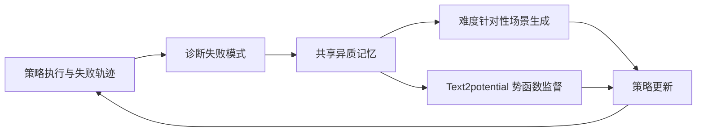

# CoDA：失败驱动的数据引擎与动作策略协同进化

## 一句话定义

**通过共享的失败诊断和学习进展记忆，同时生成下一轮训练场景与势函数监督，使仿真数据引擎和机器人策略共同改进。**

## 英文缩写速查

| 缩写 | 英文全称 | 简要说明 |
|------|----------|----------|
| CoDA | Co-Evolution of Data Engines and Action Policies | 数据和策略共同进化 |
| OOD | Out-of-Distribution | 分布外泛化 |
| SFT | Supervised Fine-Tuning | 监督微调 |

## 为什么重要

根据失败诊断联合更新仿真数据与策略，关注现有控制、数据或机器人学习方法在复杂任务中的失效点。这里单独建论文实体，避免与其他论文共用详情页；已通读原始论文 HTML 的可用正文和附录；源码执行效果仍需复现。

## 核心机制

记录 rollout 的阶段化失败与场景有效性，诊断为 difficulty mode；同一诊断编译成新的场景生成程序和 Text2potential 奖励/价值学习信号，并按学习增益调度数据生成预算。

## 方法流程

该流程依据原文方法描述，不等价于源码调用时序。

## 源码运行时序图

**暂不适用**：未核实到官方已发布的完整可运行实现，不以通用模板替代实际调用链。

## 实验与评测

四类操纵任务 OOD 成功率 27.6%，对应 SFT 基线 5.3%、按任务成功率调度的数据引擎 18.1%；LIBERO-Pro 的位置扰动结果 25%→84%、指令扰动 1%→76%。主要为仿真结果，不能外推为真机效果。

## 局限与工程实践

- 依赖可用仿真环境、可验证失败诊断及场景生成程序；项目页标注 Code coming soon，完整复现暂受限。
- **源码状态：** 官方项目页 2026-11-14 检查：Code (coming soon)，尚未提供可用源码地址。
- **原文状态：** 已通读 arXiv HTML 的可用正文和附录；具体复现及跑通情况尚未独立验证。

## 结论

**失败日志只有进入下一轮场景生成和策略训练的共同闭环，才有机会转化为泛化收益。**

1. 使用与论文一致的任务、硬件和评测协议复验，不跨实验口径比较数据。
2. 把方法改善的指标与额外的数据、计算或控制成本分开记录。
3. 对未经独立核查的复现入口，暂不声称完成验证。

## 与相关方法对比

| 对照方法 | 关键区别 | 局限或适用条件 |
|---|---|---|
| 只按成功率调度采数 | 单一成败信号不足以解释失败模式 | CoDA 诊断失败并生成下一轮场景与训练势函数 |
| 数据引擎和策略分开更新 | 两方使用的反馈目标可能不一致 | CoDA 用共享记忆联动更新 |

不同基准和硬件的结果不能直接排序。

## 关联页面

- [DemoStream：批量 TAMP 优化自动示范数据](./paper-demostream-batched-tamp.md)
- [PRM4RL：大语言模型生成的任务进度奖励](./paper-prm4rl-progress-reward.md)

## 参考来源

- [论文归档](../../sources/papers/coda-coevolving-data-policy_arxiv_2610_22362.md)
- [官方项目页归档](../../sources/sites/coda-coevolving-data-policy.md)

## 推荐继续阅读

- [arXiv 原文](https://arxiv.org/abs/2610.22362)
- [官方项目页](https://plan-lab.github.io/projects/coda/)
