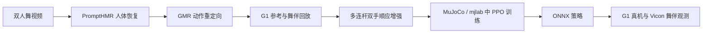
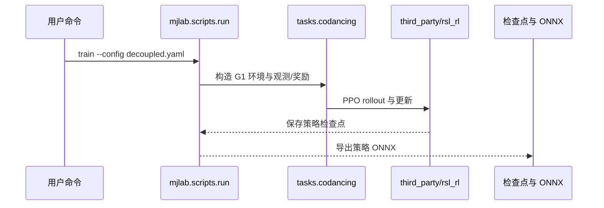
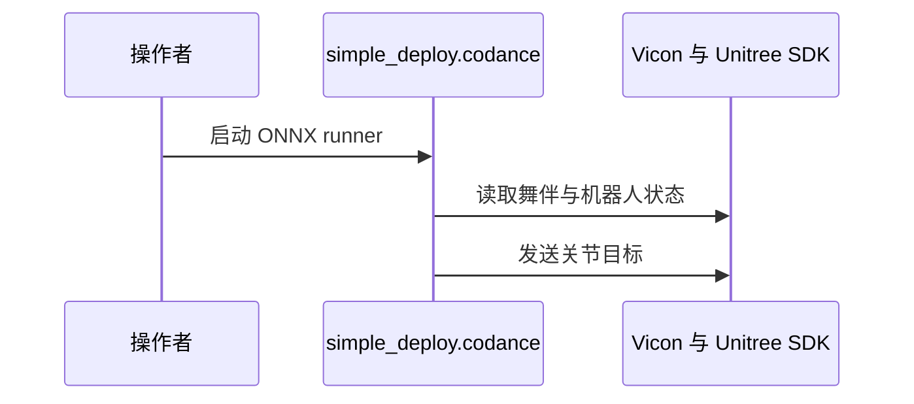

# CoDance: Learning Reactive and Compliant Human-Humanoid Interaction from Video

CoDance 用单段双人舞视频生成机器人参考动作与舞伴运动，再把结构化双手外力注入多连杆顺应增强，以训练能跟随人并对接触作出响应的人形策略。

## 英文缩写速查

| 缩写 | 英文全称 | 简要说明 |
|---|---|---|
| HHI / HHoI | Human-Human Interaction / Human-Humanoid Interaction | 输入是人-人演示，目标是人-人形物理交互。 |
| G1 | Unitree G1 humanoid robot | 论文进行实体舞伴交互演示的平台。 |
| PPO | Proximal Policy Optimization | 仿真中训练跟踪与顺应策略的强化学习算法。 |
| AMP | Adversarial Motion Priors | 解耦策略的下半身风格目标来源。 |
| ONNX | Open Neural Network Exchange | 仓库导出的策略格式，供真机运行器加载。 |

## 为什么重要

人形机器人与人持续接触时，单纯重放人体运动参考并不够：外力会改变脚步与身体状态，僵硬跟踪既难适应舞伴，也可能破坏自然互动。CoDance 将问题拆成可从普通视频获得的运动学示范和可通过仿真增强的受力响应数据，给出从人类视频到真机接触互动的具体路径。

## 方法栈

### 流程总览

1. 从一段两名舞者视频恢复人体运动；使用 PromptHMR 与 GMR 分别恢复/重定向人体动作，形成机器人参考和重放舞伴。
2. 对参考动作施加结构化的双手外力，在多连杆层面通过顺应增强适配参考轨迹，得到包含“被拉动后应如何让步”的训练片段。
3. 在 MuJoCo / mjlab 中用 PPO 训练两种目标：解耦策略以 AMP 风格目标约束下半身、上半身跟踪参考；whole-body 策略跟踪全身参考。
4. 把训练策略导出 ONNX，使用 G1 运行器将策略接入 Unitree SDK；实时 Vicon 舞伴关键点进入策略观测。



### 顺应增强的含义

增强不是简单把人体手腕轨迹当成刚性目标。对双手施加预设结构化力事件后，调整机器人多连杆参考，使身体与脚步能够在接触中让步。训练策略因此同时学到舞蹈动作风格、舞伴相对运动和手腕顺应反应。论文报告策略重现了增强示范中约 80% 的手腕位移；这是策略对训练顺应目标的响应比例，不代表任意未知外力下都能达到同样性能。

## 工程实践

官方仓库给出 Linux / NVIDIA GPU / uv 环境、训练与评测入口、发布的检查点和 ONNX 文件。单策略训练入口示例：

```sh
CUDA_VISIBLE_DEVICES=0 uv run python -m mjlab.scripts.run train \
  --config src/mjlab/tasks/codancing/config/g1/conf/decoupled.yaml
```

仓库同时发布 whole-body、解耦策略、消融与基线；训练默认配置使用 16,384 个并行环境。重建数据池由 datagen.justfile 中的 multilink 顺应增强配方生成。完整数据和七个策略检查点可从项目链接的 Hugging Face 数据集获取（README 标注约 850 MB）。

实机 Codance 运行器加载 ONNX，不需要在机器人电脑上运行 mjlab 仿真环境；它从本地 numpy 参考片段取动作参考，并从 Vicon 读取舞伴位置。部署 README 要求先完成遥控器/e-stop 检查、机器人支撑状态与标定配置，再启动运行器。此流程涉及真实机器人运动，不应把 dry-run 输出当作安全验证。

## 源码运行时序图



部署时序：



时序对应仓库 README 的训练命令和 simple_deploy 文档：训练通过 mjlab 脚本入口进入 codancing 任务与 vendored rsl_rl；部署由 ONNX 运行器连接 Vicon 与 Unitree SDK。具体传感器与操作者安全步骤以 [部署说明](../../sources/repos/codance.md) 为准。

## 实验与评测

论文将仿真交互、顺应跟踪和实机演示结合评估：

- 仿真中策略能随舞伴运动调整脚步；禁用舞伴观测时成功率降为 0%，使用观测时报告约 99.6%–99.7%，表明舞伴状态输入是跟随能力的关键条件。
- 顺应策略重现约 80% 的增强示范腕部位移；论文报告已见片段上的平均位移误差约 2.6 cm。该指标针对构造的受力事件和仿真评估设置。
- 连续片段切换测试中，解耦策略成功率为 97.6%，whole-body 跟踪策略为 96.2%；去掉片段衔接训练后，解耦策略降至 48%。
- Unitree G1 上演示与人持续双手接触跳舞，并多次在前进与后退动作间切换。

## 与其他工作对比

CoDance 与从人-人视频学习人-人形协作的方法同属“借用人类演示降低真机采数成本”路线，但监督目标不同：PAIR / D-STAR 侧重保留人际动作中的接触语义并做协作时空推理；CoDance 先获得运动学舞蹈参考，再通过结构化外力与仿真顺应增强补出机器人接触响应。相较刚性动作跟踪基线，CoDance 的重点是让步；相较端到端无参考的交互策略，它仍依赖单一舞蹈参考和预定义外力分布。

## 结论

**一句话总判：** CoDance 证明一段人类舞蹈视频可以作为人形持续接触互动的运动学起点，但真实贡献在于用受力条件化的参考增强把“跟动作”推进到“接触时会让步”。

1. 复现顺序建议先用已发布数据与检查点跑评测，再运行 datagen 配方，最后才考虑重新训练；完整训练成本显著高于单次评测。
2. 要验证顺应泛化，应单独改变外力时序、大小与方向，并报告腕位移/力误差，而不只观察舞蹈视频。
3. 解耦策略用 AMP 风格下半身目标保留动作风格，whole-body tracker 提供可比较基线；按目标选择，不要只比较单一成功率。
4. 真机复现要把 Vicon 校准、舞伴相对坐标、ONNX 观测元数据和机器人安全停机作为完整系统的一部分。
5. 数据来自单段舞蹈视频，实验是华尔兹式两手接触；不能据此推断对任意社交动作、任意舞伴或未见接触的通用能力。

## 局限与风险

论文明确把舞蹈作为窄任务实例，训练基础来自单个双人视频。仿真中舞伴主要以重放的运动轨迹表示，训练时的力事件来自增强分布；因此“对互动有响应”不等于已学得开放式人类意图理解。策略仍依赖参考动作，论文描述其逆向舞伴动作补全能力有限；相对站位也主要固定。实机实验依赖 Vicon 标记与专门校准。归档时应将结论视为真实硬件概念验证，而不是通用人-人形交互基准。

开源状态：训练、评测、顺应数据生成与真机部署代码均公开；仓库根项目采用 Apache-2.0，但 vendored rsl_rl 与从 HUSKY 改编的 AMP 模块附带不同许可，后者为 CC BY-NC 4.0。使用前需分别核对第三方许可；公开代码不等于所有组成部分均可商业使用。数据集和策略检查点由官方 README 链接至 Hugging Face。

## 关联页面

- [Learning Whole-Body Human-Humanoid Interaction from Human-Human Demonstrations](paper-notebook-learning-whole-body-human-humanoid-interaction-f.md) — 人际示范到全身物理交互的另一条路线。
- [Loco-Manipulation 与全身控制论文分类](../overview/paper-notebook-category-04-loco-manipulation-and-wbc.md)
- [模仿学习](../methods/imitation-learning.md)

## 参考来源

- [论文原文归档](../../sources/papers/codance_arxiv_2610_05324.md)
- [项目主页核查](../../sources/sites/codance-generalroboticslab.md)
- [官方源码归档](../../sources/repos/codance.md)
- [arXiv:2610.05324](https://arxiv.org/abs/2610.05324)

## 推荐继续阅读

- [CoDance 官方代码与部署说明](../../sources/repos/codance.md)
- [arXiv HTML 全文](https://arxiv.org/html/2610.05324)
