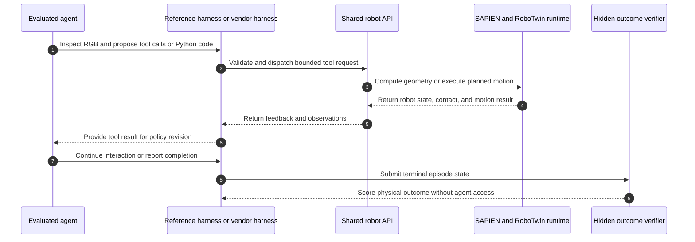

# CodeActionBench

## 一句话定义

CodeActionBench 是一个面向具身操作的 agentic Code-as-Policy 基准：它测量通用多模态 agent 能否从 RGB 观察出发，构造、执行并修订可运行的机器人策略代码。

## 英文缩写速查

| 缩写 | 英文全称 | 简要说明 |
|------|----------|----------|
| CoP | Code-as-Policy | 将机器人策略表示为可组合并执行的程序 |
| API | Application Programming Interface | agent 获取观察、几何计算、反馈和运动能力的共享接口 |
| RGB | Red, Green, Blue | 基准提供的多视角彩色图像观察 |
| TCP | Tool Center Point | agent 指定机器人末端执行器运动目标的坐标系 |
| MCP | Model Context Protocol | Codex CLI、Claude Code 连接机器人工具的协议之一 |
| VLA | Vision-Language-Action | 通过机器人数据训练观察到动作映射的另一类策略范式 |

## 为什么重要

CodeActionBench 将「模型会写代码」变成可以在物理结果上检验的问题。它把视觉解释、空间估计、抓取与放置目标选择以及失败后的策略修订留给被测 agent；运动规划和低层控制则由共享机器人基础设施承担。因此，得分更能反映 agent 是否把多模态推理转成有效的交互行为，而不是外部感知模块或预制技能包代做决策。

它也让 Code-as-Policy 与 [VLA 策略](../methods/vla.md) 的区别变得可操作：前者在推理时生成或修改程序，后者由机器人数据训练出观察到动作的映射。比较两者时，必须一起报告接口提供的感知信息、动作抽象、模型调用预算与成功判据。

## 核心原理

### 任务与信息边界

基准包含 25 个固定仿真任务，底层为 SAPIEN 与 RoboTwin 2.0 的 ALOHA-AgileX 双臂机器人配置。任务覆盖抓取、搬运、双臂交接、工具使用、物体排列与堆叠、瞬时接触事件及铰接物体操作。

agent 可见多视角 RGB、标定几何运算结果、机器人状态/接触反馈和受限运动结果；接口不暴露深度图、精确物体姿态、任务专属目标、外部专用感知/抓取候选或 verifier 状态。agent 自己选择视觉证据并构造 3D 估计和操作目标。它可以直接发工具调用，也可以把工具组合成含分支、循环和计算的 Python 程序。

### 运行闭环

运行中 agent 基于反馈继续改写或执行程序；episode 结束后 verifier 独立检查物理状态，结果不返回 agent。仓库公开 reference harness 和机器人工具；Codex CLI、Claude Code 可通过 MCP 连接工具。

## 实验与评测

| 项目 | 设置 |
|------|------|
| 任务实例 | 25 个固定仿真场景，每项 3 次尝试 |
| 被测配置 | 9 种 agent 配置，共 675 次尝试 |
| 主要指标 | hidden verifier 成功率；每项任务权重相同 |
| 辅助读数 | coverage、三次全成功任务数、episode 时间、外层工具调用数 |
| 成功判定 | verifier 根据终态物理状态与任务事件检查；agent 的完成声明单独记录 |
| 结果范围 | 成功率 2.7%–73.3%；GPT-6 Astra + Codex CLI 达 73.3%，至少一次完成 22/25 项 |

时间和工具调用用于描述资源成本而非调整主排名。论文轨迹分析还追踪中间空间检查点，避免把「机械臂执行了目标位姿」误读为「任务物理关系已成立」。

## 与其他工作对比

| 路线 | 感知与决策由谁承担 | 评测重点 | 与 CodeActionBench 的差异 |
|------|--------------------|----------|----------------------------|
| **CodeActionBench** | 被测 agent 只拿 RGB + 几何 API，自行选证据、估 3D、定目标 | 隐藏 verifier 判定的物理成功 | — |
| 既有 Code-as-Policy 系统（如 [VoxPoser](./paper-voxposer.md)） | 外部模块可提供物体位置、抓取候选或预设技能 | 系统整体能否完成任务 | 成绩混入外部感知/技能的贡献；本基准把这些决策留给 agent，归因更干净 |
| [VLA 策略](../methods/vla.md) | 由机器人数据训练的观察→动作映射 | 训练分布内外的策略成功率 | 推理时不写程序；与 CoP 横比需对齐感知信息、动作抽象与调用预算 |
| [LIBERO](./libero-benchmark.md) / [RoboTwin](./robotwin.md) 等策略基准 | 被测策略本身 | 学习型策略的任务成功率 | CodeActionBench 复用 RoboTwin 2.0 本体配置，但评测对象换成通用 agent stack |
| [EmbodiedEvo](./paper-embodied-evo-coding-agent.md) | coding agent + 跨场景沉淀的 Skills / Lessons | 经验迁移后的成功率 | 本基准测单 episode 内写对代码；EmbodiedEvo 测经验能否带进新场景 |

## 结论

CodeActionBench 提供了一个信息边界相对明确、以隐藏物理结果为准的具身 Code-as-Policy 比较协议，但其成绩仍是单一仿真机器人与固定任务实例上的 agent-stack 结果。

- 比较不同模型时，优先看共享 reference harness 下的数据；使用厂商 harness 的行应理解为模型与运行框架整体比较。
- 同时报成功率、coverage 和每任务重复稳定性；单次通过不代表可重复完成。
- 把隐藏 verifier 成功与 agent 自报完成分开读，检查「运动看似完成但物理条件未满足」的失败。
- 分析中间检查点有助于定位空间对齐、物体保持和策略终止问题，但检查点命中不能替代任务成功。
- 不把 25 个固定仿真场景的结果外推为跨场景、跨本体或真机表现；论文明确指出这些泛化仍待评估。

## 工程实践

- **先核对信息边界：** 复现或扩展任务时，记录 agent 能见到的图像、几何 API、状态反馈、运动约束和 verifier 字段，避免隐式泄漏物体真值。
- **分层定位失败：** 依次检查视觉证据选择与 3D 对齐、抓取/放置目标、规划执行反馈、物体是否保持、最终完成判断；不要只看代码是否成功运行。
- **保证比较可解释：** 冻结任务实例、资源预算和工具 schema；报告 harness、模型版本、重复次数、调用成本与 verifier 版本。
- **评估复现成本：** 官方仓库代码为 MIT，但完整轨迹/观察图像/视频数据集在入库核查时仍标为 coming soon。Linux x86-64 + NVIDIA GPU、Docker Compose 与 NVIDIA Container Toolkit 是 README 列出的主要环境要求，完整评测和导出约需 150 GB。

## 局限与风险

- 当前评测覆盖单一 ALOHA-AgileX 双臂仿真本体，每个任务使用一个固定场景实例；跨场景、任务族和本体泛化尚未由该设置证明。
- 论文未评估实体机器人迁移，模型 API 延迟与成本也限制评测规模。
- 各配置成绩包含模型、harness、提示、推理预算与工具使用方式的影响，不能简单归因于模型本身。
- verifier 只在 episode 结束后提供外部判定；agent 在线无法确认自己的成功与否，这正是完成判断评估的一部分。
- 完整轨迹与观察媒体数据仍待发布，当前的公开代码不等于所有论文数据已可下载。

## 关联页面

- [操作任务](../tasks/manipulation.md) — 具身操作的任务边界与方法入口
- [LLM 机器人控制接口](../concepts/llm-robotics-control-interfaces.md) — 通用 agent 如何通过程序和工具接入机器人
- [LIBERO Benchmark](./libero-benchmark.md) — 可与该任务/评测基准作不同侧重点的参照
- [VLA](../methods/vla.md) — 数据训练得到的视觉语言动作策略
- [具身大模型评测基准选型闭环](../queries/embodied-eval-benchmark-selection-loop.md) — 本页归入其 ③ 策略任务成功率评测层：以隐藏 verifier 判定物理终态，区分 agent 自报完成与真实成功

## 参考来源

- [论文来源](../../sources/papers/codeactionbench_arxiv_2609_33807.md)
- [项目页核查](../../sources/sites/codeactionbench-org.md)
- [官方仓库与复现入口](../../sources/repos/codeactionbench.md)

## 推荐继续阅读

- [论文 HTML 全文](https://arxiv.org/html/2609.33807v1) — 任务设置、接口边界与评测附录
- [项目页](https://codeactionbench.org/) — 交互式结果与 agent 轨迹演示
- [官方仓库](https://github.com/lyhkk/CodeActionBench) — 安装、运行和扩展文档
