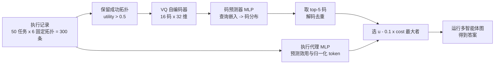
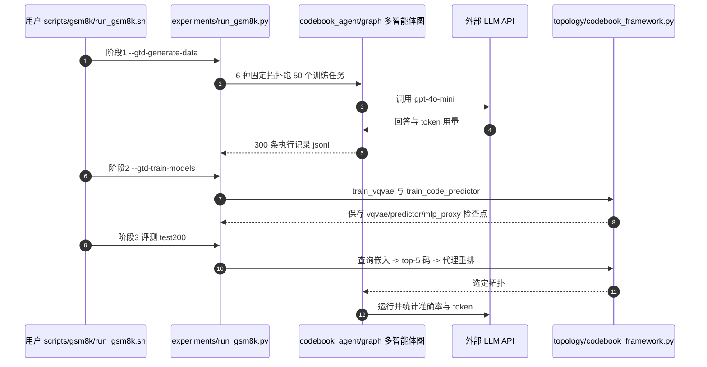

# Codebook Agent：多智能体拓扑的摊销式设计

**Codebook Agent**（论文 *Codebook Agent: Amortized Topology Design for LLM Multi-Agent Systems*，[arXiv:2609.02264](https://arxiv.org/abs/2609.02264)，[代码](https://github.com/jinxiy1104/CodebookAgent)）观察到：能通过奖励过滤的 LLM 多智能体通信图只有约六种，于是不再对每个查询生成邻接矩阵，而是把成功拓扑压成一个与查询无关的 16 项码本，推理时“查表 + 一次批量重排”。

## 一句话定义

**用向量量化自编码器把成功的智能体通信拓扑离散成小码本，再用查询嵌入预测码分布、用测得的效用与 token 成本训练的 MLP 代理重排，替代迭代式图生成。**

## 英文缩写速查

| 缩写 | 英文全称 | 简要说明 |
|------|----------|----------|
| VQ-VAE | Vector-Quantized Variational Autoencoder | 本文把展平邻接矩阵编码并量化到 16 个离散码 |
| MAS | Multi-Agent System | 由多个 LLM 智能体按通信图协作的系统 |
| MLP | Multi-Layer Perceptron | 码预测器与执行代理均为 MLP |
| GTD | Guided Topology Diffusion | 论文对比的最强先验设计器（扩散生成 + 图网络代理，平均 83.02） |
| EMA | Exponential Moving Average | 码本向量的更新方式 |
| CoT | Chain-of-Thought | 单智能体基线之一 |

## 为什么重要

- 它指出“拓扑设计”的难点被高估：奖励过滤后的有效拓扑数量很少，搜索整个邻接空间多数是浪费。
- 边数与实测 token 负相关（r 约 -0.4），说明按边数稀疏化来省钱的常见做法可能适得其反；训练时应直接用测得的 token 成本。
- 推理 2.4 ms、无需迭代搜索，使“每个查询动态选拓扑”可以在服务路径上使用。

## 流程总览

## 方法

- **码本：** 展平邻接矩阵 -> 32 维潜变量 -> 量化到 16 码；仅用成功拓扑训练；EMA 更新、commitment 系数 0.25、50 个 batch 后重置死码；200 epoch，Adam lr 3e-4，batch 16。
- **奖励：** R = u - λτ̃，λ = 0.1，τ̃ 为同任务按均值归一化的 token 数。
- **码预测器：** MLP（d-256-256-K），输入冻结的 all-MiniLM-L6-v2 查询嵌入（384 维），以温度 2 的奖励软目标训练。
- **执行代理：** MLP 输入展平邻接与查询嵌入，输出效用与归一化 token 成本；训练期带一个 32 码的辅助结构 token 头；200 epoch，lr 1e-3，batch 256。避免了节点画像相同时消息传递评分器无法区分候选的问题。
- **推理：** top-5 码解码去重，一次批量前向取 û - λĉ 最大的拓扑。
- **数据规模：** 每个基准仅 300 条执行记录。

## 源码运行时序图

官方仓库已开源，入口与论文一致（`experiments/run_<benchmark>.py`，`--mode GTD --gtd_generator vqvae --gtd_proxy mlp`）。

复现路径：先按 README 下载数据集并抽取 `*_test200.jsonl`，配置 `.env` 的 API key，再依次运行三阶段；脚本 `scripts/<benchmark>/run_*.sh` 已串联。

## 实验与评测

- **基准：** GSM8K、MATH、MultiArith、SVAMP、MBPP、HumanEval，并迁移到 MMLU。基线含单智能体（Vanilla、CoT、SC-CoT）、多智能体（LLM-Debate、LLM-Blender、DyLAN）和学习式设计器（GPTSwarm、ADAS、AFLOW、MaAS、AgentDropout、G-Designer、ARG-Designer、TopoDIM、GTD）。
- **gpt-4o-mini 平均：** Codebook Agent 84.62，GTD 83.02，Vanilla 77.63；逐项 GSM8K 94.8、MATH 56.5、MultiArith 99.4、SVAMP 95.4、MBPP 83.5、HumanEval 78.1，表内均为最高。
- **Qwen-3-8B：** GSM8K / MATH / MMLU 为 92.7 / 63.5 / 65.8，平均 74.0；GTD 72.7，CoT 67.5。
- **效率：** 每拓扑 2.4 ms（迭代生成器 301–396 ms）；token 减少 21.9%–33.2%（GSM8K 1239 到 927，MATH 2304 到 1611）。

## 工程实践

- 开源核查：GitHub 仓库存在且可浏览（tip 56175cb，2026-08-03），含 VQ、码预测器、MLP 代理与六基准脚本；数据集需自备，未发布预训练检查点；根目录未见 LICENSE。详见 [仓库归档](../../sources/repos/codebook-agent.md)。
- 训练只需 300 条记录，主要成本是收集记录时对 LLM 的调用。
- 代理应当用测得的 token 成本而不是边数做成本项。

## 与机器人学习的关系

无直接关系。可借鉴的只是思路：当有效结构只有少数几类时，用离散码本加查表替代每次在线搜索，和机器人里用技能库或离散潜变量代替连续规划的做法类似（推测）。

## 结论

**Codebook Agent 的核心判断是：多智能体拓扑的有效空间很小，查表加重排就够，不必每次生成图。**

- 真正起作用的指标是测得的效用与 token 成本，而非边数。
- 各智能体同画像时，应避免依赖节点画像的评分器，改用展平邻接矩阵的代理。
- 300 条记录即可训练全部组件，迁移到新骨干仍需重新收集。
- 论文单次运行、每基准 200 题，差距小于一两分的比较不宜过度解读。
- 部署读法：拓扑生成延迟 2.4 ms 可忽略，节省来自 token。

## 局限与风险

- 论文无独立局限小节；评测每配置单次运行，测试集为每基准 200 题的子集（MultiArith 180、HumanEval 160）。
- 主结果多为同质智能体团队，异质团队的收益未在主表体现。
- 结果依赖外部 LLM API；预训练检查点未发布（截至 2026-10-12）。
- 附录未读到。

## 与其他工作对比

- 相比 GTD、G-Designer、ARG-Designer 等逐查询图生成，本文把生成替换成查表，延迟从百毫秒级降到 2.4 ms，平均准确率高 1.6 分。
- 评估多智能体系统本身的方法论见 [AI 智能体评测](../concepts/ai-agent-evaluation.md)；同批论文 [Co-Evolving Harness](./paper-co-evolving-harness-models.md) 则从 harness 演化的角度优化智能体。

## 关联页面

- [WaytoAGI 本周顶级 AI 论文技术地图](../overview/waytoagi-top-ai-papers-2026-09-07-09-13-technology-map.md)
- [AI 智能体评测](../concepts/ai-agent-evaluation.md)
- [智能体编程软件基础](../concepts/agentic-coding-software-fundamentals.md)
- [Co-Evolving Harness 与模型](./paper-co-evolving-harness-models.md)

## 参考来源

- [codebook_agent_arxiv_2609_02264.md](../../sources/papers/codebook_agent_arxiv_2609_02264.md) — 论文摘录
- [codebook-agent.md](../../sources/repos/codebook-agent.md) — 仓库归档
- [WaytoAGI 周报来源](../../sources/blogs/waytoagi_feishu_top_ai_papers_2026-09-07-09-13.md) — 线索来源
- [arXiv:2609.02264](https://arxiv.org/abs/2609.02264)

## 推荐继续阅读

- [CodebookAgent GitHub](https://github.com/jinxiy1104/CodebookAgent)
- [arXiv HTML 全文](https://arxiv.org/html/2609.02264v1)
