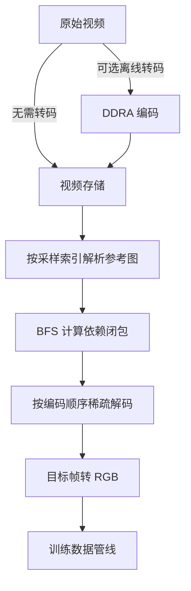
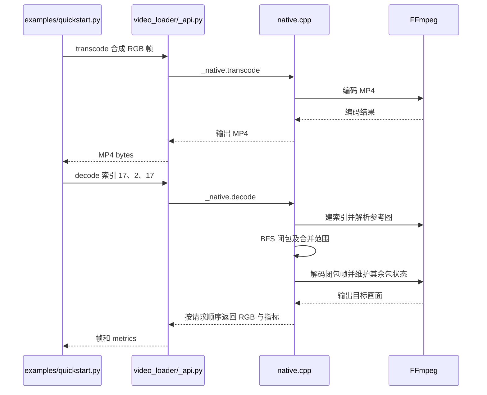

# codec4AI：面向 AI 训练的随机视频访问

## 一句话定义

codec4AI 联合设计依赖感知稀疏解码与可选的离线 DDRA 编码，降低机器人视频训练数据随机采样时的无关帧和参考帧重建。

## 英文缩写速查

| 缩写 | 英文全称 | 简要说明 |
|---|---|---|
| DDRA | Dependency-Decoupled Random Access | 限制帧间参考结构的编码方式 |
| GOP | Group of Pictures | 视频编码中的图像组 |
| DPB | Decoded Picture Buffer | 维护已解码参考画面的缓冲区 |
| PSNR | Peak Signal-to-Noise Ratio | 实验中对齐重建质量的指标 |
| VLA | Vision-Language-Action | 视觉语言动作模型 |

## 核心信息

| 项 | 内容 |
|---|---|
| 机构 | 北京大学、清华大学 |
| 论文 | [arXiv:2610.33079v1](https://arxiv.org/abs/2610.33079v1)，2026-10-21 |
| 代码 | [codec4AI](https://github.com/kaname-madoka18/codec4AI)，GPL-3.0-or-later |
| 实验 | 3,000 个 episode、8,908 路相机；三种机器人数据集 |

## 流程总览

## 核心机制

- **稀疏解码：** 对目标帧递归找出直接和间接参考帧，仅重建依赖闭包；非闭包帧仍走 state-only 路径，以维护帧序和 DPB。已有视频无需转码即可使用此路径。
- **DDRA：** 离线编码使每个区间内 B 帧仅参考两侧 I 帧，避免 B 帧互相形成参考链。对每个目标至多重建目标与两个锚帧；多个目标可共享锚点。该上界是像素重建数，不表示无需解析其他包。
- **取舍：** 更长的 I 帧间隔可能让目标共享锚帧，但更远的预测可能增加码率；去除 B 帧间引用也限制压缩灵活性。

## 源码运行时序图

以上对应仓库 `f9f9c6d` 的合成示例和 H.264/HEVC 稀疏路径；无参考图及 AV1 分支采用回退路径，见[源码归档](../../sources/repos/codec4ai.md)。

## 评测与边界

论文主加载实验使用 16 CPU 核、64 GiB、32 workers、batch size 8，每相机请求 10 帧。所有方案通过 episode 级 Lance 和对象存储读取，转码方案按 RGB PSNR 对齐。四种访问模式平均下，H.265 DDRA 吞吐为所选 LeRobot v3 基线的 **1.45 倍**，媒体载荷降低 **58.7%**；基线使用两帧 GOP AV1，并非 LeRobot 对所有部署的强制设置。

在 LIBERO 上，H.265 DDRA CRF28 的 VLA/WAM 成功率分别为 98.20% / 99.05%，原始数据为 98.00% / 99.20%；这是特定训练配置下的结果，并非对所有任务无损的证明。加载基准不含完整 RGB 张量跨进程传输、GPU 计算与离线转码，不能直接推断端到端训练提速。

## 结论

该方法适合评估视频随机采样成为训练瓶颈的机器人数据管线。

- 先在原始视频上测稀疏解码，再衡量离线 DDRA 转码的额外收益和成本。
- 用实际采样跨度、CPU、存储带宽及任务成功率验证，不能直接套用论文倍率。
- 检查 `closure_mode`、重建帧数与 state-only 包数，确认运行的确是稀疏路径。
- 公开 fast264/fast265 预设的 GOP 是 8；论文主加载实验使用 GOP 32 与特定编码构建，复现时需核对配置。

## 工程实践与局限

公开 Python 包支持 Linux CPU 下的 H.264、HEVC、AV1 MP4；FFmpeg 补丁提供 H.264/HEVC 参考图和 state-only 路径。未打补丁时回退连续解码，AV1 当前使用完整包集合。`Video` 在 0.3 版不缓存索引。项目页链接了代码，未列专门数据下载入口；发布和重分发还需核对许可证及平台支持。

## 关联页面

- [LeRobotDataset v3.0](../concepts/lerobot-dataset-v3.md)：机器人数据集组织与视频存储。
- [LeRobot](./lerobot.md)：机器人数据采集和训练框架。

## 推荐继续阅读

- [官方 API 文档](https://github.com/kaname-madoka18/codec4AI/blob/main/docs/API.md)

## 参考来源

- [论文归档与原文](../../sources/papers/codec4ai_arxiv_2610_33079.md)
- [项目页归档](../../sources/sites/codec4ai.md)
- [源码归档](../../sources/repos/codec4ai.md)
