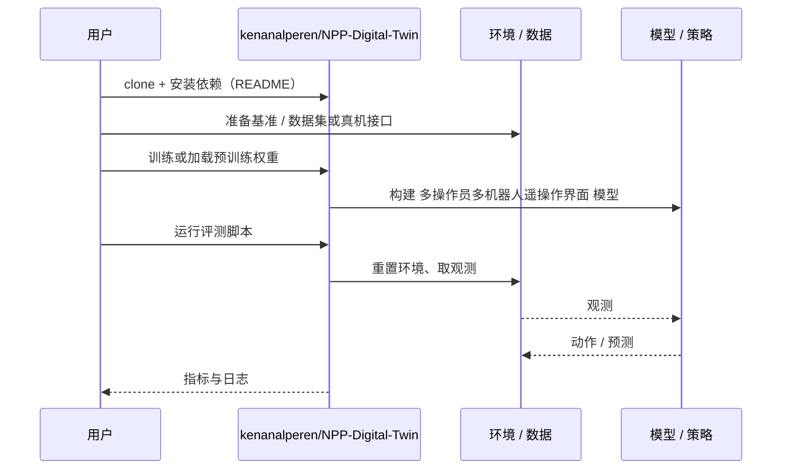

# 多操作员多机器人遥操作界面（arXiv:2610.15001）

**多操作员多机器人遥操作界面**（*Design and Evaluation of a Collaborative Teleoperation Interface for Multi-Operator Multi-Robot Systems in Challenging Environments*，[arXiv:2610.15001](https://arxiv.org/abs/2610.15001)，[代码](https://github.com/kenanalperen/NPP-Digital-Twin)）来自 [具身智能小站 2026-10-14 盘点](../../sources/blogs/wechat_embodied_station_41_papers_streamingwam_2026-10-14.md)，属「多机器人协作与评测」组。

## 一句话定义

**在核电站数字孪生中比较共处共享、远程共享与共处独立三种界面，同时衡量任务效率、认知负荷与态势感知。**

## 英文缩写速查

| 缩写 | 英文全称 | 简要说明 |
|------|----------|----------|
| NPP | Nuclear Power Plant | 核电站场景 |
| SA | Situational Awareness | 态势感知 |
| HRI | Human-Robot Interaction | 人机交互 |

## 为什么重要

- 多操作员多机器人任务中态势共享方式直接影响协作效率。
- 开源结论：**已开源**（步骤 2.5，2026-10-14）。核电站数字孪生资源仓库可达。
- 同期同组工作见 [流式动作块与世界模型记忆：具身智能小站 10-14 期 41 篇阅读坐标](../overview/embodied-station-2026-10-14-41-papers-technology-map.md)。

## 核心机制

| 项 | 内容 |
|----|------|
| **arXiv** | [2610.15001](https://arxiv.org/abs/2610.15001) |
| **开源** | **已开源** |
| **要点** | 用户实验；不能替代真实灾害现场验证。 |
| **文内指标** | 用户实验指标；以原文为准。 |

## 源码运行时序图

以下为按仓库入口（`kenanalperen/NPP-Digital-Twin`）推断的通用运行链路；入库日仅核实仓库可达，未逐文件阅读，具体脚本名以 README 为准。

## 实验与评测

- 用户实验指标；以原文为准。
- **读法：** 本页为索引级摘要，依据公众号转述的官方摘要与仓库信息整理；逐项数字与 baseline 以原文 PDF 为准。

## 与其他工作对比

- 横向索引见 [流式动作块与世界模型记忆：具身智能小站 10-14 期 41 篇阅读坐标](../overview/embodied-station-2026-10-14-41-papers-technology-map.md)；同 arXiv 不重复造页。

## 结论

**界面设计要把态势感知与负荷一起量化，而不只看完成时间。**

1. 开源边界：**已开源** — 核电站数字孪生资源仓库可达。
2. 核心机制：用户实验；不能替代真实灾害现场验证。
3. 复现与选型前核对任务协议、硬件与基准口径，勿直接横比公众号摘录数字。

## 关联页面

- [teleoperation](../tasks/teleoperation.md)
- [humanoid-multi-robot-coordination](../concepts/humanoid-multi-robot-coordination.md)
- [embodied-station-2026-10-14-41-papers-technology-map](../overview/embodied-station-2026-10-14-41-papers-technology-map.md)

## 参考来源

- [collaborative_teleoperation_multi_operator_multi_robot_arxiv_2610_15001.md](../../sources/papers/collaborative_teleoperation_multi_operator_multi_robot_arxiv_2610_15001.md)
- [wechat_embodied_station_41_papers_streamingwam_2026-10-14.md](../../sources/blogs/wechat_embodied_station_41_papers_streamingwam_2026-10-14.md)
- [arXiv:2610.15001](https://arxiv.org/abs/2610.15001)

## 推荐继续阅读

- [arXiv PDF](https://arxiv.org/pdf/2610.15001)
- [https://github.com/kenanalperen/NPP-Digital-Twin](https://github.com/kenanalperen/NPP-Digital-Twin)
