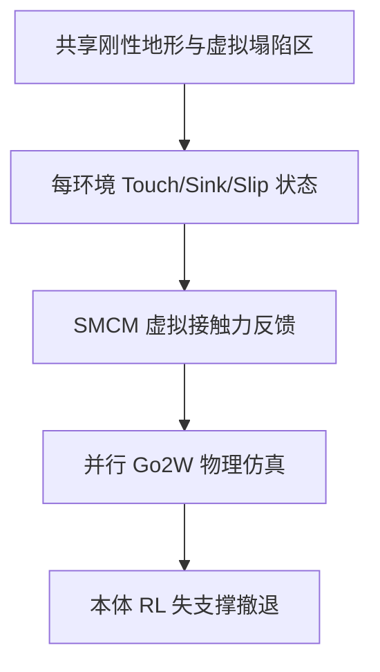

# 混合地形建模的内存高效坍塌反应式撤退策略学习（Memory-Efficient Parallel Policy Learning for Collapse-Reactive Retreat via Hybrid Terrain Modeling）

**机构：** 福岛国际研究教育机构（F-REI）、奈良先端科学技术大学院大学  
**论文：** [arXiv:2611.16337](https://arxiv.org/abs/2611.16337)

## 一句话定义

**稳定区保持 rigid terrain，塌陷区只施加虚拟接触力。State-Multiplexed Contact Model 在环境间共享几何/接触规律，但每环境保留独立塌陷状态，模拟 Touch（接触失支撑）、Sink（下陷）及 Slip（侧滑）；仅用本体感知训练单策略在失支撑后撤退。**

## 英文缩写速查

| 缩写 | 英文全称 | 简要说明 |
|---|---|---|
| RL | Reinforcement Learning | 反应策略训练 |
| SMCM | State-Multiplexed Contact Model | 环境独立的坍塌状态 |
| DR | Domain Randomization | 物理随机化 |

## 为什么重要

真实坍塌区域会随轮足接触改变支撑，若仿真为每个并行环境都复制坍塌刚体则内存高昂。

## 核心原理

稳定区保持 rigid terrain，塌陷区只施加虚拟接触力。State-Multiplexed Contact Model 在环境间共享几何/接触规律，但每环境保留独立塌陷状态，模拟 Touch（接触失支撑）、Sink（下陷）及 Slip（侧滑）；仅用本体感知训练单策略在失支撑后撤退。

### 流程总览

以下根据论文方法整理，箭头表示控制/数据流向。

## 实验与评测

各三种坍塌原语完整训练时中位撤退成功率约 90%；省略对应训练原语，相关场景成功率往往低于 40%，去 Touch 时 Touch 成功率低于 10%。论文报告相比刚体复制地形可大幅提高并行规模、缩短收敛时间；Go2W 四类实机坍塌和室外边缘完成撤退验证。

## 与其他工作对比

稳定区保持 rigid terrain，塌陷区只施加虚拟接触力。State-Multiplexed Contact Model 在环境间共享几何/接触规律，但每环境保留独立塌陷状态，模拟 Touch（接触失支撑）、Sink（下陷）及 Slip（侧滑）；仅用本体感知训练单策略在失支撑后撤退。 与传统同方向方法的主要区别见以上控制接口及研究动机；跨论文统计结果不具有相同测试协议。

## 结论

**混合地形建模的内存高效坍塌反应式撤退策略学习 的实际价值在于明确研究对象与实验边界，而非脱离原文场景比较单个成功率。**

1. 共享几何不等于共享塌陷状态，环境必须独立。
2. 三种塌陷原语不能互相完全替代。
3. 轮足实机成功率和仿真内存收益分属不同指标。

## 工程实践

实际验证时先检查任务接口与坐标系，再按论文试验复现主指标；记录 RL / SMCM / DR 相关状态、控制采样与异常回退路径，不能以论文中的概念图代替可执行模块证明。

**源码开放状态：** 本次核对的论文未发现可核实的作者算法运行入口，不臆测代码接口。

## 源码运行时序图

**不适用**：尚无可确认的官方完整算法运行入口；以上主干流程是论文方法图，不是虚构源码调用。

## 局限与风险

虚拟接触不是精细颗粒物理求解；超过 4096 环境时未显著加速收敛。真实数据来自 Go2W 轮足，不能直接推论普通四足/人形。

## 关联页面

- [sim2real](../concepts/sim2real.md)
- [humanoid locomotion](../tasks/humanoid-locomotion.md)
- [perceptive locomotion](../../roadmap/depth-perceptive-locomotion.md)
- [11.09–11.13 29 篇总览](../overview/humanoid_quadruped_2026_11_09_13_29_papers.md)

## 参考来源

- [arXiv v1 原文核对归档](../../sources/papers/collapse-retreat-hybrid-terrain_arxiv_2611_16337.md)
- [arXiv v1 HTML 全文](https://arxiv.org/html/2611.16337v1)

## 推荐继续阅读

- [论文 PDF](https://arxiv.org/pdf/2611.16337v1)
