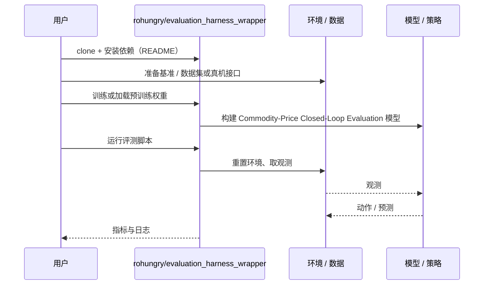

# Commodity-Price Closed-Loop Evaluation（arXiv:2611.07441）

**Commodity-Price Closed-Loop Evaluation**（*Closed-Loop Physics-Based Manipulation Evaluation at a Commodity Price: What 4.4 L4 GPU hours at $3.50 Buys You*，[arXiv:2611.07441](https://arxiv.org/abs/2611.07441)，[代码](https://github.com/rohungry/evaluation_harness_wrapper)）来自 [具身智能小站 2026-11-06 盘点](../../sources/blogs/wechat_embodied_station_20_papers_curobov2_fast_halo_humanwam_2026-11-06.md)，属「导航与闭环评测」组。

## 一句话定义

**在仿真搬盒任务上，8 张 L4 并行跑完 200 次评测，耗时约 38 分钟，按论文单价花费 3.49 美元。**

## 英文缩写速查

| 缩写 | 英文全称 | 简要说明 |
|------|----------|----------|
| Commodity-Price Closed-Loop Evaluation | Closed-Loop Physics-Based Manipulation Evaluation at a Commodity Price: What 4.4 L4 GPU hours at $3.50 Buys You | 本文方法 / 基准的简称 |

## 为什么重要

- 用 3.49 美元跑完 200 次仿真搬盒评测。作者还剔除了 5 个开局就判成功的场景。
- 开源结论：**已开源**（步骤 2.5，2026-11-06）。资源入口 rohungry/evaluation_harness_wrapper 经 git ls-remote 可达；无项目页。
- 同期同组工作见 [按路段调速的规划、虚拟房间到真机的人形动作与人类视频缩放：具身智能小站 11-06 期 20 篇阅读坐标](../overview/embodied-station-2026-11-06-20-papers-technology-map.md)。

## 核心机制

- **基准：** 基于 Barreiros et al.（lbm_eval）的 Drake 双 Franka FR3 仿真，评测 pick_and_place_box（右臂抓盒放入圆形目标区，限时 15 s；原论文套件未含该任务）。
- **扇出：** Modal 无服务器上 8 个容器、每个 1 张 L4，按 scenario_index 切成互不相交的 25 个一片；种子由索引派生，分片并集与不分片结果一致；策略由独立 gRPC 进程服务，Xvfb + EGL 无头渲染。
- **报告协议：** R1 剔除 1 s 内完成的 5 个伪影场景（分母 195）；R2 每个成功都看录像；R3 报 N/195 与 95% Wilson 区间。
- **成本（表 I）：** 37.7 min 墙钟，4.36 L4-GPU-小时，$0.80/小时 → $3.49；训练 26 min，训练加一次复现约 $3.85；表 II 全部工作约 $34。

## 源码运行时序图

以下为按仓库入口（`rohungry/evaluation_harness_wrapper`）推断的通用运行链路；入库日仅核实仓库可达，未逐文件阅读，具体脚本名以 README 为准。

## 实验与评测

策略共用 ResNet-18 + 末端位姿 MLP 编码器，用 99 条 TRI 示范（4,203 关键帧）训练，只差解码器与 (H, K)。表 II（195 场景，95% Wilson 区间）：

| 检查点 | 解码器 | (H, K) | 成功率 | 区间 |
|--------|--------|--------|--------|------|
| v1 / seed1 / seed2 | BC | (1,1) | 5.1% / 11.8% / 2.6% | [2.8,9.2] / [8.0,17.1] / [1.1,5.9] |
| v2a | DDPM | (1,1) | 0% | [0,1.9] |
| v2b | 分块 DDPM | (16,8) | 0% | [0,1.9] |
| v2b-bc（含两个种子） | 分块 BC | (8,4) | 0% | [0,1.9] |
| v2b-bc | 分块 BC | (8,1) 逐步重规划 | 0% | [0,1.9] |

- 三个独立分块检查点共 780 rollout 无真实成功；三个单步 BC 检查点均大于 0。逐步重规划仍为 0%，说明问题在分块预测的训练形式而非开环执行。
- 验证 MSE 不预测成功率：0.0148 对应 11.8%，0.0152 对应 2.6%。
- 人工检查：基线因漂移累积失败；分块检查点轨迹不跟随场景。

## 与其他工作对比

- 横向索引见 [按路段调速的规划、虚拟房间到真机的人形动作与人类视频缩放：具身智能小站 11-06 期 20 篇阅读坐标](../overview/embodied-station-2026-11-06-20-papers-technology-map.md)；同 arXiv 不重复造页。

## 结论

**用 3.49 美元跑完 200 次仿真搬盒评测：作者还剔除了 5 个开局就判成功的场景。**

1. 开源边界：**已开源** — 资源入口 rohungry/evaluation_harness_wrapper 经 git ls-remote 可达；无项目页。
2. 核心机制：在仿真搬盒任务上，8 张 L4 并行跑完 200 次评测，耗时约 38 分钟，按论文单价花费 3.49 美元。
3. 复现与选型前核对任务协议、硬件与基准口径，勿直接横比公众号摘录数字。

## 工程实践

- 算力不是瓶颈，瓶颈是未文档化的环境要求：需在镜像中写入 EGL vendor ICD 文件（GPU 运行时只挂驱动、不含用户态 GL 库）、为 Drake 资产下载脚本加解释器符号链接，并注意训练与服务之间检查点格式漂移。
- 模型资产在镜像构建时烘焙；每个分片把逐 episode JSON 写入持久卷，聚合从卷中读取，不依赖调度进程存活。
- 先按 R1 筛伪影、R2 看录像核实成功、R3 报 N/195 与 Wilson 区间；不剔除时无动作策略也会报 2.5%。
- 同一检查点可在不同执行参数下（如不同 K）服务，无需重训。

## 局限

- 仅一个任务、一个数据规模（约 100 条示范）、一个模型规模；分块负面结果不应外推，数据充足时动作分块已被证明有效。
- 本文目的是测成本与速度而非提升成功率，策略成功率仅 0% 到 11.8%；分块失败的机制只被部分隔离。
- 是 workshop 短文；作者披露使用 LLM 助手起草代码与稿件；本页未运行代码。
- 成本 $3.49 取决于 Modal 的 $0.80/L4-小时单价，且假设「干净执行」。

## 关联页面

- [simulation-evaluation-infrastructure](../concepts/simulation-evaluation-infrastructure.md)
- [vision-language-navigation](../tasks/vision-language-navigation.md)
- [manipulation](../tasks/manipulation.md)
- [embodied-station-2026-11-06-20-papers-technology-map](../overview/embodied-station-2026-11-06-20-papers-technology-map.md)
- [具身大模型评测基准选型闭环](../queries/embodied-eval-benchmark-selection-loop.md) — 评测执行侧的成本参照：③ 策略任务成功率层的仿真闭环评测（200 次约 3.49 美元），说明闭环评测规模化的门槛

## 参考来源

- [commodity_price_closed_loop_evaluation_arxiv_2611_07441.md](../../sources/papers/commodity_price_closed_loop_evaluation_arxiv_2611_07441.md)
- [wechat_embodied_station_20_papers_curobov2_fast_halo_humanwam_2026-11-06.md](../../sources/blogs/wechat_embodied_station_20_papers_curobov2_fast_halo_humanwam_2026-11-06.md)
- [arXiv:2611.07441](https://arxiv.org/abs/2611.07441)

## 推荐继续阅读

- [arXiv PDF](https://arxiv.org/pdf/2611.07441)
- [https://github.com/rohungry/evaluation_harness_wrapper](https://github.com/rohungry/evaluation_harness_wrapper)
