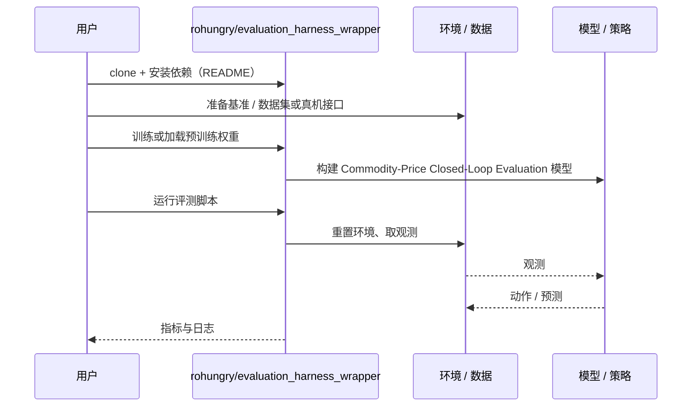

# Commodity-Price Closed-Loop Evaluation（arXiv:2611.07441）

**Commodity-Price Closed-Loop Evaluation**（*Closed-Loop Physics-Based Manipulation Evaluation at a Commodity Price: What 4.4 L4 GPU hours at $3.50 Buys You*，[arXiv:2611.07441](https://arxiv.org/abs/2611.07441)，[代码](https://github.com/rohungry/evaluation_harness_wrapper)）来自 [具身智能小站 2026-11-06 盘点](../../sources/blogs/wechat_embodied_station_20_papers_curobov2_fast_halo_humanwam_2026-11-06.md)，属「导航与闭环评测」组。

## 一句话定义

**在仿真搬盒任务上，8 张 L4 并行跑完 200 次评测，耗时约 38 分钟，按论文单价花费 3.49 美元。**

## 英文缩写速查

| 缩写 | 英文全称 | 简要说明 |
|------|----------|----------|
| Commodity-Price Closed-Loop Evaluation | Closed-Loop Physics-Based Manipulation Evaluation at a Commodity Price: What 4.4 L4 GPU hours at $3.50 Buys You | 本文方法 / 基准的简称 |

## 为什么重要

- 用 3.49 美元跑完 200 次仿真搬盒评测。作者还剔除了 5 个开局就判成功的场景。
- 开源结论：**已开源**（步骤 2.5，2026-11-06）。资源入口 rohungry/evaluation_harness_wrapper 经 git ls-remote 可达；无项目页。
- 同期同组工作见 [按路段调速的规划、虚拟房间到真机的人形动作与人类视频缩放：具身智能小站 11-06 期 20 篇阅读坐标](../overview/embodied-station-2026-11-06-20-papers-technology-map.md)。

## 核心机制

| 项 | 内容 |
|----|------|
| **arXiv** | [2611.07441](https://arxiv.org/abs/2611.07441) |
| **开源** | **已开源** |
| **要点** | 在仿真搬盒任务上，8 张 L4 并行跑完 200 次评测，耗时约 38 分钟，按论文单价花费 3.49 美元。 |
| **文内指标** | 公众号转述：作者还剔除了 5 个开局就判成功的场景。 |

## 源码运行时序图

以下为按仓库入口（`rohungry/evaluation_harness_wrapper`）推断的通用运行链路；入库日仅核实仓库可达，未逐文件阅读，具体脚本名以 README 为准。

## 实验与评测

- 公众号转述：作者还剔除了 5 个开局就判成功的场景。
- **读法：** 本页为索引级摘要，依据公众号转述的官方摘要与仓库信息整理；逐项数字与 baseline 以原文 PDF 为准。

## 与其他工作对比

- 横向索引见 [按路段调速的规划、虚拟房间到真机的人形动作与人类视频缩放：具身智能小站 11-06 期 20 篇阅读坐标](../overview/embodied-station-2026-11-06-20-papers-technology-map.md)；同 arXiv 不重复造页。

## 结论

**用 3.49 美元跑完 200 次仿真搬盒评测：作者还剔除了 5 个开局就判成功的场景。**

1. 开源边界：**已开源** — 资源入口 rohungry/evaluation_harness_wrapper 经 git ls-remote 可达；无项目页。
2. 核心机制：在仿真搬盒任务上，8 张 L4 并行跑完 200 次评测，耗时约 38 分钟，按论文单价花费 3.49 美元。
3. 复现与选型前核对任务协议、硬件与基准口径，勿直接横比公众号摘录数字。

## 关联页面

- [simulation-evaluation-infrastructure](../concepts/simulation-evaluation-infrastructure.md)
- [vision-language-navigation](../tasks/vision-language-navigation.md)
- [manipulation](../tasks/manipulation.md)
- [embodied-station-2026-11-06-20-papers-technology-map](../overview/embodied-station-2026-11-06-20-papers-technology-map.md)
- [具身大模型评测基准选型闭环](../queries/embodied-eval-benchmark-selection-loop.md) — 评测执行侧的成本参照：③ 策略任务成功率层的仿真闭环评测（200 次约 3.49 美元），说明闭环评测规模化的门槛

## 参考来源

- [commodity_price_closed_loop_evaluation_arxiv_2611_07441.md](../../sources/papers/commodity_price_closed_loop_evaluation_arxiv_2611_07441.md)
- [wechat_embodied_station_20_papers_curobov2_fast_halo_humanwam_2026-11-06.md](../../sources/blogs/wechat_embodied_station_20_papers_curobov2_fast_halo_humanwam_2026-11-06.md)
- [arXiv:2611.07441](https://arxiv.org/abs/2611.07441)

## 推荐继续阅读

- [arXiv PDF](https://arxiv.org/pdf/2611.07441)
- [https://github.com/rohungry/evaluation_harness_wrapper](https://github.com/rohungry/evaluation_harness_wrapper)
