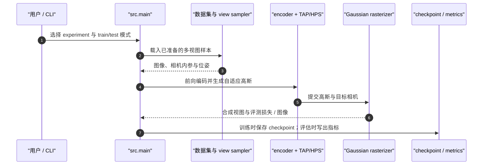

# CompactSplat

## 一句话定义

**CompactSplat** 是一种稀疏视图前馈 3D Gaussian Splatting（3DGS）重建方法：按图像区域纹理复杂度分配高斯，并通过层级采样让平坦区域使用更大、更少的原语，从而在渲染质量与表示大小之间调节。

## 英文缩写速查

| 缩写 | 英文全称 | 简要说明 |
|------|----------|----------|
| 3DGS | 3D Gaussian Splatting | 用显式 3D 高斯表示并渲染场景 |
| TAP | Texture-Aware Partitioner | 按图像纹理自适应划分空间区域 |
| HPS | Hierarchical Pyramid Sampler | 从多尺度属性金字塔采样并构造高斯 |
| NVS | Novel View Synthesis | 从未输入的相机视角合成场景图像 |
| HRRC | High-Resolution Rendering Consistency | 在不同输出分辨率检查同一重建的渲染一致性 |

## 为什么重要

- **解除每像素一个高斯的约束：** 均匀分配会在墙面、地面等低纹理区域浪费原语，同时可能不足以表达局部复杂细节。CompactSplat把预算按图像内容重新分配。
- **稀疏度可调：** 论文将推理期稀疏控制作为框架能力，使用户可在原语数量、显存占用和渲染保真度之间选点，而不必为不同阈值重新训练。
- **前馈重建补充：** 它与 [Instant NuRec](./paper-instant-nurec.md) 一样采用前馈高斯重建思路，但面向稀疏视图通用重建；Instant NuRec 针对驾驶场景、长片段分层与仿真消费。

## 核心信息

| 项 | 内容 |
|----|------|
| **作者** | Bing He、Jingnan Gao、Yunuo Chen、Zhengxue Cheng、Rong Xie、Li Song、Wenjun Zhang |
| **机构** | 上海交通大学（Shanghai Jiao Tong University） |
| **发表** | NeurIPS 2026 Poster；arXiv:2610.13177 |
| **输入 / 输出** | 稀疏、已标定的多视图图像 → 场景 3D 高斯表示与新视角渲染 |
| **代码与权重** | [官方 GitHub](https://github.com/hebing-sjtu/CompactSplat)；[Hugging Face 权重](https://huggingface.co/binghe-sjtu/compactsplat)；已公开 |
| **数据集** | RealEstate10K、DL3DV、ScanNet；数据需按仓库说明自行准备 |

## 核心原理

### TAP：图像内容决定分区

Texture-Aware Partitioner（TAP）递归细分图像区域，根据局部纹理差异让高细节区域使用小块和更多高斯，纹理平滑区域保留大块。它把均匀的 pixel-to-Gaussian 分配改成由内容决定的空间布局。

### HPS：用多尺度属性金字塔适配区域大小

Hierarchical Pyramid Sampler（HPS）在分区块中心读取高斯属性，并结合块的空间覆盖范围调整高斯尺度。细分出的区域从高分辨率特征取属性；更大的平滑区使用较粗尺度的采样与更大的高斯。

### 流程总览

## 源码运行时序图

官方仓库提供 `src.main` 训练 / 评估入口、配置、数据加载、模型与自定义高斯分区模块；以下按仓库入口概括离线训练和评估调用关系。输入数据和训练权重需按 README 另行准备。

## 工程实践

| 项 | 建议 |
|----|------|
| **运行环境** | README 给出的原始配置以 Python 3.10、PyTorch 2.4.0、CUDA 12.4 为基准；仓内另提供 H200 环境脚本，按目标环境选择，不要混用配置假设。 |
| **数据与相机** | 准备仓库支持的数据集与评估索引；输入需包含一致坐标系下的相机内参和位姿。 |
| **权重** | 从 [官方 Hugging Face 仓](https://huggingface.co/binghe-sjtu/compactsplat) 下载，并让模型变体与配置匹配。 |
| **复现核查** | 官方 README 明确指出当前分区判据和默认阈值与论文设定不同；训练 smoke test 也不是论文完整训练课表。对照仓内 `docs/REPRODUCIBILITY.md`、模型配置与评估命令再比较论文数字。 |
| **机器人消费** | 新视角外观重建不能直接当作可碰撞地图；导航与操作仍需额外校验尺度、占据、碰撞几何和动态更新。 |

## 实验与评测

论文在 RealEstate10K、DL3DV 和 ScanNet 上报告，与前馈 3DGS 方法比较重建指标及高分辨率渲染一致性。官方代码仓 README 摘录的 RealEstate10K 设置为两张 256×256 输入视图；CompactSplat-B 报告 **PSNR 27.523、SSIM 0.891、LPIPS 0.118**，平均每输入像素 **0.554 个高斯**，每场景 **72.6k** 个高斯。这些是论文报告值，不能视作当前 checkout 的独立复测；高斯数减少也不等同于几何闭合或碰撞精度提升。

## 结论

**CompactSplat把前馈 3DGS 的高斯预算从逐像素均匀铺设改成纹理自适应分配，并提供推理期稀疏度调节；论文结果显示在更少原语下仍可保持重建质量，但机器人使用仍需单独验证几何与碰撞属性。**

1. **看主要收益：** 检查同一数据与视图设置下的画质、每视图高斯数及渲染显存，避免只引用 PSNR。
2. **看控制旋钮：** 稀疏阈值用于选择画质 / 内存点位；部署前测对应分辨率、场景与硬件。
3. **谨慎复现：** 仓库可运行且权重公开，但仓库当前默认实现存在论文差异；需使用匹配设定才能将代码结果与论文表格对齐。
4. **分清输出用途：** 它优化的是场景外观和新视角合成；规划可用几何、占据与物理一致性需另行构建和验证。

## 与其他工作对比

| 对照 | 差异读法 |
|------|----------|
| [3D Gaussian Splatting 原始工作](./paper-rcl-2308-04079-3d-gaussian-splatting-for-real-time-radiance-fie.md) | 原始 3DGS 为逐场景优化的显式表示；CompactSplat 是学习式前馈重建，重点改进高斯空间分配。 |
| [Instant NuRec](./paper-instant-nurec.md) | 都是前馈高斯重建；CompactSplat强调稀疏视图通用重建与可调稀疏度，Instant NuRec强调多相机驾驶日志、长序列分层和仿真接口。 |
| [GS-Playground](./gs-playground.md) | CompactSplat生成场景表示；GS-Playground侧重把 3DGS 渲染接入物理仿真与策略训练。 |

## 局限与风险

- **重建不等于测绘：** 画面重建与高分辨率一致性指标不能证明尺度无漂移、表面闭合、自由空间可靠或碰撞查询准确。
- **输入条件：** 需要稀疏多视图、相机内参与位姿；位姿或标定误差会影响几何与新视角质量。
- **复现边界：** 代码已发布，但项目 README 明示当前分区判据 / 默认阈值与论文不同，需以复现说明核对具体论文设置。
- **数据准备：** 论文数据集不随模型仓库自动提供，准备流程与授权受各数据集条款约束。

## 关联页面

- [具身感知六种空间表征](../concepts/embodied-perception-six-spatial-representations.md) — 说明 3DGS 外观场与机器人可消费地图之间的差别
- [Instant NuRec](./paper-instant-nurec.md) — 自动驾驶场景前馈 3DGS 重建
- [3D Gaussian Splatting 原始工作](./paper-rcl-2308-04079-3d-gaussian-splatting-for-real-time-radiance-fie.md) — 显式高斯表示与原始优化范式
- [GS-Playground](./gs-playground.md) — 3DGS 与物理仿真耦合

## 参考来源

- [CompactSplat 论文摘录](../../sources/papers/compactsplat_arxiv_2610_13177.md)
- [CompactSplat 项目主页归档](../../sources/sites/compactsplat-project-page.md)
- [CompactSplat 官方代码归档](../../sources/repos/compactsplat.md)

## 推荐继续阅读

- [CompactSplat arXiv 论文](https://arxiv.org/abs/2610.13177) — 完整方法、消融与评测
- [CompactSplat 官方代码与复现说明](https://github.com/hebing-sjtu/CompactSplat) — 环境、训练、评估和当前实现差异
