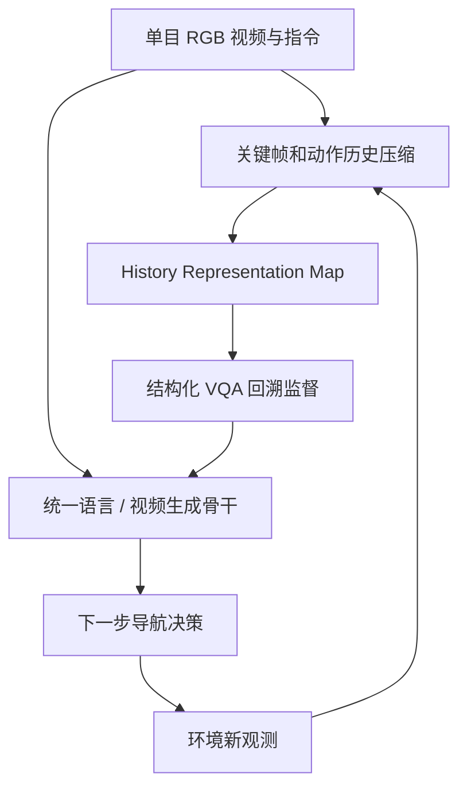

# Compass 1: Towards Open-World and Persistent Embodied Navigation from Monocular RGB Videos（开放世界持久单目导航）

## 一句话定义

**Compass 1** 是统一视觉导航中的语言理解、视频生成和长时视觉历史检索的单目 RGB 基础模型，使用压缩关键帧记忆帮助机器人回忆之前走过的环境。

## 英文缩写速查

| 缩写 | 英文全称 | 简要说明 |
|---|---|---|
| RGB | Red Green Blue | 单目彩色图像输入 |
| HRM | History Representation Map | 压缩的关键帧与动作历史 |
| VQA | Visual Question Answering | 用结构化问答监督历史信息检索 |
| SR | Success Rate | 项目设定的导航任务成功率 |

## 为什么重要

仅依据当前图像的导航方法容易在长任务中遗忘来路；Compass 1 将过去近两分钟的视觉片段构成可检索上下文，不要求单独维护一个深度/里程计先验接口来完成其单目设定的导航实验。

## 流程总览（官网方法摘要）

仅为方法模块级表达；公开代码仓尚未包含可验证部署模型入口。

## 核心原理

以关键帧级历史压缩实现长时间空间回溯，配合结构化 VQA 监督“位置/行为历史理解”；视频与语言任务共享表示，导航根据历史与当前视觉输入规划下一步动作。

## 实验与评测（官方报告）

| 评测 | 数值 |
|---|---:|
| 开放世界综合成功率 | 79.4% |
| 同设定官方最强对照 | 17.8% |
| 持久记忆回溯测试成功率 | 58% |

这些来自项目不同实验协议，应分别引用；导航还需查看 SR、SPL、NE 等标准分项，不应将 79.4% 写成全部导航基准统一得分。

## 结论

**长时导航的贡献是可用的历史记忆结构，不是仅换一个视觉 backbone。**

1. 对比模型必须控制是否提供全景/深度/里程计。
2. 评估时加入重复位置、遮挡、回头路等记忆压力测试。
3. 开源状态尚为研究展示，暂不能一键复现真机部署。

## 与其他工作对比

[SWAM](./paper-swam-cross-modal-alignment.md) 解决跨来源视频与动作学习；[WICL](./paper-world-in-context-learning-roboscript.md)在模拟环境中更新任务记忆，而 Compass 1 聚焦**导航中的时空历史表示**。

## 源码运行时序图

**不适用：** 截至 2026-11-11，官方 README 仅公开研究内容，数据集、部署代码及真实机器人 checkpoint 预计在 2026-12 发布，不能据展示页面臆造运行调用栈。

## 工程实践

- 先通过[官网](https://www.archon.tech/research/compass1)核对公开评测数据及摄像头观察模态。
- 等待官方仓发布数据/部署代码/权重后，再评估具体推理频率、历史窗口与硬件适配；当前没有足够依据给出运行命令。

## 局限与风险

- 公开展示统计来自作者实验；真实环境稳定性、长场景分布外泛化仍需独立验证。
- 模型/数据尚未完全开放，工程复现依赖将来的发布日程；时间计划不是发布保证。

## 关联页面

- [SWAM](./paper-swam-cross-modal-alignment.md)
- [WICL](./paper-world-in-context-learning-roboscript.md)

## 参考来源

- [Compass 1 论文摘录](../../sources/papers/compass-1-2611-12087.md)
- [官方项目主页](../../sources/sites/compass1-official.md)
- [展示仓与开放计划](../../sources/repos/compass1-release-status.md)

## 推荐继续阅读

- [arXiv:2611.12087](https://arxiv.org/abs/2611.12087)
- [Compass 1 官方仓库](https://github.com/OpenDriveLab/Compass1)
