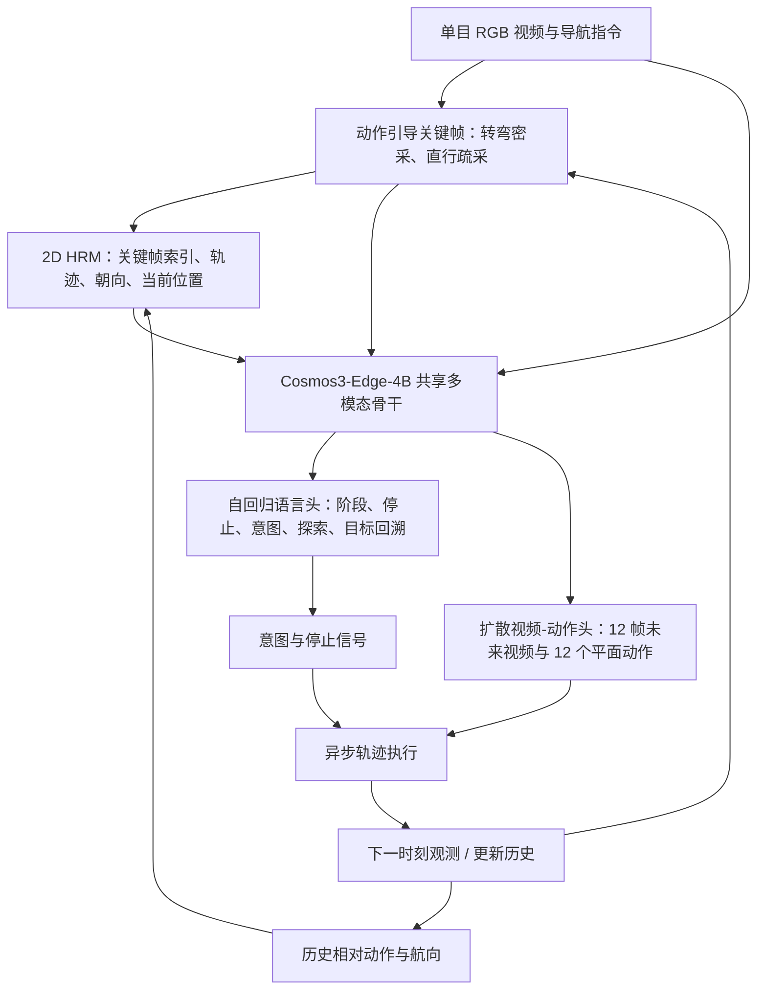

# Compass 1: Towards Open-World and Persistent Embodied Navigation from Monocular RGB Videos（开放世界持久单目导航）

## 一句话定义

**Compass 1** 是统一视觉导航中的语言理解、视频生成和长时视觉历史检索的单目 RGB 基础模型，使用压缩关键帧记忆帮助机器人回忆之前走过的环境。

## 英文缩写速查

| 缩写 | 英文全称 | 简要说明 |
|---|---|---|
| RGB | Red Green Blue | 单目彩色图像输入 |
| HRM | History Representation Map | 压缩的关键帧与动作历史 |
| VQA | Visual Question Answering | 用结构化问答监督历史信息检索 |
| SR | Success Rate | 项目设定的导航任务成功率 |

## 为什么重要

单靠最近图像执行长指令，容易忘记已走过的路、反复左右探索或提前停止。Compass 1 将历史关键帧与动作轨迹渲染为 2D **History Representation Map（HRM）**，并通过三类 VQA 监督让模型真正使用历史，而非简单堆叠长视频。

**输入与底层执行须区分：** 论文的导航策略视觉输入是单目 RGB；真机评测明确写明所有方法依赖里程计执行闭环速度控制（§4.1）。因此不能将「只用单目 RGB」解释为整台机器人无需里程计、姿态估计或低层控制。

## 流程总览（论文 Figure 2–4）

图为论文中的**方法及推理模块关系**，不是未发布源码的真实函数调用序列。导航输出为本体坐标增量 `[Δx, Δy, Δyaw]`。

## 核心原理

1. **History Representation（§2.1）**：基于动作变化挑选关键帧；将历史位姿、帧索引、朝向箭头和当前位姿绘在 HRM 图像中。相邻索引可合并显示，避免重复经过区域标签拥挤。模型无需额外的地图网络结构。
2. **History Utilization（§2.2）**：三类结构化 VQA 对应不同失效模式：Task-Stage Grounding 负责阶段定位/停止/下一步意图（IFN）；Exploration Consistency 通过已探索方向与上一轮意图减轻左右摇摆（BVN）；Spatiotemporal Target Retrieval 同时查询过去看见目标的关键帧及相对方向（HBN）。论文消融指出只有 HRM 而没有明确回溯监督时，地图容易被忽略。
3. **统一骨干（§2.3）**：使用 **Cosmos3-Edge-4B**，自回归语言头处理 VQA，扩散视频-动作头联合预测 **12 个未来视频帧与 12 个动作**；两头在部署时异步执行，先下发动作再完成语言意图与终止判断，并可中断控制器。
4. **推理优化（§4.4）**：KV cache + CUDA Graph 缓解增长的历史窗口开销；论文在 NVIDIA RTX PRO 6000 上报告 63 关键帧条件下相较未优化推理延迟降低 80.4%，异步执行相对同步降低约 46.4%。0.43 秒输出 12 个动作的「约 28Hz」是作者给出的有效动作生成吞吐率，**不是**实机伺服环频率。

## 训练与数据标注（§2.4、§3）

- **规模**：自采真实交互视频 **500+ 小时** + 标注 YouTube 视频 **2,000+ 小时**；训练时按**采样比例**自采 85% / YouTube 15%，不能误写为原始时长比。
- **伪动作**：DJI Action 4 第一视角视频，经 π³ 姿态恢复和 MoGe-2 米制尺度估计提取 `[Δx, Δy, Δyaw]`；筛除尺度异常、姿态剧烈起伏和多轴尖峰。
- **半自动标注**：动作基元 + 视频进入 Doubao-Seed-Pro-2.1 生成分阶段指令；转弯区间密采、直线约每 3 秒采样；Qwen3.8-27B 标任务阶段与目标框，边界片段交由人工核验，目标框使用最终帧锚定并向前传播。
- **训练配置（作者报告）**：32× NVIDIA H200、60,000 steps、global batch 256；VQA / 视频生成 / 动作预测损失权重 **3:1:1**。这是训练资源，不代表公布了可运行训练代码。

## 实验与评测（论文 §4、附录 A/B）

| 评测口径 | Compass 1 | 对照 / 说明 |
|---|---:|---|
| Go2 真机开放世界，8 类任务×4 场景×10 次 | **254/320（79.4%）** | 最强对照 AwareVLN **17.8%**；其他基线亦在作者数据上微调并选择原始或微调权重的较高结果 |
| 初始可见目标 / 基础两阶段 / 基础历史回溯 | **98% / 93% / 98%** | 仅是三类基础任务，非所有任务都超过 90% |
| 多阶段 / 持久历史回溯 | **50% / 58%** | 作者报告同设定对比基线在这两项均为 0% |
| 超视距探索：目标驱动 / 需求驱动 | **85% / 83%** | 与历史回溯不属于同一任务 |
| 跨本体历史回溯：轮式 / 人形 / 无人机 | **9/10 / 7/10 / 7/10** | 每种本体 10 次小样本测评，不等于 320 次主实验 |
| R2R-CE Val-Unseen（单目） | SR **70.1**，SPL **63.2** | 仿真基准，独立于真机 79.4% |
| IntentionNav | SR **42.5**，SPL **42.1** | 300 条训练、200 条测试；非零微调 |
| IndoorUAV-VLN Test Unseen | SR **18.09**，nDTW **12.14** | 过滤上下运动轨迹，所有方法微调 |

**消融（Figure 7）**：分别删除 HRM、阶段定位、探索一致性或时空目标回溯均削弱相应任务；删除视频生成目标或 YouTube 数据也有性能损失。论文所示跨本体结果来自作者实验，不能外推为任意硬件已验证。

## 实验与评测（官方报告）

| 评测 | 数值 |
|---|---:|
| 开放世界综合成功率 | 79.4% |
| 同设定官方最强对照 | 17.8% |
| 持久记忆回溯测试成功率 | 58% |

这些来自项目不同实验协议，应分别引用；导航还需查看 SR、SPL、NE 等标准分项，不应将 79.4% 写成全部导航基准统一得分。

## 结论

**Compass 1 的核心创新是把稀疏视觉历史变成可读的空间地图，再用任务化 VQA 激活地图，而非只是把视频上下文拉长。**

1. 进行对照时区分**策略视觉输入**与**低层里程计闭环**；「单目」不代表整机完全无需状态估计。
2. 用 IFN、BVN、HBN 三组测试分别定位阶段混淆、探索死锁和历史回溯失败。
3. 对多阶段任务检查停止判断和方向意图传播；单纯添加 HRM 不保证模型主动回溯。
4. 在真机评估需核对 320 次 Go2 主实验和每本体 10 次跨平台实验的样本量区别。
5. 截至本次核验，模型 checkpoint、数据下载和部署代码计划在 2026 年 12 月发布，暂不具备官方端到端复现条件。

## 与其他工作对比

[SWAM](./paper-swam-cross-modal-alignment.md) 解决跨来源视频与动作学习；[WICL](./paper-world-in-context-learning-roboscript.md)在模拟环境中更新任务记忆，而 Compass 1 聚焦**导航中的时空历史表示**。

## 源码运行时序图

**不适用（截至 2026-11-16）**：官方 [OpenDriveLab/Compass](https://github.com/OpenDriveLab/Compass) 目前仅有 README、插图和 LICENSE，部署代码、真机 checkpoint、数据集在 TODO 中仍标注预计 2026-12。上方 Mermaid 是**论文方法图**，不冒充源码调用链。

## 工程实践

- 先确认机载单目 RGB 的相机高度与数据分布差异：论文主要训练视角约 1.0m，跨本体测试的轮式 0.35m、Go2 0.5m、人形 0.85m、无人机 1.5m。
- 接口边界：作者报告输出平面位移与航向增量，真机评测仍需底层里程计/速度闭环；勿直接将输出当作关节级力矩控制。
- 可参考 Figure 4 的「π³ + MoGe-2 伪动作 → 阶段指令 → 关键帧 → 目标定位 → 人工边界验收」流程构建数据质量检查；参数与复现步骤须待官方代码发布再确认。

## 局限与风险

- 真机主实验集中在 Go2 的四类场景、八项任务；人形和无人机只有每本体 10 次跨平台测评，尚不能证明广泛长期部署鲁棒性。
- 动态遮挡、玻璃反光、极端光照、转弯误差积累和回程目标遮蔽仍会导致目标丢失或碰撞；持久回溯任务成功率为 58%，并非已解决。
- 单目视觉感知不等于执行层无里程计；作者实验依赖控制层里程计闭环，并在云端 RTX PRO 6000 推理，网络和算力开销需要单独工程验证。
- 数据集、模型权重与部署代码截至 2026-11-16 **尚未按计划发布**；预计 12 月仅为官方时间表，不代表已开源或可立即复现。

## 关联页面

- [导航纵深路线](../../roadmap/depth-navigation.md)（Stage 4：VLN 与持续导航）
- [SWAM](./paper-swam-cross-modal-alignment.md)
- [WICL](./paper-world-in-context-learning-roboscript.md)

## 参考来源

- [Compass 1 论文摘录](../../sources/papers/compass-1-2611-12087.md)
- [官方项目主页](../../sources/sites/compass1-official.md)
- [展示仓与开放计划](../../sources/repos/compass1-release-status.md)

## 推荐继续阅读

- [arXiv:2611.12087](https://arxiv.org/abs/2611.12087)
- [Compass 1 官方仓库](https://github.com/OpenDriveLab/Compass)
