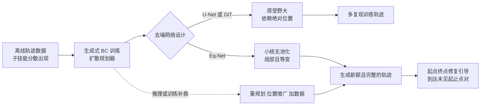

# What Do You Need for Compositional Generalization in Diffusion Planning?（arXiv:2505.18083）

**论文：** Quentin Clark、Florian Shkurti（多伦多大学），[arXiv:2505.18083](https://arxiv.org/abs/2505.18083)（本页依据 v3，2026-02-09；v1/v2 题为 *Diverse Trajectory Stitching / Composition*）。入选 Glen Berseth 的 [CoRL 2026 阅读清单](https://www.fracturedplane.com/blog/2026/11/10/CoRL2026-Reading-List.html)（P1，规划与组合泛化组）。

## 一句话定义

**论文把扩散规划器（用生成式行为克隆训练）能否把训练中分开出现的子轨迹拼成新轨迹，归因于局部感受野、平移等变性和推理选择，并给出一个只靠这两点设计的小型卷积去噪网络 Eq-Net（作者自述）。**

## 英文缩写速查

| 缩写 | 英文全称 | 简要说明 |
|------|----------|----------|
| BC | Behavioural Cloning | 行为克隆，监督式模仿学习 |
| TD | Temporal Difference | 时序差分学习，离线 RL 中被视为擅长拼接的机制 |
| DiT | Diffusion Transformer | 以 Transformer 为去噪骨干的扩散模型 |
| U-Net | U-shaped Network | Diffuser 默认的带下采样 1D 卷积骨干 |
| Eq-Net | Equivariant Network | 本文提出的无池化小核残差 1D 卷积去噪网络 |
| KER | Kernel Expansion Rate | Eq-Net 中核每隔多少层增大 2 |
| PosEnc | Positional Encoding | 位置编码，用来构造「局部但不等变」的对照 |
| GC | Goal-Conditioned | 目标条件，本文用修复（inpainting）实现 |
| SDE | Stochastic Differential Equation | 扩散的连续 / 离散随机微分方程形式 |

## 为什么重要

- 作者要回答的缺口：图像扩散模型会组合，规划器却常常复现训练轨迹；在机器人数据普遍很小的条件下，不能只靠扩数据（Sec. I, III-C）。
- 对做长时域规划的人，它给出一条可检查的清单：感受野多大、是否依赖绝对位置、是否频繁重规划（Sec. III-C）。
- 它把 Diffusion Policy、CompDiffuser、Diffusion Forcing 等为什么能或不能组合放进同一个解释框架（Sec. V-A，附录 VI-I），不过这是作者的事后解释，不是预先验证过的预测。

## 核心原理与流程总览

论文核心主张（作者自述，Sec. I, III-B）：两个性质，加上推理方式，决定组合是否发生。

- **局部感受野（Def. 1）：** 某一步的去噪预测只依赖其邻域。多步去噪后信息仍可传遍整条轨迹（附录 Fig. 12）。
- **平移等变性（Def. 2）：** 去噪预测不依赖状态在序列里的绝对位置，同一个「抓取」子技能出现在轨迹开头或末尾都被同样处理。
- **三类干预（Fig. 3）：** 重规划（推理）、位置增广（训练，随机左移并用末状态补齐）、架构修改（Eq-Net）。
- **Eq-Net（Sec. III-C，附录 VI-E）：** 残差 1D 卷积，步长 1、无池化、无下采样；核从 3 起每 KER 层增大 2（导航 KER=10、深度 15、通道 256；操作 KER=5、深度 25、通道 128，Table II）。

## 工程实践

- **实验环境（Sec. III-D, Table V）：** Maze（点机器人，Numpy，主实验用 11×11，局部实验用 5×5）、Didactic（真机 Franka，3 条训练轨迹）、Block-Stack 与 Well-Plate Sim（RoboSuite）、Well-Plate Real（真机 Franka）、Lights（改自 OGBench puzzle-4x6-play）。其余环境数据集 50 至 1000 条轨迹。
- **基线实现：** U-Net、DiT、Diffusion Policy 用 CleanDiffuser；CompDiffuser 用作者自己的实现（附录 VI-C1）。规划器预测状态，再用逆动力学恢复动作（附录 VI-B）。
- **新颖度与完整度度量（Sec. III-E）：** 为每个环境手工定义原语（例如 Maze 的路口集合），轨迹原语集是某条训练轨迹的子集即判为「记忆」，数量不足训练轨迹则为「部分完成」。度量依赖手工原语，换环境需重新定义。
- **局部性度量（Sec. IV-D）：** 对中心状态求去噪梯度，取包含 50% 梯度幅值的窗口，沿去噪步积分。
- **关键数字：**
  - Maze-GC（Table I）：完成率 U-Net 0、U-Net/Aug 0.44±0.0、Eq-Net/PosEnc 13.39±5.0、Eq-Net 83.8±6.4（%）；唯一路径数 116.8±4.8。
  - Didactic（真机）：Eq-Net 77%，U-Net 与 DiT 均为 0。
  - KER（Table VI，1000 次生成）：KER=10 完成率 0.995、新颖率 0.802；KER=16 新颖率升到 0.9701、完成率降到 0.965。
  - 数据规模阈值（附录 VI-C3）：Eq-Net 约 10^1.75 条、DiT 约 10^2.75、U-Net 约 10^3.75 训练样本开始泛化，并且在阈值附近完成率先降后升。
  - 参数量与算力：Eq-Net 48.9 至 61.1 MB 对 U-Net 120 MB 与 DiT 74.2 MB（Table II）；全部实验约 168 GPU 天（附录 VI-C4）。
- **复现状态：** 论文未给代码 / 项目页链接，本页不列 `code:`。

## 评测证据与清单说法的对比核对

清单一句话摘要（作者说由 LLM 据摘要起草）：*Shift equivariance and local receptive fields explain when diffusion planners trained by BC stitch and compose sub-trajectories.*

| 清单用词 | 论文实际（v3） | 判断 |
|----------|----------------|------|
| shift equivariance + local receptive fields | 摘要与 Sec. I 明确写这两项，且 v1 用 positional equivariance / local receptiveness，是同一对概念 | 对得上 |
| 「explain when ... stitch」 | 论文列出三个关键因素：这两项加上推理选择（摘要「three properties」，Sec. I 称这两项「不是唯一因素」） | 清单漏了第三项；解释是实验观察加事后归因，不是定理（Sec. V-A） |
| trained by BC | 限定为「生成式 BC」训练的扩散规划器，且重点是整段生成（HA=HF=T），不含 TD / 动态规划（Sec. II） | 对得上 |
| stitch and compose sub-trajectories | 衡量对象是手工原语定义的「新颖且完整」轨迹，环境被刻意设计成需要拼接 | 对得上，但结论的适用范围是这些受控环境 |
| （清单未提）Eq-Net、真机、数据规模 | 论文还提出 Eq-Net，含两个真机 Franka 任务（Didactic、Well-Plate Real），并发现数据足够时 U-Net / DiT 也会组合 | 清单只说「解释」，没说它同时给出了架构与「数据足够就能组合」的反面结果 |
| 论文自身数字 | 正文写 Maze 引导任务「83.3% 完成率，约 7.5 倍」，Table I 为 83.8±6.4 与 13.39±5.0，比值约 6.3 倍 | 论文内部不一致（v1 写同样的 83.3 与 7.5 倍），本页采用表中数 |

另外：清单标题为 v3 题名；v1/v2 题名是 *Diverse Trajectory Stitching / Composition*。

## 结论

该研究把局部感受野、平移等变性和推理选择连接到扩散规划的组合泛化，证据限于受控拼接环境。

- 评测时同时检查新颖性和任务完整性，不能把新颖轨迹比例直接当成功泛化。
- 把架构、数据覆盖率及引导方式分开控制，再判断 Eq-Net 的局部与等变偏置是否有帮助。
- 迁移到多任务或多本体数据前另做验证，两个 Franka 任务不足以证明通用架构优势。

## 局限

**论文自述（Sec. V-B，附录 VI-E2）：**
- 环境都是专门设计成需要拼接的，没有在多任务或多本体机器人大数据集上验证。
- 引导只用了修复（inpainting），目标抽象（语言）或多模态时不适用；classifier / classifier-free 引导留作未来工作。
- Eq-Net 只是概念验证，不是有竞争力的通用架构；论文称其训练和推理效率约为 U-Net 的一半（此为 v1 附录 A.4.2 的说法，v3 附录未保留该句）。

**本页读到的未验证之处（读者判断）：**
- 因果结论依赖设计的对照模型（如用位置编码构造「局部但不等变」，用增广近似「等变但不局部」），增广只是近似等变，所以「局部性比等变性更重要」的排序并不干净。
- 度量靠手工原语，不同环境不可比；结果多为单一环境上的 5 次采样误差棒，未见跨随机种子训练的重复（推测：训练只跑一次）。
- 真机任务只有 Didactic（3 条训练轨迹、单一可行解）与 Well-Plate Real；Fig. 2、5 中真机的具体数值本页没能从文本读出。
- 数据规模结论（Sec. IV-D）来自单一 Maze 数据集；Fig. 8 说明 creativity 会随着覆盖率提高而饱和，较高的新颖率不一定意味着更好的泛化。
- 重规划类基线（Diffusion Policy、CompDiffuser）的超参数沿用原论文但在新环境上由作者自己调，公平性无法独立验证。

## 关联页面

- [扩散模型](../concepts/diffusion-model.md)
- [Diffusion Policy](../methods/diffusion-policy.md)：本文把其「短块 + 频繁重规划」解释为局部性与等变性的另一种实现
- [行为克隆](../methods/behavior-cloning.md)
- [模仿学习](../methods/imitation-learning.md)
- [在线 RL 与离线 RL 对比](../comparisons/online-vs-offline-rl.md)：拼接常被视为 TD 学习的优势
- [Diffusion Forcing](../entities/paper-sa-2407-01392-diffusion-forcing-next-token-prediction-meets-fu.md)：本文附录 VI-I 讨论其短记忆组合

## 参考来源

- [来源归档：论文通读记录](../../sources/papers/compositional-generalization-diffusion-planning_arxiv_2505_18083.md)
- [arXiv:2505.18083](https://arxiv.org/abs/2505.18083)
- [Glen Berseth：My CoRL 2026 Reading List](https://www.fracturedplane.com/blog/2026/11/10/CoRL2026-Reading-List.html)（清单条目来源，仅用于核对摘要）

## 继续阅读

- [arXiv PDF（v3）](https://arxiv.org/pdf/2505.18083v3)
- [Diffusion Policy 方法页](../methods/diffusion-policy.md)
- [扩散模型概念页](../concepts/diffusion-model.md)
