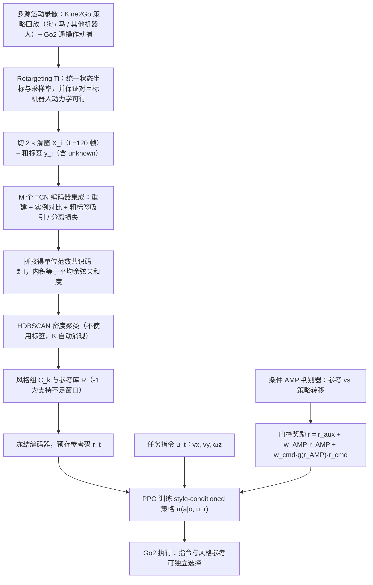

# Compositional Motion Styles（arXiv:2610.24008）

**Compositional Motion Styles**（*Weakly Supervised Discovery of Motion Styles for Compositional Robot Control*，[arXiv:2610.24008](https://arxiv.org/abs/2610.24008)，[项目页](https://www.proroklab.org/compositional-motion-styles/)）来自 [具身智能小站 2026-11-01 盘点](../../sources/blogs/wechat_embodied_station_56_papers_libero_dynamic_latency_eval_2026-11-01.md)，属「人形与腿足控制」组。

## 一句话定义

**CODES从运动记录中发现风格，再让控制器组合风格与独立速度指令；跨仿真器和四足真机展示迁移，风格保真与指令跟踪之间仍存在取舍。**

## 英文缩写速查

| 缩写 | 英文全称 | 简要说明 |
|------|----------|----------|
| Compositional Motion Styles | Weakly Supervised Discovery of Motion Styles for Compositional Robot Control | 本文方法 / 基准的简称 |

## 为什么重要

- 速度指令之外，还能独立选择步态风格。
- 开源结论：**待发布**（步骤 2.5，2026-11-01）。项目页 HTTP 200，未列 GitHub，页面含 soon 字样（脚本扫描）。
- 同期同组工作见 [动态评测、技能编译与环境潜变量适配：具身智能小站 11-01 期 56 篇阅读坐标](../overview/embodied-station-2026-11-01-56-papers-technology-map.md)。

## 流程总览

图依据：论文 §III-A–D / Fig.1、式 (13)–(14)

## 核心机制

| 项 | 内容 |
|----|------|
| **arXiv** | [2610.24008](https://arxiv.org/abs/2610.24008) |
| **开源** | **待发布** |
| **要点** | CODES从运动记录中发现风格，再让控制器组合风格与独立速度指令；跨仿真器和四足真机展示迁移，风格保真与指令跟踪之间仍存在取舍。 |
| **文内指标** | 公众号未给具体数字，本页不引用。 |

## 源码运行时序图

**不适用（待发布）** — 项目页 HTTP 200，未列 GitHub，页面含 soon 字样（脚本扫描）。 不编造运行脚本；代码公开后再补。

## 实验与评测

- 公众号未给具体数字，本页不引用。
- **读法：** 本页为索引级摘要，依据公众号转述的官方摘要与仓库信息整理；逐项数字与 baseline 以原文 PDF 为准。

## 与其他工作对比

- 横向索引见 [动态评测、技能编译与环境潜变量适配：具身智能小站 11-01 期 56 篇阅读坐标](../overview/embodied-station-2026-11-01-56-papers-technology-map.md)；同 arXiv 不重复造页。

## 结论

**速度指令之外，还能独立选择步态风格：CODES从运动记录中发现风格，再让控制器组合风格与独立速度指令；跨仿真器和四足真机展示迁移，风格保真与指令跟踪之间仍存在取舍。**

1. 开源边界：**待发布** — 项目页 HTTP 200，未列 GitHub，页面含 soon 字样（脚本扫描）。
2. 核心机制：CODES从运动记录中发现风格，再让控制器组合风格与独立速度指令；跨仿真器和四足真机展示迁移，风格保真与指令跟踪之间仍存在取舍。
3. 复现与选型前核对任务协议、硬件与基准口径，勿直接横比公众号摘录数字。

## 关联页面

- [locomotion](../tasks/locomotion.md)
- [motion-retargeting](../concepts/motion-retargeting.md)
- [sim2real](../concepts/sim2real.md)
- [reinforcement-learning](../methods/reinforcement-learning.md)
- [embodied-station-2026-11-01-56-papers-technology-map](../overview/embodied-station-2026-11-01-56-papers-technology-map.md)

## 参考来源

- [compositional_motion_styles_arxiv_2610_24008.md](../../sources/papers/compositional_motion_styles_arxiv_2610_24008.md)
- [wechat_embodied_station_56_papers_libero_dynamic_latency_eval_2026-11-01.md](../../sources/blogs/wechat_embodied_station_56_papers_libero_dynamic_latency_eval_2026-11-01.md)
- [arXiv:2610.24008](https://arxiv.org/abs/2610.24008)
- [arXiv PDF](https://arxiv.org/pdf/2610.24008)：已通读全文：摘要、§I–§IV（问题设定、retargeting、弱监督表示、共识几何与聚类、条件 AMP 组合控制、Go2 案例设置）；§V 评估结果仅浏览

## 推荐继续阅读

- [arXiv PDF](https://arxiv.org/pdf/2610.24008)
- [项目页](https://www.proroklab.org/compositional-motion-styles/)
