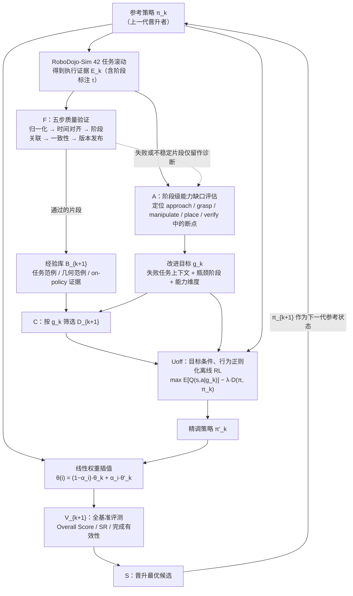

# Compounding Physical RSI（Turning Execution Failure into Inherited Capability）

**Compounding Physical RSI**（[arXiv:2611.06654](https://arxiv.org/abs/2611.06654)，v1，2026-11-04，cs.RO；技术报告，署名 CSU MinosLab，题头标注「ECCV 2026 RoboDojo Safe World Models Challenge | Champion | CSU-AI-07」）把「物理递归自我改进」落成一个三段式循环：先把失败定位到任务阶段，再用离线 RL 修补，最后在权重空间做候选插值并用全量基准评测选出下一代。本页依据 v1 PDF 全文（10 页，含参考文献）通读整理；v1 即截至 2026-11-06 的最新版本。

## 一句话定义

**Compounding Physical RSI 是一个「诊断阶段级能力缺口 → 目标条件离线 RL 修补 → 参考/精调权重线性插值并经全基准评测晋升」的代际自演化框架；其产出策略 CSU-AI-07 在 RoboDojo-Sim 42 任务上报告 Overall Score 26.15、Success Rate 20.70%（三 seed 均值）。**

## 英文缩写速查

| 缩写 | 英文全称 | 简要说明 |
|------|----------|----------|
| RSI | Recursive Self-Improvement | 递归自我改进：执行、诊断自身失败、更新自身的循环 |
| VLA | Vision-Language-Action | 视觉–语言–动作模型 |
| RL | Reinforcement Learning | 强化学习 |
| Uoff | offline policy refinement operator | 论文式 (1) 中的离线策略精调算子 |
| SR | Success Rate | 全任务二值完成率 |
| Overall Score | Overall Score | RoboDojo 中连续的阶段级任务进度得分（论文 §6.1 的描述） |
| Episode | Episode schema | 论文 §4.1 的统一、含来源与阶段边界的轨迹单元 |
| TIES | TIES-Merging | 论文 §5.1 引用的干扰感知权重合并方法 |
| CSU-AI-07 | 参赛编号 / 策略名 | 论文中最终策略的名字，同时是挑战赛参赛编号 |

## 为什么重要

- **把 RSI 讲成「复利」问题。** 论文的论点（§1，作者表述）：操作任务是阶段串联，整体成功率像各阶段通过率的乘积，所以一次修复既抬高后续阶段，又让更多 rollout 越过当前「能力前沿」、暴露下一个隐藏失败模式；反过来跨任务回退也会相乘。因此重点是各代之间能否「复利」，而不是单次更新。
- **三个瓶颈对应三段式设计。** 终端反馈不能定位失败阶段（→ 诊断）、失败轨迹不提供纠正动作（→ 修补）、共享权重更新会损伤旧技能（→ 保留）。
- **落点很具体：** 离线 RL + 权重插值 + 全基准择优，而不是改 harness 或写代码——与库内 [Physical RSI 1.0](./physical-rsi.md)（System 2 agent 改写 System 1 代码 harness）是两条不同路线，见下文「在 RSI 谱系中的位置」。
- **证据口径要克制：** 论文只给出终点成绩，不含逐代曲线、消融或真机，「复利」是被论证和命名的，并未被单独实验证实（见局限）。

## 在 RSI 谱系中的位置

本库已有 RSI 综述 / 索引页与若干 RSI 节点，本文与它们的关系如下（均已核对，无重复节点）：

| 库内页面 | 性质 | 与本文关系 |
|----------|------|------------|
| [Physical RSI Research Map](./physical-rsi-research-map.md) | SAIL 的 Physical RSI 文献地图（配套论文 arXiv:2610.18842，库内未单独建论文节点） | 本文 §2.1 引用 [16]=该论文（「Who Improves the Robot? Toward Physical Recursive Self-Improvement」）作为 Physical RSI 的定义来源，本文是其框架下的一个具体实例；按其 L0–L5 读法，本文的改进算子 A、C、Uoff 固定（论文 §7 自述），更新对象是策略权重，属于「继承执行系统更新」一类，推测约在 L1–L3，**不是**程序级的元改进 |
| [Physical RSI 1.0（HKU MMLab×Kinetix）](./physical-rsi.md) | 项目页型节点，Darwinian Self-Harness，改写代码 harness | 同在 RoboDojo-Sim 上竞榜，路线不同：它改 harness 代码，本文改 VLA 权重。**数字出入见「核对与出入」** |
| [Awesome RSI](./awesome-rsi.md) | RSI 精选列表 | 索引页；本文可作为其「具身 / 机器人」方向的条目 |
| [RoboDoctor-RSI](./robodoctor-rsi.md) | 训练免费、冻结低层策略、诊断后选择控制模式 | 同为「诊断 + 复用验证经验」，但 RoboDoctor 不更新权重；本文更新权重并做保留 |
| [The Last AI Built by Humans](./paper-last-ai-built-by-humans-rsi.md) | 五级自治框架与 HCI 的概念论文 | 本文 [15] 引用它作为「现代 RSI」来源；按其框架，本文属于执行改进而非元改进 |
| [RSI Survey 2607.07663](./paper-rsi-survey-2607-07663.md) | 1,250 篇自改进文献 survey | 综述，非同篇 |
| [RSI-Anything](./paper-rsi-anything.md) / [MetaRSI-v1](./paper-metarsi-v1.md) / [Dream-RSI](./paper-dream-rsi.md) | 其他 RSI 论文节点 | 均为不同 arXiv 编号与方法，非同篇 |
| [RSI 四层五推动](../queries/rsi-four-tier-five-pushes.md) | 查询页 | 阅读路线参考 |
| [EmbodiRSI 待办归档](../../sources/papers/embodirsi_instaagent_pending.md) | 本文 [23] 引用的 EmbodiRSI（arXiv:2609.38905），库内仅有未完成草稿，无 wiki 节点 | 不同篇 |

## 核心方法 / 机制

论文用式 (1) 描述第 k 代的转移（§2.2）：

- 执行证据 E_k = {(o_t, s_t, a_t, r_t, τ_t)}：观测、机器人与物体状态、动作、奖励、任务阶段标注 τ。
- g_k = A(E_k)：**能力缺口评估**，输出结构化改进目标。
- B_{k+1} = B_k ∪ F(E_k)：**质量验证** F 过滤新轨迹后并入经验库。
- D_{k+1} = C(B_{k+1}, g_k)：**经验筛选** C 取与目标相关的子集。
- π'_k = Uoff(π_k, D_{k+1}, g_k)：**离线精调**。
- π_{k+1} = S({π_k^(i)}, V_{k+1})：**权重插值候选 + 全基准评测择优**。

### 1. 能力缺口评估（§3）

- **执行证据（§3.1）：** 在 RoboDojo-Sim 的多种任务配置下滚动当前策略，记录带时间索引的轨迹：阶段边界、动作转换、机器人与物体状态变化、终止条件、对环境变化的行为响应。
- **阶段级评估（§3.2）：** 算子 A 把每条 rollout 与任务的预期阶段序列（例如 approach、grasp、manipulate、place、verify）对照，找出执行偏离的位置及伴随条件，归纳出复发的失败模式：目标选错、抓取不稳、操作阶段不完整、动作转换不一致、对场景变化敏感。
- **改进目标 g_k（§3.3）：** 结构化记录「失败任务上下文、瓶颈阶段、受影响的能力维度」，能力维度举例为目标选择 / 抓取稳定 / 阶段转换 / 接触持续；g_k 同时作为后续经验筛选 C 与离线优化 Uoff 的条件。
- **图 2 的两个例子：** (a) 接触桌面物体后任务阶段不推进；(b) 抓起后在搬运中滑脱，且该失败只有在策略学会稳定抬起之后才可观测。
- **论文未说明的部分：** A 具体是规则程序、学习模型还是 LLM / VLM 判定、阶段标注 τ 是仿真器直接给出还是另行推断、改进目标 g_k 的编码形式（文本、one-hot 还是向量），全文均无描述。

### 2. 离线 RL 修补（§4）

- **统一 Episode（§4.1）：** 任务标识、语言指令、时间同步的观测–状态–动作、来源、阶段边界、终止结果标志、质量状态、数据集版本。
- **三类经验（§4.2）：** (i) 任务范例（指令条件的多阶段行为）；(ii) 几何范例（目标条件的空间结构）；(iii) on-policy 执行证据（当前策略实际访问的状态分布，含成功推进、未完成动作和接近前沿的恢复行为）。
- **五步质量验证 F（§4.3）：** 归一化 → 时间对齐 → 阶段关联 → 一致性评估（指令、场景状态、机器人构型、动作序列）→ 版本化发布。失败 / 不稳定 rollout 只留作诊断（给 A），**不**作为动作监督；只有通过验证的片段进入 B_{k+1}。
- **目标驱动的经验选择 C（§4.4）：** 检索与 g_k 共享瓶颈阶段、物体交互模式或状态转换边界的已验证 Episode，优先选在被诊断限制处「成功推进」的轨迹；筛出的 D_{k+1} 与 g_k、π_k 一并版本化，保证每次更新可追溯。
- **目标条件离线 RL（§4.5，式 2）：**

  π'_k = argmax_π E_{s∈D_{k+1}, a∼π(·|s,g_k)} [ Q(s,a | g_k) ] − λ·D(π, π_k)

  g_k 以通用价值函数（UVFA）方式充当目标；D 衡量与参考策略 π_k 的散度，λ>0 控制锚定强度；论文称该形式沿用行为正则化 / 保守离线 RL（引用 BRAC、CQL、IQL）以抑制分布外价值外推，锚定项的第二个作用是限制目标之外状态和任务上的参数漂移。
- **论文未说明的部分：** Q 的网络结构与训练方式、D 取 KL 还是 MSE 还是别的、λ 取值、使用 BRAC / CQL / IQL 中的哪一种或其变体、策略骨干与动作头、数据量、梯度步数、各类经验的混合比例、用什么奖励 r_t。这意味着**式 (2) 只是目标函数的通式，不是可复现的算法规格**。

### 3. 权重空间候选筛选（§5）

- **参考状态初始化（§5.1）：** 维护一个可完整评测的共享参考策略 π_k；兼容的检查点（要求模型架构、参数表示、执行接口一致）通过 model soup 权重平均与干扰感知合并（TIES）组成参数空间基底，为离线学习提供连贯初始化。
- **候选构造（§5.2，式 3）：** θ_k^(i) = (1 − α_i)·θ_k + α_i·θ'_k，α_i ∈ [0,1]；理由是 θ_k 与 θ'_k 同源，线性模式连通性保证插值后功能连贯；插值直接作用于权重，每个候选仍是单一独立策略，无额外推理开销。完全采用 θ'_k 有跨任务回退风险，完全拒绝 θ'_k 则丢掉新能力，插值路径给出二者之间的 Pareto 前沿。
- **评测引导晋升（§5.3）：** 每个候选在标准化 RoboDojo-Sim 协议 V_{k+1} 下评测，指标为 Overall Score、Success Rate 与任务完成有效性（task-completion validity），权衡目标任务上的增益与其他任务的损失；S 选出最优者作为 π_{k+1}，其余候选丢弃。模型身份、参考谱系、经验版本、评测日志一并归档。
- **论文未说明的部分：** α 的网格或搜索策略、候选数量、「最优」的具体判据（Overall 与 SR 如何加权）、总共跑了几代、每代用时与算力。§6.2 仅称 **Seed 0 用于迭代中的候选选择**，Seed 1、2 为留出评测。

## 流程总览

图依据：论文 Fig.1 与式 (1)–(3)（§2.2、§3–§5）。虚线为论文 §4.3 的描述：不合格轨迹留给诊断 A。

## 实验与评测

论文**只有一个实验设置**：RoboDojo-Sim 全部 42 个任务（五个能力维：泛化、记忆、长时程、精度、开放任务指定，§6.1），固定晋升后的检查点与基准配置，报告三个独立评测 seed 的算术平均（§6.2）。

**表 1：CSU-AI-07 三 seed 结果（论文 Table 1）**

| Evaluation | Overall Score | Success Rate (%) |
|------------|---------------|------------------|
| Seed 0（用于迭代中的候选选择） | 26.53 | 21.05 |
| Seed 1 | 25.46 | 20.31 |
| Seed 2 | 26.45 | 20.75 |
| 三 seed 均值 | 26.15 | 20.70 |

seed 间跨度为 1.07 分和 0.74 个百分点（§6.2）；论文据此称留出 seed 与 Seed 0 接近。

**表 2：RoboDojo-Sim 总榜（论文 Table 2，Overall Score / SR %）**

| 策略 | Overall | SR |
|------|---------|-----|
| CSU-AI-07 | 26.15 | 20.70 |
| GalaxeaVLA (G0.5) | 20.23 | 14.88 |
| Xiaomi-Robotics-1 | 20.07 | 13.93 |
| Hy-Embodied-0.5-VLA | 13.07 | 8.80 |
| SimpleMemVLA | 12.58 | 9.27 |
| Spatial Forcing | 12.38 | 8.04 |
| π0.5 | 11.44 | 6.93 |
| InternVLA-A1.5 | 11.15 | 7.14 |
| VLAct | 10.65 | 7.58 |
| X-VLA | 10.13 | 6.52 |
| X-WAM | 7.69 | 3.83 |
| StarVLA | 6.40 | 3.24 |
| π0 | 3.48 | 1.53 |
| GR00T-N1.7 | 2.85 | 1.31 |

- 对次优者（G0.5）的优势：Overall +5.92（相对 29.3%）、SR +5.82 个百分点（相对 39.1%）（§6.3）；对 π0.5 的 SR 约为其近三倍（20.70 vs 6.93，§6.3）。我复算：均值、差值与相对增幅与表内数字一致。
- 论文称 13 个公开基线中最高 SR 为 14.88%（§6.1），20.70% 仍留有大量余地（§6.3）。
- **论文没有的东西：** 没有逐代曲线（每代 Overall / SR 如何增长）、没有诊断 / 经验筛选 / 权重插值任何一环的消融、没有各任务或各能力维的分项成绩、没有基础策略（起点）自身的分数、没有真机实验。§7 自述「细粒度消融尚待补充」。

## 结论

**这是一份冠军方案技术报告：它给出清晰的三段式框架与一个仿真基准上的第一名成绩，但「复利」机制本身尚无实验证据，算法细节也不足以复现。**

- 可信的部分：RoboDojo-Sim 上三 seed 均值 26.15 / 20.70%，并列表 2 中 13 个公开基线之首（数字自洽）。
- 可借鉴的设计：以阶段为粒度的失败定位 + 目标条件的经验筛选 + 「参考–精调」线性插值后用全量基准评测择优，核心是把「不要遗忘」交给评测而非正则项。
- 不能下的结论：不能说哪一环贡献了多少；不能说多代之间确实复利；不能说可迁移到真机。
- 读法：Seed 0 既用于候选选择又计入三 seed 均值，Seed 1、2 虽为留出评测，但任务集和基准配置与选择时相同，故更接近「同基准的重复评测」而非泛化检验（我的判断）。
- 复现门槛高：论文未给代码、项目页、权重与关键超参，跟进者需自行补全 Q 函数、散度项、α 网格等。

## 局限

**原文自述（§7）：**

1. 当前只有集成系统在 42 任务上的整体结果，诊断、经验筛选、权重整合各自贡献的消融尚缺。
2. 改进算子（A、C、Uoff）固定，演化的是策略能力而非改进程序本身；把 RSI 扩展到改进程序自身是 Physical RSI 的更高门槛。
3. 从物理仿真走向真实硬件「将是下一步」，因为每次试验成本更高。

**我的核对（论文全文逐页读完）：**

- **不支持真机：** 全文只在 RoboDojo-Sim 评测；摘要与正文没有任何真机数据或部署描述；§2.1 把 physical 定义为「物理仿真或物理硬件」都算，并非真机验证。RoboDojo 本身有 sim 与 real 两部分（见 [RoboDojo](./robodojo.md)），本文只用 Sim。
- **起点策略未披露：** 全文没有说明基础 VLA 或初始检查点是什么（既未说用了 π0.5、G0.5 还是自训模型），也没有基础策略的得分，因而「提升量」不可知。
- **晋升用 Seed 0：** 候选选择用了与最终成绩同一基准的评测，存在对基准的选择性适应风险；论文以 Seed 1、2 与 Seed 0 接近作为反证，但没有做真正独立任务集上的检验。
- **「复利」未被直接证明：** 没有逐代数字，也没有对照「无保留阶段 / 无诊断」的变体，无法区分是复利、还是单次精调 + 插值的收益。
- **挑战赛语境：** 题头为 ECCV 2026 RoboDojo Safe World Models Challenge 冠军；此处「第一」基于论文表 2 的 13 个公开基线，不含其他挑战参赛者或其他榜单条目（见下一节）。

## 核对与出入

- **与草稿登记（v1 摘要口径）：** 草稿只写「摘要提出能力缺口评估、离线强化学习修补和权重空间候选筛选；是否支持真机部署需核对全文」。全文核对结论：**不支持真机**，仅仿真；并且摘要里的三环节在全文里只有式 (1)–(3) 级别的描述，没有可复现超参。版本号仍为 v1（arXiv 摘要页仅列 [v1]）。
- **与库内 [Physical RSI 1.0](./physical-rsi.md) 的数字出入：** 该页记录项目页口径「RoboDojo-Sim Overall #1（2026-09-28：Score 36、SR 31%）」，而本文表 2 的最高值为 26.15 / 20.70%，且表中无 HKU MMLab 的 Physical RSI 1.0。可能原因（均为推测）：评测日期 / 赛道 / 协议不同，或该榜条目不满足本文所称的「公开基线」口径。我尝试访问 RoboDojo 榜单页，页面为前端渲染，抓取不到榜单内容，**无法核实**当前榜单上是否存在 CSU-AI-07 及其排名；两页数字请分别按各自出处引用，不要合并比较。
- **作者署名：** 论文题头只写 CSU MinosLab；作者上标 1–6 在页面上定义为贡献角色（核心算法、主要贡献者、资源贡献者、项目负责人、执行负责人、技术负责人），不是机构编号。CSU 的全称论文未展开（推测为某高校缩写，未核实）；通讯作者为 Xiu Su。
- **数据集计数：** 本文称 RoboDojo-Sim 42 任务，与 [RoboDojo](./robodojo.md) 页一致；[RoboDoctor-RSI](./robodoctor-rsi.md) 页提到的 54 任务是另一设置，不要混用。

## 源码运行时序图

**不适用。** 论文全文无项目页、GitHub 链接、权重或数据发布声明（PDF 中检索 github / http / code / released 仅出现参考文献与 GR00T 仓库引用）；arXiv 摘要页无评论字段与外链。无可阅读的官方实现，无法绘制基于源码的时序图。上方「流程总览」依据论文方法图与式 (1)–(3)，不是代码调用链。

## 与相关工作对比

| 工作 | 改什么 | 如何防回退 | 验证场景 | 与本文关系 |
|------|--------|------------|----------|------------|
| 本文 | 策略权重（离线 RL） | 锚定项 + 线性插值 + 全基准晋升 | RoboDojo-Sim 仿真 | — |
| [Physical RSI 1.0](./physical-rsi.md) | 代码 harness（System 2 改写 System 1） | 评测选择 / 继承 | RoboDojo-Sim（项目页口径） | 同基准、不同对象；数字见上节 |
| [RoboDoctor-RSI](./robodoctor-rsi.md) | 不改权重，选控制模式并复用验证经验 | 冻结策略 | RoboDojo | 同为诊断驱动，但无权重更新 |
| [RSI-Anything](./paper-rsi-anything.md) | 预测式世界模型 + 可验证改进环 | 真实评估反馈 | 见该页 | 方法路径不同 |
| [Dream-RSI](./paper-dream-rsi.md) / [MetaRSI-v1](./paper-metarsi-v1.md) | 探索策略 / 多算子元调度 | 见各页 | 非本文基准 | 概念层相邻 |
| [DAgger](../methods/dagger.md) / [Behavior Cloning](../methods/behavior-cloning.md) | 用专家回标缓解分布偏移 | — | — | 本文 §4.2 引用 DAgger 论文作为「近分布数据」的依据，但不依赖专家回标，改用已验证片段 |
| [π0.5](./paper-pi05-open-world-vla.md) / [G0.5](./paper-galaxea-g05.md) / [Xiaomi-Robotics-1](./xiaomi-robotics-1.md) | 静态预训练的通用 VLA | — | 表 2 基线 | 本文的对照对象；基线是静态训练，本文还多一轮针对该基准的迭代，对比并非同等训练口径（我的判断） |

## 关联页面

- [Recursive Self-Improvement（概念）](../concepts/recursive-self-improvement.md)
- [Physical RSI 1.0](./physical-rsi.md) · [Physical RSI Research Map](./physical-rsi-research-map.md) · [Awesome RSI](./awesome-rsi.md)
- [RoboDojo](./robodojo.md) · [XPolicyLab](./xpolicylab.md) · [具身评测基准总览](../overview/hub-embodied-eval-benchmark.md)
- [RoboDoctor-RSI](./robodoctor-rsi.md) · [RSI 四层五推动](../queries/rsi-four-tier-five-pushes.md)
- [VLA](../methods/vla.md) · [Manipulation](../tasks/manipulation.md)
- 表 2 基线：[G0.5](./paper-galaxea-g05.md) · [Xiaomi-Robotics-1](./xiaomi-robotics-1.md) · [π0.5](./paper-pi05-open-world-vla.md) · [π0](./paper-pi0.md) · [SimpleMemVLA](./paper-simplememvla.md) · [InternVLA-A1.5](./paper-internvla-a15-unified-vla.md) · [X-VLA](./paper-x-vla.md)

## 参考来源

- [compounding-physical-rsi_arxiv_2611.06654 来源归档](../../sources/papers/compounding-physical-rsi_arxiv_2611_06654.md)
- [arXiv:2611.06654](https://arxiv.org/abs/2611.06654)（v1，2026-11-04）
- [arXiv PDF](https://arxiv.org/pdf/2611.06654)：已逐页通读 §1–§8 与参考文献（共 10 页，无附录）

## 推荐继续阅读

- RoboDojo：[arXiv:2607.04434](https://arxiv.org/abs/2607.04434)（论文 [34]，基准与评分口径）；XPolicyLab：[arXiv:2608.09892](https://arxiv.org/abs/2608.09892)（论文 [35]）
- Physical RSI 定义来源：[arXiv:2610.18842](https://arxiv.org/abs/2610.18842)（论文 [16]）与 [arXiv:2610.29677](https://arxiv.org/abs/2610.29677)（论文 [17]）
- 方法依据：Wu 等 Behavior Regularized Offline RL（[arXiv:1911.11361](https://arxiv.org/abs/1911.11361)）、Model Soups（Wortsman 等，ICML 2022）、TIES-Merging（Yadav 等，NeurIPS 2023）
