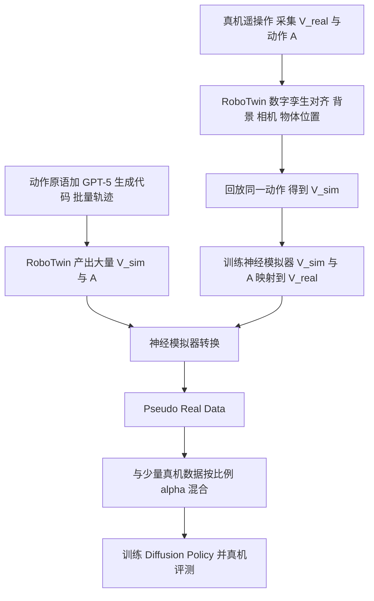

# ComSim：Compositional Simulation（arXiv:2604.11386）

## 一句话定义

**ComSim 把经典模拟器（RoboTwin）产出的、动作精确的仿真视频，经一个用少量真机数据微调的神经模拟器转成「真实风格」视频，得到与动作严格对齐的 Pseudo Real Data，再与少量真机数据混合训练 Diffusion Policy（§3.1–3.5）。**

## 英文缩写速查

| 缩写 | 英文全称 | 简要说明 |
|------|----------|----------|
| ComSim | Compositional Simulation | 本文方法名，经典模拟加神经模拟的组合 |
| DP | Diffusion Policy | 评测用的 CNN 版扩散策略（附录 8.2） |
| DiT | Diffusion Transformer | 论文正文描述的神经模拟器骨干（附录实现见下） |
| FRESCO | Spatial-Temporal Correspondence for Zero-Shot Video Translation | 推理时保持帧间一致的在线策略（附录 8.1） |
| SD1.5 | Stable Diffusion 1.5 | 附录 8.1 中被微调的底座 |
| CD / VD | Control Dynamics / Visual Dynamics | 动作条件 / 仿真观测条件（§3.3） |
| OOD | Out-of-Distribution | 物体初始位置或物体本身不在真机演示范围内 |
| FID / FVD / LPIPS | Fréchet Inception / Video Distance, Learned Perceptual Image Patch Similarity | 表 1 视频质量指标 |

## 为什么重要

- 真机演示贵且覆盖窄；经典模拟器能批量给出动作精确的数据，但外观与物理有 sim2real 差距，直接混训收益有限（§1、§3.1）。
- 本文给出一条折中路线：动作与轨迹由模拟器保证，外观由神经模拟器补，用 20 条真机演示即可训练转换器（§3.3、附录 8.2）。
- 作者自述的结果：10 条真机加 200 条伪真实数据显著高于 20 条纯真机，并在空间与物体 OOD 上有提升（§4.2–4.3）。

## 核心原理与流程总览

- **Real2Sim 对齐（§3.2、附录 10）：** 背景与物体颜色用取色器提取，规则物体用卡尺量尺寸，特殊物体（Fanta 等瓶子、扑克牌）直接对应 RoboTwin 预建资产；相机外参用棋盘格加 PnP 求解；物体位置落在 5 cm 网格节点上，朝向取固定角度目录。作者声明刻意用规则式对齐而非学习式，避免误差传入神经模拟器训练（附录 10）。
- **神经模拟器（§3.3、附录 8.1）：** 正文称 DiT 同时受 Control Dynamics（动作）与 Visual Dynamics（仿真观测）条件，在采样时组合两路分数（图 2 右）。附录给出的实现是 Stable Diffusion 1.5 微调加 FRESCO 推理，固定一条风格转换文本指令。
- **大规模生成（§3.4）：** 在 RoboTwin 中定义动作原语（抓、推、对齐、叠放等），由 GPT-5 合成可执行代码并施加组合约束，覆盖不同物体与初始化。
- **联合训练（算法 1）：** D_combined = α·D_real + (1−α)·P_pseudo，其中 α 为超参数，论文未给出具体取值。

## 工程实践

- **硬件（附录 9.1）：** 两台 ORBBEC PiPER 6 自由度机械臂加 PiPER 示教器遥操作；单个顶置 ORBBEC DaBaiDC1 RGB-D 相机；RTX 4090 工作站做推理与控制。
- **神经模拟器训练（附录 8.1）：** 视频抽成 10 FPS 图像序列，随机 1/5 做验证，30 epoch，batch 8，梯度累积 4，AdamW 学习率 5e-5，单卡 H200 约 10 小时。
- **策略训练（附录 8.2）：** CNN 版 Diffusion Policy，预测步长 8、观测 3 步、动作 6 步，batch 256，300 epoch，单卡 H200 约 20 小时（约 200 条、平均长度约 300 的数据）。
- **数据配比（附录 8.2）：** 每任务真机只录 20 条且限于分布内；10 Real 是其中随机抽 10 条；仿真与伪真实各 200 条且故意包含 OOD 位置与物体。
- **评测（附录 9.2）：** 每个维度固定 30 次真机试验，所有策略共用同一套试验。
- **开源状态：** 截至 2026-11-12，论文与项目页（faceong.github.io/ComSim）均未给出代码或数据链接，页面因此不写 `code:`。

## 评测证据与清单说法的对比核对

清单（Glen Berseth 的 CoRL 2026 阅读清单，条目 099/101，P2，由 LLM 据摘要起草）一句话：「Combines classical and neural simulation in a real-sim-real loop to generate large, real-consistent action-video datasets.」

| 清单措辞 | 论文核对 |
|----------|----------|
| classical and neural simulation | 属实，摘要与 §1 即此定位。但附录 8.1 的实现是 SD1.5 加 FRESCO 的图像到图像风格迁移，并非学习物理动力学的世界模型；正文 §3.3 说 DiT 与附录实现不一致，页面作者无法从文本判断最终实验用的是哪个。 |
| real-sim-real loop | 流程是单向的三段（真机采集 → 仿真回放 → 神经转换 → 真机部署），摘要称 closed-loop，但文中没有用策略结果反馈到数据生成的迭代，「loop」更像对齐闭环（我的判断）。 |
| large | 策略实验中每任务 200 条伪真实演示（附录 8.2），神经模拟器训练仅 200 对（§3.3）；规模是「数百条」而非大规模，论文也未展示随规模增长的曲线。 |
| real-consistent | 以表 1（视频指标）与表 2–3（真机成功率）为证据，属实但有限。表 1 里 Sim 的 FID（187.40）优于 Baseline（254.59）；动作一致性由「保留仿真动作」构造得到，论文没有单独的动作保真度定量指标。 |
| action-video datasets | 属实，数据为 (V_real 风格视频, A) 对，动作直接来自模拟器。 |
| 缺失的限定 | 清单未提：只测桌面操作、只测 Diffusion Policy 一种策略、真机试验每格 30 次、需要先做人工 Real2Sim 对齐（卡尺、取色、棋盘格标定）。 |

## 结论

ComSim 的收益来自几何对齐的仿真轨迹与真实风格视频配对，不能把神经外观转换当成已验证的物理世界模型。

- 复现前先解决正文与附录的模型实现差异，明确使用的风格迁移管线。
- 把人工场景对齐成本和伪真实数据生成成本分别记录，检验换场景是否仍划算。
- 同时对照纯真机、纯伪真实和混合数据，并核验动作一致性，避免仅以视频质量指标推断控制收益。

## 局限

**作者自述（第 5 章后、附录 10.3）：** 实验仅限桌面操作，扩展到移动操作留待未来；未来拟用非配对数据；物体位置对齐是「naive」的网格离散方案，位置误差低于 1 cm、角度误差低于 1 度，连续 6-DoF 对齐留待未来。

**页面作者看到的未验证之处（判断）：**

- 只用一种策略（CNN 版 Diffusion Policy）、一套硬件、一个相机视角，没有跨策略或跨本体验证。
- 对齐流程依赖人工（取色、卡尺、棋盘格、网格摆放），「scalable」主要指数据生成端，换场景的人工成本论文没有量化。
- 正文 DiT 与附录 SD1.5 加 FRESCO 的描述不一致；§3.3 称 10 个任务共 200 对，而附录 7 称评测选取 5 个 RoboTwin 任务，表 1 列 8 个任务名，图 11 与 12 还出现 Ranking Blocks RGB、Stack Blocks Three、Adjust Bottle，任务清单前后并不完全对得上。
- 表 2 中「200 Pseudo Real (Zero Shot)」被称为 DP 无真机监督的「upper bound」，但其成功率低于混入 10 条真机的设置，该措辞不严谨。
- 没有消融 α 的取值，也没有「同等数量的真机演示」对照（如 210 Real）来区分增益来自数据量还是来自伪真实分布；各格只有 30 次试验且未给方差。
- 无代码与数据链接，复现依赖作者自行搭建 RoboTwin 数字孪生。

## 关联页面

- [RoboTwin 2.0](../entities/robotwin.md)：本文的经典模拟器与动作原语底座
- [Diffusion Policy](../methods/diffusion-policy.md)：评测使用的策略
- [Sim2Real](../concepts/sim2real.md)：问题背景
- [域随机化](../concepts/domain-randomization.md)：另一条缩小 sim2real 差距的路线
- [Sim2Real 路线对比](../comparisons/sim2real-approaches.md)
- [CycleGAN 式 Sim2Real 图像迁移](../methods/cyclegan-sim2real.md)：同类「仿真图像转真实风格」思路
- [生成式世界模型](../methods/generative-world-models.md)
- [RoboDream](../entities/paper-sa-2606-02577-robodream-compositional-world-models-for-scalabl.md)：同为组合式数据合成，但走世界模型路线

## 参考来源

- [comsim_arxiv_2604_11386.md](../../sources/papers/comsim_arxiv_2604_11386.md)
- [arXiv:2604.11386](https://arxiv.org/abs/2604.11386)
- [项目页](https://faceong.github.io/ComSim/)

## 继续阅读

- [arXiv PDF](https://arxiv.org/pdf/2604.11386v1)
- [RoboTwin 2.0](../entities/robotwin.md)
- [Diffusion Policy](../methods/diffusion-policy.md)
