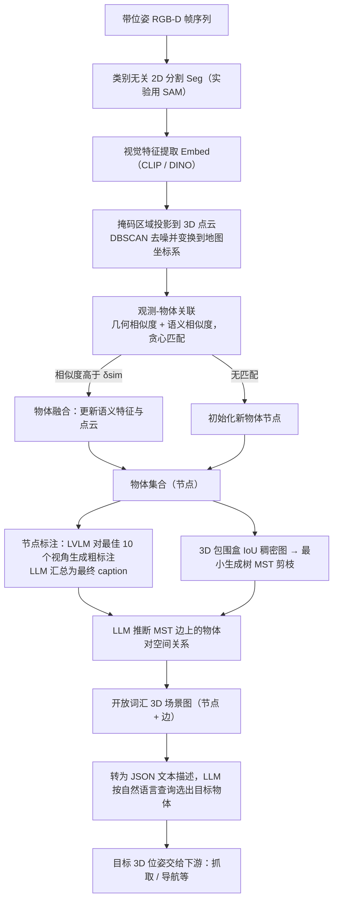

# ConceptGraphs

**ConceptGraphs** 收录于 [具身智能研究室 · 具身世界模型六路线综述](https://mp.weixin.qq.com/s/mmIJRp9g6NqblMCjd9D5GQ) **上下文主导型** 段。本页为知识库 **策展编译** 详情节点；量化指标以原文 PDF / 项目页为准。

## 一句话定义

VLM 语义融入三维对象图，支持开放词汇空间查询。

## 英文缩写速查

| 缩写 | 英文全称 | 简要说明 |
|------|----------|----------|
| WM | World Model | 根据状态与动作预测未来观测/状态 |
| WAM | World Action Model | 联合未来与动作生成的具身策略 |
| MPC | Model Predictive Control | 滚动时域优化选动作 |
| VLA | Vision-Language-Action | 视觉–语言–动作策略 |

## 为什么重要

- 属于六路线 taxonomy 的 **上下文主导型**：预测结果被用于 **持续维护可查询世界状态与记忆（World Proxy）。**
- 与 [六路线技术地图](../overview/embodied-wm-six-routes-technology-map.md) 中同段工作对照阅读，避免与 WAM/评估/记忆类节点混淆。

## 流程总览

图依据：论文 §II-A/B/C、Fig. 2。

## 核心信息

| 项 | 内容 |
|----|------|
| **路线** | 上下文主导型 |
| **出处** | [arXiv:2309.16650](https://arxiv.org/abs/2309.16650) |
| **文内角色** | VLM 语义融入三维对象图，支持开放词汇空间查询。 |

## 结论

**ConceptGraphs 在六路线框架下的读法：先看预测输出被谁消费，再看是否改善真实行动——而非只看网络新旧或画面观感。**

- 归入 **上下文主导型** 的判断标准是 **闭环职责**，不是模型架构标签。
- 与同路线邻接工作对照时，优先比较 **动作条件性、物理一致性与部署接口**。
- 细节数字与开源状态以原文为准；本页服务图谱导航与交叉引用。

## 实验与评测

- **本页无量化数字**：六路线综述只给出该工作在 taxonomy 中的定位，未转述实验表格；成功率、消融与实机协议以 [arXiv:2309.16650](https://arxiv.org/abs/2309.16650) 为准。
- **该路线该看的指标**：长时 / 多阶段任务成功率，以及记忆或场景图规模与检索开销的关系。
- **综述的评价取向**：按文内判断「评价从画质转向行动效用」，读实验时先问预测是否改善了真实执行，再看画面观感（见 [六路线技术地图](../overview/embodied-wm-six-routes-technology-map.md)）。

## 与其他工作对比

- **同路线邻接工作**（综述 **上下文主导型** 段）：[SayPlan](./paper-sayplan-llm-scene-graph-planning.md)、[Hydra](./paper-hydra-0.md)。
- **对照要点**：ConceptGraphs 负责 **把场景建成开放词汇 3D 图**，SayPlan 负责 **在图上用 LLM 做长程规划**，Hydra 侧重 **实时分层建图**——同一条上下文链上的三段分工，不是互斥方案。
- **跨路线区分**：上下文主导型的闭环职责是「持续运行维护 World Proxy 的状态与记忆」；与其他路线的分界是 **预测结果被谁消费**，不是模型架构或参数量。定量对照回到各自原文，本页不做跨论文数字拼接。

## 关联页面

- [具身世界模型六路线技术地图](../overview/embodied-wm-six-routes-technology-map.md)
- [上下文主导型 分类 hub](../overview/embodied-wm-route-context.md)
- [Generative World Models](../methods/generative-world-models.md)
- [World Action Models](../concepts/world-action-models.md)

## 参考来源

- [wechat_embodied_ai_lab_wm_six_routes_survey_2026-08-25.md](../../sources/blogs/wechat_embodied_ai_lab_wm_six_routes_survey_2026-08-25.md)
- [arXiv PDF](https://arxiv.org/pdf/2309.16650)：已通读方法部分（实验与附录以略读为准）：§II-A 物体级 3D 建图、§II-B 场景图生成、§II-C LLM 任务规划、§II-D 实现细节

## 推荐继续阅读

- [arXiv:2309.16650](https://arxiv.org/abs/2309.16650)
