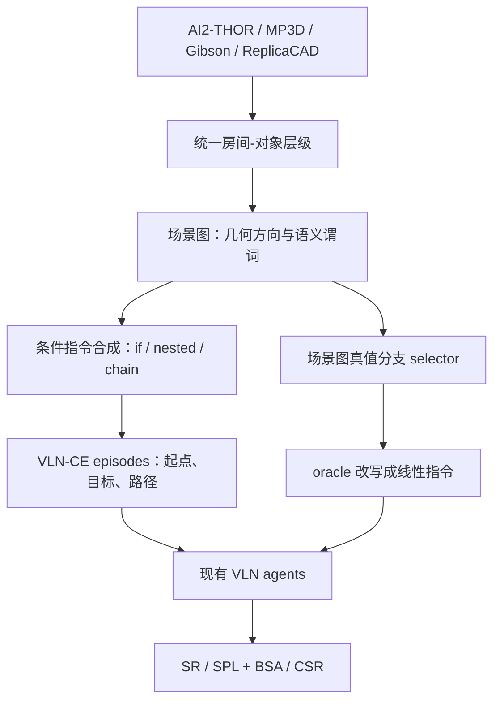

# CondVLN：条件分支视觉语言导航诊断基准

**CondVLN** 是从四类室内 3D 环境的可验证场景图谓词生成条件导航指令的评测基准，用来区分智能体是否识别场景条件、选对逻辑分支，以及最终按分支完成导航。

## 英文缩写速查

| 缩写 | 英文全称 | 简要说明 |
|------|----------|----------|
| VLN | Vision-and-Language Navigation | 智能体根据自然语言指令与视觉观测在环境中导航 |
| CondVLN | Conditional Vision-and-Language Navigation | 论文中的条件分支 VLN 基准名称 |
| BSA | Branch Selection Accuracy | 按序到达正确分支子目标的最长前缀比例 |
| CSR | Conditional Success Rate | 完整遵守分支并达到标准导航成功条件的比例 |
| SR | Success Rate | 达到目标成功半径的 episode 比例 |
| SPL | Success weighted by Path Length | 同时考虑是否成功及路径效率的 VLN 指标 |
| MP3D | Matterport3D | 论文使用的真实室内扫描场景数据源 |
| AABB | Axis-Aligned Bounding Box | 用于计算对象间几何距离的轴对齐包围盒 |

## 为什么重要

一般 VLN 得分回答“机器人有没有到一个目标”，不一定回答“它是否根据眼前条件选择了正确路线”。比如指令说“如果厨房里有咖啡桌就去洗碗机北侧的凳子，否则去浴室洗手池下方的灯”；机器人即使到达看起来合理的地方，也可能走的是错误分支。CondVLN 把这个问题从自由叙述变成有真值、有难度刻度、可以拆分计分的 benchmark。

## 核心信息

| 字段 | 内容 |
|------|------|
| 机构 | 德克萨斯大学奥斯汀分校（The University of Texas at Austin）；柯林斯航空航天公司（Collins Aerospace） |
| 作者 | Seoyoung Lee、Neel P. Bhatt、Pranay Samineni、Cong Liu、S P Sharan、Timothy Barclay、Gregory M. Wagner、Daniel Milan、Sandeep Chinchali、Ufuk Topcu、Atlas Wang |
| 论文 | arXiv:2608.17318，2026-08-18；类别 cs.CV / cs.RO |
| 场景来源 | AI2-THOR、Matterport3D、Gibson、ReplicaCAD |
| 规模 | 论文报告超过 11,500 条生成条件指令；不等同于均已转成无失败路径的 episode |
| 难度刻度 | 逻辑嵌套深度、条件链长度、空间组合、条件证据可观测性、指令跨度 |
| 评测 | SR / SPL 等标准 VLN 指标 + BSA / CSR 条件分支指标 |
| 开放材料 | 项目页链接匿名 Code / Dataset 镜像；本次未能核验镜像内容、许可及可复现性 |

## 流程总览

生成阶段把四类来源的场景标注统一成房间与对象，再把对象关系转换为可验证条件和目标；评测阶段既观察现成 agent 对条件句的表现，也用场景图真值构造 oracle 分支选择对照。

## 核心原理

### 1. 从异构室内环境构造统一场景图

对象节点至少包括语义标签与 3D 中心；若源数据可用，还包括尺寸、半径或 AABB。对象间距离按 AABB 表面距离 → 包围球表面距离 → 中心距离的优先级回退，方位关系由 8 个水平象限与垂直 up / level / down 组合。near / far / above / below 等语义关系由固定阈值生成，并将计算度量留在关系边上，方便追溯谓词真值。

这套方法提升不同环境数据格式间的一致性，但空间谓词依赖固定几何阈值和底层语义/几何标注质量；“可验证”是相对于其程序化生成规则而言，不意味着扫描场景没有标注误差。

### 2. 用逻辑深度与链长度控制语言难度

模板从存在对象、缺失对象与空间关系中抽样条件和目标，并生成基本 IF–THEN–ELSE、嵌套条件和 ELSE-IF 链。论文使用 Simple、Nested、Deep Nested、Chain、Long Chain、Nested Chain 六类任务，并改变分支深度、依赖链、跨房间空间组合和指令跨度。将成功路径包装为 VLN-CE 格式前，使用 Habitat-Sim 计算测地参考路径，并过滤寻路失败样本。

### 3. 用 BSA / CSR 拆开“选分支”和“走完”

标准 SR / SPL 继续衡量最终目标到达和路径效率；BSA 看正确分支的有序子目标是否按序到达，允许部分进度；CSR 则要求所有分支子目标完整完成且最终任务成功。于是：

- **SR 不低、CSR 低**：目标可能可达，但分支遵循或其中间子目标仍失败。
- **BSA 部分得分、CSR 低**：走对了部分分支路径，但没有完整完成分支或最终目标。
- **BSA / CSR 随深度或链长度下降**：复杂条件逻辑让现有 agent 更难保持分支与执行一致。

无子目标 episode 的 BSA / CSR 采用论文约定，成功者计入满分，失败者从相应条件指标样本集中排除。该规则会影响指标总体解释，不能只看数值而忽略纳入集合。

### 4. Oracle 对照的正确读法

论文用生成时记录的场景图真值直接确定 IF / ELSE 结果，把条件指令递归改写为线性目标/有序子目标链，再交给未更改的 VLN-Zero。底层导航 episode、路径和目标保持不变，因此对照主要用于估计“去掉条件分支选择难度”后的表现。

但该 selector 拿到构造阶段已知的真值，不需要从机器人视觉观测中重新识别对象或推断条件。因此它是诊断对照，不是一个可直接部署、感知端到端的导航模型。论文摘要提到在一些情形下约 2x 提升，正文指出其优势依复杂度与指标而变，且聚合结果并非始终领先；不要把 headline 读成普遍性能翻倍。

## 源码运行时序图

**暂不适用。** 官方项目页确实放有 Code 按钮，但该按钮指向匿名 4open 镜像；本次无法读取其 README、文件树和运行入口，因而不能可靠地把论文流程改写成源码执行时序。若后续镜像提供可核验训练 / 评测脚本，应在本节补上对应运行时序。

## 实验与评测

| 方面 | 论文设置 / 观察 |
|------|----------------|
| Agent | VLN-Zero、NaVid、NaVILA、Open-Nav；除原方法必须项外不重新训练 |
| 环境 | AI2-THOR、Gibson、ReplicaCAD、Matterport3D；基于 VLN-CE 兼容接口 |
| 条件输入 | 只给自然语言条件指令，不额外提供 branch label |
| 条件指标 | BSA（部分分支进度）与 CSR（完整分支 + 最终成功） |
| 主发现 | 传统指标可能掩盖分支错误；嵌套更深、链条更长时条件指标普遍下降 |
| Oracle 对照 | 使用生成时 scene-graph 真值先选分支，再将指令线性化并运行 VLN-Zero |

本文不复述四环境的整张数值表：更有解释力的结论是不同环境与复杂度下模型排名会变，标准 SR / SPL 也不能代表正确的条件推理。摘要的“2x”应与正文具体 oracle 对照和指标范围一起阅读。

## 工程实践

若要把 CondVLN 用于自己的 VLN agent 验收，优先把问题拆成三层：

1. **条件证据是否看见：** 对象在当前房间是否存在、空间关系是否可观测。
2. **条件是否被正确判定：** 模型有无选择与场景真值一致的分支。
3. **选定分支是否能执行：** 目标接地、子目标顺序与连续导航是否成功。

保留 SR / SPL 作执行与路径效率指标，同时增加 BSA / CSR，能避免“走到了但理由/分支不对”被单一到达率掩盖。跨数据集对比时还要记录生成阈值、对象消歧、pathfinding 过滤和无子目标样本的纳入规则。

## 局限与风险

- **室内闭集：** 当前实例基于四类室内环境与 VLN-CE/Habitat 生态，不能直接证明对户外开放世界导航有效。
- **场景图不等于无误真值：** 底层扫描、对象标签和几何关系有数据集自身瑕疵。
- **固定关系阈值：** 手工阈值化的 near / far / above / below 关系可能跨场景失配。
- **oracle 信息泄漏：** oracle 分支选择使用生成时条件真值，不承担在线视觉感知和不确定性处理。
- **代码与数据可用性待确认：** 项目页提供匿名镜像链接，但当前尚不能确认实际文件、授权条款或长期可用性。

## 结论

**CondVLN 的贡献是把条件分支从 VLN 指令里的隐含要求，变成可控生成、可验证真值、可单独计分的评测轴；它诊断的是“是否按对条件走”，而不是提供新的通用导航策略。**

1. **常规成功率不足以代表理解正确：** 到达一个可行目标，不证明选择了与场景条件一致的路径。
2. **BSA 与 CSR 应合并阅读：** 前者显示有序分支进度，后者要求完整分支和最终到达。
3. **复杂性是核心变量：** 嵌套深度与条件链长度增长时，现有 agent 的条件表现会退化。
4. **oracle 结果只能作为分支选择对照：** 它依赖数据生成时真值，不应当作可部署系统的能力上限以外的结论。
5. **数据入口与材料状态分开标注：** 项目页链接匿名代码和数据镜像，但实际文件、许可与复现步骤待核验。

## 关联页面

- [Vision-Language Navigation](../tasks/vision-language-navigation.md)
- [Vision-Language-Action Models](../methods/vla.md)
- [Zero-Shot Object Navigation](../tasks/zero-shot-object-navigation.md)

## 推荐继续阅读

- [arXiv 摘要](https://arxiv.org/abs/2608.17318)
- [arXiv HTML 全文](https://arxiv.org/html/2608.17318v1)
- [CondVLN 官方项目页](https://condvln.github.io/)
- [官方项目页与代码/数据开放状态核查](../../sources/sites/condvln-project-page.md)

## 参考来源

- [arXiv 论文来源归档](../../sources/papers/if_then_otherwise_condvln_2608_17318.md)
- [CondVLN 官方项目页核查](../../sources/sites/condvln-project-page.md)
- [匿名代码 / 数据入口核查](../../sources/repos/condvln-benchmark-artifact.md)
