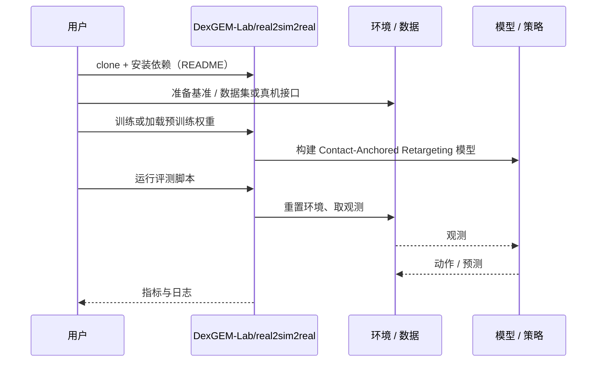

# Contact-Anchored Retargeting（arXiv:2609.24093）

**Contact-Anchored Retargeting**（*Dexterous Robot Manipulation from Human Demonstrations via Contact-Anchored Retargeting and Residual Policy Learning*，[arXiv:2609.24093](https://arxiv.org/abs/2609.24093)，[代码](https://github.com/DexGEM-Lab/real2sim2real)）来自 [具身智能小站 2026-10-18 盘点](../../sources/blogs/wechat_embodied_station_26_papers_embodiedswe_2026-10-18.md)，属「灵巧与触觉」组。

## 一句话定义

**先用物理残差学习补全人类示范接触，再按接触位置和顺序重定向到机器人手，最后修复动力学可行性。**

## 英文缩写速查

| 缩写 | 英文全称 | 简要说明 |
|------|----------|----------|
| Retargeting | Motion Retargeting | 跨形态动作重定向 |

## 为什么重要

- 跨手形态迁移要先保留接触结构，而不是匹配关节。
- 开源结论：**已开源**（步骤 2.5，2026-10-18）。仓库可达（git ls-remote）。
- 同期同组工作见 [编程智能体造数据与 VLA 闭环评测：具身智能小站 10-18 期 26 篇阅读坐标](../overview/embodied-station-2026-10-18-26-papers-technology-map.md)。

## 核心机制

| 项 | 内容 |
|----|------|
| **arXiv** | [2609.24093](https://arxiv.org/abs/2609.24093) |
| **开源** | **已开源** |
| **要点** | 残差策略补全接触 → 按接触位置与顺序重定向 → 动力学可行性修复。 |
| **文内指标** | 公众号称覆盖四种手形态与真机双手任务；训练仍依赖仿真。 |

## 源码运行时序图

以下为按仓库入口（`DexGEM-Lab/real2sim2real`）推断的通用运行链路；入库日仅核实仓库可达，未逐文件阅读，具体脚本名以 README 为准。

## 实验与评测

- 公众号称覆盖四种手形态与真机双手任务；训练仍依赖仿真。
- **读法：** 本页为索引级摘要，依据公众号转述的官方摘要与仓库信息整理；逐项数字与 baseline 以原文 PDF 为准。

## 与其他工作对比

- 横向索引见 [编程智能体造数据与 VLA 闭环评测：具身智能小站 10-18 期 26 篇阅读坐标](../overview/embodied-station-2026-10-18-26-papers-technology-map.md)；同 arXiv 不重复造页。

## 结论

**接触锚定是跨手形态迁移的稳定中间表示。**

1. 开源边界：**已开源** — 仓库可达（git ls-remote）。
2. 核心机制：残差策略补全接触 → 按接触位置与顺序重定向 → 动力学可行性修复。
3. 复现与选型前核对任务协议、硬件与基准口径，勿直接横比公众号摘录数字。

## 关联页面

- [dexterous-kinematics](../concepts/dexterous-kinematics.md)
- [motion-retargeting](../concepts/motion-retargeting.md)
- [manipulation](../tasks/manipulation.md)
- [embodied-station-2026-10-18-26-papers-technology-map](../overview/embodied-station-2026-10-18-26-papers-technology-map.md)

## 参考来源

- [contact_anchored_retargeting_residual_dexterous_arxiv_2609_24093.md](../../sources/papers/contact_anchored_retargeting_residual_dexterous_arxiv_2609_24093.md)
- [wechat_embodied_station_26_papers_embodiedswe_2026-10-18.md](../../sources/blogs/wechat_embodied_station_26_papers_embodiedswe_2026-10-18.md)
- [arXiv:2609.24093](https://arxiv.org/abs/2609.24093)

## 推荐继续阅读

- [arXiv PDF](https://arxiv.org/pdf/2609.24093)
- [https://github.com/DexGEM-Lab/real2sim2real](https://github.com/DexGEM-Lab/real2sim2real)
