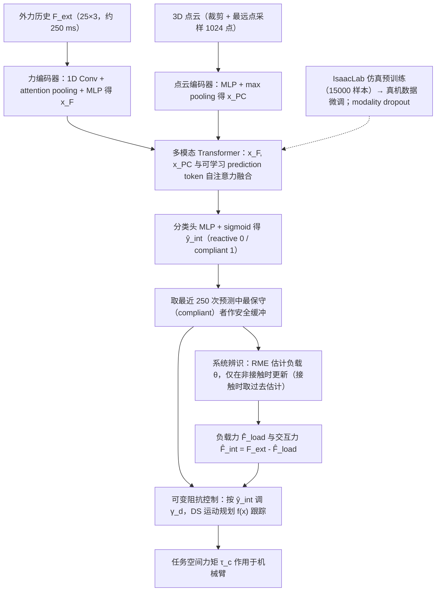

# Contact-Aware Adaptive Impedance（arXiv:2610.24235）

**Contact-Aware Adaptive Impedance**（*Multimodal Interaction Estimation for Contact-Aware Adaptive Impedance Control*，[arXiv:2610.24235](https://arxiv.org/abs/2610.24235)，[项目页](https://contact-aware-adaptive-impedance.github.io)）来自 [具身智能小站 2026-11-01 盘点](../../sources/blogs/wechat_embodied_station_56_papers_libero_dynamic_latency_eval_2026-11-01.md)，属「灵巧、接触与精细操作」组。

## 一句话定义

**融合力历史与三维点云识别交互类型，再选择负载补偿或柔顺响应；单臂、模仿策略和双臂实验验证适配，负载与推力同时出现时会延后补偿。**

## 英文缩写速查

| 缩写 | 英文全称 | 简要说明 |
|------|----------|----------|
| Contact-Aware Adaptive Impedance | Multimodal Interaction Estimation for Contact-Aware Adaptive Impedance Control | 本文方法 / 基准的简称 |

## 为什么重要

- 分清负载与人手推力，再调整阻抗。
- 开源结论：**待发布**（步骤 2.5，2026-11-01）。项目页 HTTP 200，未列 GitHub，页面含 soon 字样（脚本扫描）。
- 同期同组工作见 [动态评测、技能编译与环境潜变量适配：具身智能小站 11-01 期 56 篇阅读坐标](../overview/embodied-station-2026-11-01-56-papers-technology-map.md)。

## 流程总览

图依据：论文 §II、§III-A–B、§IV-A–B / Fig.1、Fig.2

## 核心机制

| 项 | 内容 |
|----|------|
| **arXiv** | [2610.24235](https://arxiv.org/abs/2610.24235) |
| **开源** | **待发布** |
| **要点** | 融合力历史与三维点云识别交互类型，再选择负载补偿或柔顺响应；单臂、模仿策略和双臂实验验证适配，负载与推力同时出现时会延后补偿。 |
| **文内指标** | 公众号未给具体数字，本页不引用。 |

## 源码运行时序图

**不适用（待发布）** — 项目页 HTTP 200，未列 GitHub，页面含 soon 字样（脚本扫描）。 不编造运行脚本；代码公开后再补。

## 实验与评测

- 公众号未给具体数字，本页不引用。
- **读法：** 本页为索引级摘要，依据公众号转述的官方摘要与仓库信息整理；逐项数字与 baseline 以原文 PDF 为准。

## 与其他工作对比

- 横向索引见 [动态评测、技能编译与环境潜变量适配：具身智能小站 11-01 期 56 篇阅读坐标](../overview/embodied-station-2026-11-01-56-papers-technology-map.md)；同 arXiv 不重复造页。

## 结论

**分清负载与人手推力，再调整阻抗：融合力历史与三维点云识别交互类型，再选择负载补偿或柔顺响应；单臂、模仿策略和双臂实验验证适配，负载与推力同时出现时会延后补偿。**

1. 开源边界：**待发布** — 项目页 HTTP 200，未列 GitHub，页面含 soon 字样（脚本扫描）。
2. 核心机制：融合力历史与三维点云识别交互类型，再选择负载补偿或柔顺响应；单臂、模仿策略和双臂实验验证适配，负载与推力同时出现时会延后补偿。
3. 复现与选型前核对任务协议、硬件与基准口径，勿直接横比公众号摘录数字。

## 关联页面

- [manipulation](../tasks/manipulation.md)
- [contact-rich-manipulation](../concepts/contact-rich-manipulation.md)
- [tactile-sensing](../concepts/tactile-sensing.md)
- [embodied-station-2026-11-01-56-papers-technology-map](../overview/embodied-station-2026-11-01-56-papers-technology-map.md)

## 参考来源

- [contact_aware_adaptive_impedance_arxiv_2610_24235.md](../../sources/papers/contact_aware_adaptive_impedance_arxiv_2610_24235.md)
- [wechat_embodied_station_56_papers_libero_dynamic_latency_eval_2026-11-01.md](../../sources/blogs/wechat_embodied_station_56_papers_libero_dynamic_latency_eval_2026-11-01.md)
- [arXiv:2610.24235](https://arxiv.org/abs/2610.24235)
- [arXiv PDF](https://arxiv.org/pdf/2610.24235)：已通读方法部分（实验与附录以略读为准）：摘要、§I–§V（问题设定、分类器架构与训练、可变阻抗控制、系统辨识与力估计、评估）；后续应用实验仅浏览

## 推荐继续阅读

- [arXiv PDF](https://arxiv.org/pdf/2610.24235)
- [项目页](https://contact-aware-adaptive-impedance.github.io)
