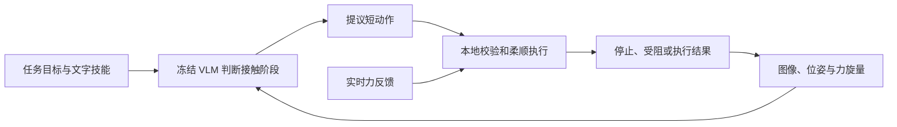
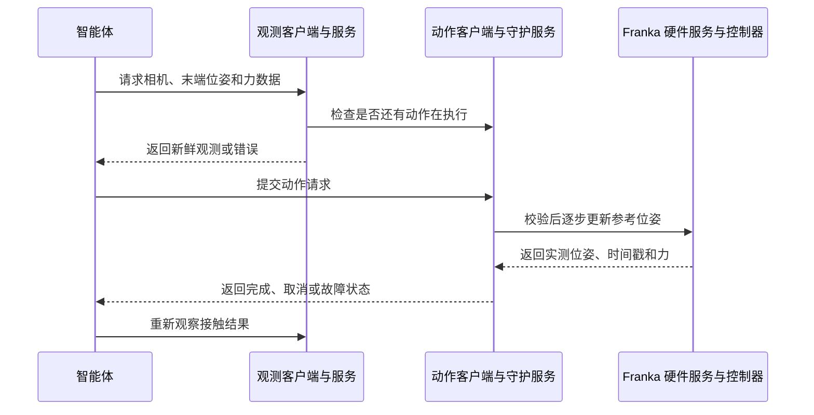

# Contact Harness: Enabling VLM Agents to Perform Contact-Rich Manipulation · 让视觉语言智能体完成接触丰富操作

## 一句话定义

冻结视觉语言模型以秒级节奏判断接触阶段和选择短动作，本地柔顺控制在动作执行中用实时力反馈修正参考位姿。作者另公开 Contact-4 仿真基准，用于比较此类智能体与学习策略。

## 英文缩写速查

| 缩写 | 英文全称 | 简要说明 |
|---|---|---|
| VLM | Vision-Language Model | 解释视觉、接触观测与任务阶段，提出下一动作 |
| VLA | Vision-Language-Action Model | 对照中的示范微调动作策略 |
| RGB-D | Red, Green, Blue and Depth | 颜色和深度图像，用于观察几何关系 |
| EEF | End Effector | 机器人末端执行器 |
| CLI | Command-Line Interface | 智能体请求观测或提交动作的命令行接口 |

## 为什么重要

视觉能看到几何对齐，却难直接判断顶住、卡滞或就位；力估计能提供受力方向，但不能独自定位接触点。将图像、末端位姿和受力按任务阶段解释，再由快环限制继续施力，可避免把模型推理延迟带入实时接触调节。

## 核心信息

| 项 | 内容 |
|---|---|
| 机构 | 南洋理工大学（Nanyang Technological University），MARS Lab |
| 论文 | arXiv:2611.29377v1，2026-11-22，Shilin Shan、Yuxuan Hu、Chuhao Zhou 等 |
| 平台 | 真机 Rokae、Franka；Contact-4 使用 MuJoCo/robosuite 中的 Panda |
| 开放资源 | MIT 许可的项目代码和提示词，包含 Franka 与仿真实现；Rokae 公开的是提示词，不是完整真机部署；仿真示范 CC BY 4.0 |
| 不需训练的范围 | 作者运行冻结 VLM 加任务文字技能，不用示范微调该方法；公开示范被用于基准中的学习策略对照 |

## 核心原理与方法

- **慢环状态判断：** 腕部和第三视角视觉看对齐与深度；六维外力旋量提供负载方向和大小；具备指端触觉时再用弯载线索；参考与实测位姿之差可提示受阻。各模态相互校验，不能把一次力峰直接当成功。
- **文字技能：** 系统提示定义观测单位、坐标系与停止约定；任务技能提供阶段、终止标准和判断规则。无微调不等于无任务先验。
- **快环执行：** 运动侧检查时效、位姿和速度等边界；在阻抗控制中按实时力反馈裁剪会继续加重接触的位移分量，独立硬保护可停止。软件阈值不是实际峰值力的保证。
- **数据用途：** Contact-4 有 Insert、Wipe、Write、Pivot，以及 Place、Stack 两项参考任务。公开演示合计 300 条、93,195 帧（10 Hz）；四个接触任务 200 条。它是仿真遥操作数据，不是真机轨迹或基准评测用种子。

## 评测与结果

| 作者实验 | 结果 | 比较条件 |
|---|---|---|
| Rokae 连接器插入 | 136/150 完全插入（90.7%） | 15 种连接器，各 10 次；共享插入技能，不代表任意连接器 |
| 其他真机接触任务 | 擦白板、写字、剥离、翻转的平均 100% | 额外任务限定于论文平台和设置；论文也列出取放和堆叠参考 |
| Contact-4 六项仿真 | GPT-6 Astra 58/60（96.7%），ForceVLA 41/60（68.3%）；Fable 5.1/5.2 各 59/60 | 每任务 10 种子；此表使用任务成功条件，没有额外力违规即失败规则 |
| 四项接触任务消融 | 完整 95.0%，对模型隐去力 82.5%，去文字技能 42.5%，去柔顺执行与软限制 62.5% | 与总表成功口径不同；隐去力仅对 VLM，不关闭本地力反馈 |
| 时效代价 | 真机 15 类插入平均 378 秒；仿真成功回合五项统计时间（不含 Write）为 Astra 331 秒、ForceVLA 49 秒 | 不能把高成功率读成高节拍；96 秒来自另设的快速模式与记忆下的 IEC C13 |

## 工程实践：源码运行时序

以下对应发布仓库的 Franka 路径。观测客户端检查动作状态并获取新鲜传感器数据；动作客户端提交、按命令 ID 查询，等待完成或失败。代码可离线审阅，未用真实机械臂执行。

## 与其他工作对比

[Show-Harness](paper-show-harness.md) 是面向取放的智能体框架；本论文对照给它加了阻抗控制，但保留离散动作空间，因此结果不等于否定该方法在原任务上的效果。[ForceVLA](paper-forcevla.md) 以示范微调带力观测的动作策略，在同表中更快但对这套接触基准成功率较低。选型应固定起始种子、完成判据和控制设置，同时比较成功、时间与接触力。

## 局限与风险

远程模型服务超时、相机遮挡、少像素小连接器和传感误差仍可导致失败，卡滞与就位也可能有相似力读数。动作守护不能保证安全峰值，演示不是部署授权或机械安全认证；应在仿真和隔离测试核对停止链路、动作时效和接触限制，再评估真机。当前未核实完整 Rokae 运行栈或模型权重公开。

## 结论

该工作证明了慢速模型推理与快速柔顺执行可协作，但落地应优先衡量节拍、失败可检测性和保护边界。

- 将任务阶段、预期接触和失败判据分别写进技能，不用单一力读数代替任务验收。
- 机器人侧独立管理命令时效、力与工作空间边界；模型只提供下一步提议。
- 用不同起始种子比较学习策略和智能体，报告时间与力，并注明哪些任务用人工判读。
- 不把 Contact-4 的成功示范或论文的仿真成绩直接外推到生产真机。

## 关联页面

- [机器人智能体执行框架](../methods/robot-agent-harness.md)
- [触觉阻抗控制](../methods/tactile-impedance-control.md)
- [接触力旋量闭环](../queries/contact-wrench-closed-loop.md)
- [具身大模型评测基准选型闭环](../queries/embodied-eval-benchmark-selection-loop.md)

## 参考来源

- [论文全文归档](../../sources/papers/contact_harness_arxiv_2611_29377.md)
- [官方项目页](../../sources/sites/contact-harness-project.md)
- [Franka 与仿真代码](../../sources/repos/contact-harness.md)
- [Contact-4 数据集](../../sources/datasets/contact-4.md)

## 推荐继续阅读

- [论文附录 B、E、H](https://arxiv.org/pdf/2611.29377v1)：实现、成功口径、受阻案例与时延。
- [Contact-4 评测协议](https://github.com/NTUMARS/Contact-Harness/tree/5827438a166667f5eb24761e2d37827b59cc64f7/contact4)：仿真任务、种子、结果与视频格式。
