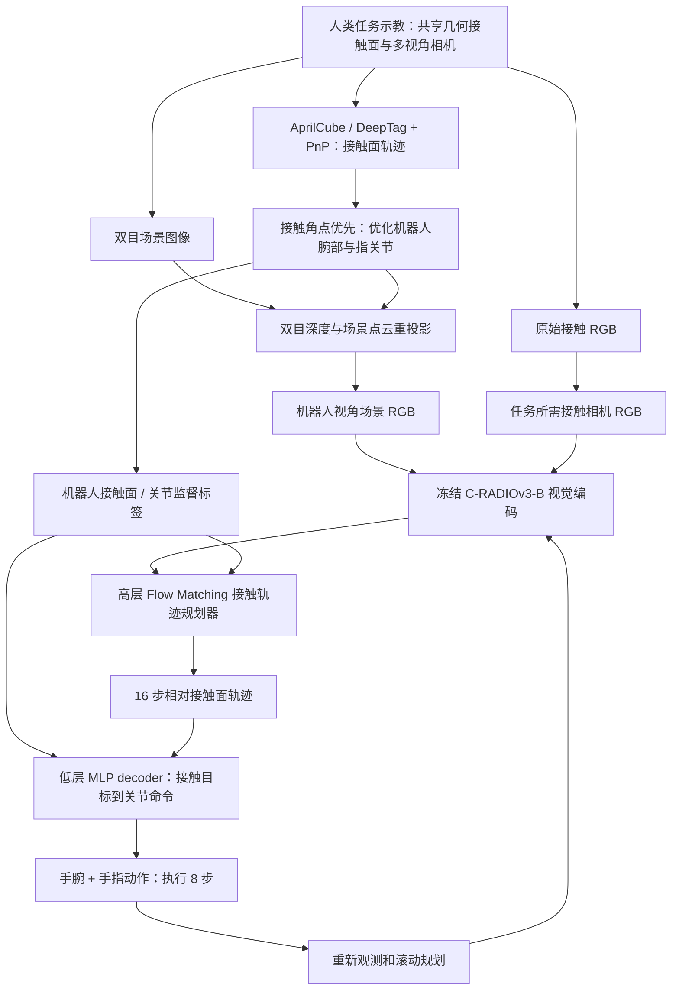
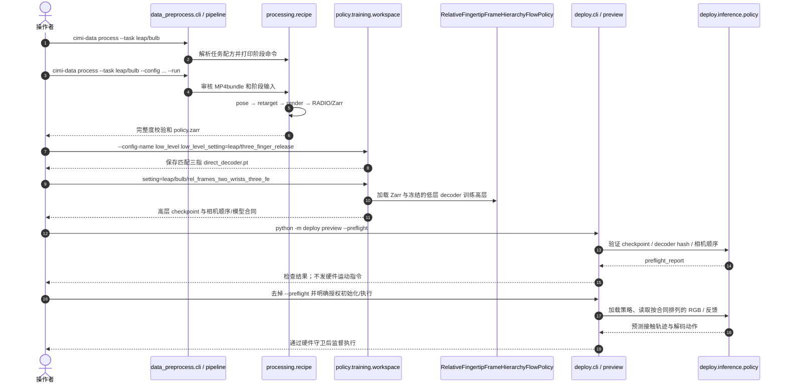

# CIMI：接触模仿接口｜Contact Imitation Interface: Transferring Dexterous Skills by Showing How Contact Unfolds

- **原始论文：** [arXiv:2610.41028v1](https://arxiv.org/html/2610.41028v1)
- **项目：** [NUS LinS Lab — CIMI](https://nus-lins-lab.github.io/CIMIWeb/)
- **源码：** [ariszxxu/CIMI](https://github.com/ariszxxu/CIMI)
- **研究机构：** 新加坡国立大学（National University of Singapore）、RoboScience、华南理工大学（South China University of Technology）
- **复核版本：** arXiv v1；官方项目页、补充材料与 2026-11-09 可访问源码

## 一句话定义

**CIMI 是一套用共用的指尖接触面视觉和几何接口将人类示教迁移到灵巧手的模仿学习系统**：先保持人手/机器人指尖的接触几何对齐，再用分层策略规划接触面轨迹、转换为腕部与关节动作。

## 英文缩写速查

| 缩写 | 英文全称 | 简要说明 |
|---|---|---|
| CIMI | Contact Imitation Interface | 以共享接触接口进行灵巧示教迁移 |
| CC | Contact Camera | 指根/指尖邻近区域的局部 RGB 接触相机 |
| CTX | Context Views | 腕部与虎口等场景上下文 RGB 视角 |
| PnP | Perspective-n-Point | 基于可见标记角点求相机/接触面位姿 |
| FK | Forward Kinematics | 由关节状态计算指尖接触面的位姿 |
| SE(3) | Special Euclidean Group in 3D | 刚体三维旋转和平移组合 |

## 为什么重要

灵巧任务（硬币拾取、细方块、抽信件、**拧灯泡**）不仅取决于物体在哪里，更依赖每个手指**何时、何处、如何贴靠与重新接触**。把人手的关节角直接复制给不同构型的机器人手，容易破坏原始示范中的接触几何。CIMI 把接触面作为人—机器人共享表示，并用指尖邻近视觉降低接触区域被手指自身遮挡带来的信息损失。

## 指尖相机能看到什么？

- **局部接触过程：** 视野靠近手指与目标物交界处；能从 RGB 画面观察指尖相对物体的贴合、边缘可见性、接触与释放阶段的视觉变化，比远处腕相机更靠近实际交互部位。
- **灯泡安装的多次接触：** 三指按任务需要交替夹持、旋转、松开和重新夹持；局部视角持续提供接触区域的视觉证据，配合腕部/虎口场景视角观察整体灯泡和夹持关系。
- **看不到什么：** 相机不直接测量牛顿单位的接触力、法向压力或真实摩擦系数；也不能把视频中视觉上贴合等同于已经建立可承载外力的稳定接触。接触失效和滑移可通过连续图像与物体/手指相对运动反映，但**不是直接测力**。

论文中的相机布局不是在所有任务中把九路视频全部输入策略：采集阶段共九路同步视频（3 路指尖接触、4 路场景、2 路定位），训练/部署时按手型和任务选择 RGB 场景及局部接触视角。**灯泡任务**使用额外的虎口场景视图和三指接触视图；所用深度用于离线场景重投影及场景预处理，而不是把深度张量直接输入最终策略。

## 核心原理

### 1. 采集与接触面跟踪

人手和机器人手配置名义一致的指尖接触面几何与局部 RGB 摄像头位置。人手示范以约 10 Hz 采集多路同步画面；通过 AprilCube 标记、DeepTag 角点检测和 PnP 重建手指接触面的 SE(3) 姿态轨迹。

### 2. 接触优先重定向和视角重投影

- 以接触面四角点位置匹配为主要约束，联合求解机器人腕位姿、关节配置并加入时间平滑项，避免只拟合人手关节角导致接触点偏离。
- 接触相机的局部画面因共享几何可直接复用；腕部/虎口相机在重定向后发生视点移动，需要利用双目深度/点云重投影并叠加机器人几何，生成机器人视角的 RGB 训练图像。
- 相同一批人类硬币/方块示教可以分别重定向到 LEAP 和 Wuji；但对应机器人动作、视角渲染和 Zarr 缓存需分别制作。

### 3. 分层策略：接触面规划与低层关节执行

- **高层：** 冻结的 C-RADIOv3-B 编码选择的场景和指尖 RGB；结合以拇指为参考的接触几何/本体信息，由条件 Flow Matching 规划器预测 16 个未来接触面相对位姿，旋转使用 6D 连续表示，预测形式每指每步为 3+6 维。
- **低层：** 训练好的 MLP controller/decoder 从接触面目标与当前关节状态生成手腕和手指执行命令。先使用合成的动作扰动及 FK 约束进行低层训练，再冻结它训练高层策略；不能误写成只有一个端到端关节角预测网络。
- **滚动执行：** 规划输出按 10 Hz 轨迹刻度覆盖约 1.6 秒，每次执行前 8 步后获取新观测和再规划。**10 Hz 指动作轨迹采样率，不能直接等同视觉网络的推理频率。**

## 流程总览

以下来自论文方法（人类采集 D1–D4、策略学习 L1–L3），箭头区分了接触面标签和视觉输入：

图中的 `J → L` 表示低层训练时的监督目标，`M → L` 表示训练后/部署时高层预测接触轨迹驱动冻结的低层 decoder；不是说训练时两个网络必然同时联合反向传播。

## 源码运行时序图

对照官方 [pyproject.toml](https://github.com/ariszxxu/CIMI/blob/main/pyproject.toml)、[`src/data_preprocess/cli.py`](https://github.com/ariszxxu/CIMI/blob/main/src/data_preprocess/cli.py)、[`src/data_preprocess/pipeline.py`](https://github.com/ariszxxu/CIMI/blob/main/src/data_preprocess/pipeline.py)、[`src/policy/training/workspace.py`](https://github.com/ariszxxu/CIMI/blob/main/src/policy/training/workspace.py) 与 [`src/deploy/preview.py`](https://github.com/ariszxxu/CIMI/blob/main/src/deploy/preview.py) 核对入口；此图显示**离线数据、训练、部署预检的先后调用**，而不是未核验的“通用机器人执行循环”。

注意，运行完整灯泡流程需要原始示教、处理后数据、实际训练出的 checkpoint、三指 decoder、C-RADIO 权重、任务相机标定和设备；仓库有执行入口不意味着这些资源已提供下载。

## 实验与评测

原文 **Table II**：每种方案、每组手—任务执行 **20 次**，按六组的“最终阶段”成功率等权平均。列中的 Lift/Light 是原文对应任务阶段名，不代表同一物理指标。

| 方法 / 视觉 | LEAP 方块 Lift | LEAP 硬币 Lift | LEAP 信封 Lift | LEAP 灯泡 Light | Wuji 方块 Lift | Wuji 硬币 Lift | 六组均值 |
|---|---:|---:|---:|---:|---:|---:|---:|
| WristJoint / CTX | 0 | 0 | 0 | 5 | 0 | 0 | 0.8% |
| ContactSurface / CTX | 0 | 0 | 0 | 10 | 0 | 0 | 1.7% |
| WristJoint / CTX+CC | 20 | 35 | 15 | 70 | 15 | 30 | 30.8% |
| ContactSurface / CTX+CC | **75** | **85** | **80** | **90** | **70** | **85** | **80.8%** |

**读数字时拆开两个因素：**

1. 固定接触面规划器 `ContactSurface`，增加接触相机：**1.7% → 80.8%**（CTX → CTX+CC）；说明在论文测试任务与相机设置下，局部视觉的作用显著。
2. 固定相机输入 CTX+CC，更换动作表示/分层：**30.8% → 80.8%**（WristJoint → ContactSurface）；说明接触轨迹规划和低层解码也关键。
3. 原文 **Table III** 的重定向消融：硬币接触角点误差 **14.67 → 0.51 mm**、硬币 Lift 成功率 **0 → 85%**；灯泡角点误差 **5.72 → 1.09 mm**、灯泡 Light 成功率 **0 → 90%**。这里比较的是**接触优先重定向**，不能归功于仅加入指尖相机。
4. 原文 **Table IV** 在 **LEAP 硬币 + 灯泡两任务**的不同模块消融中，完整方案最终阶段均值 **87.5%**；移除场景几何叠加后 **62.5%**，同时移除场景重投影则 **30.0%**。**87.5% 是两任务均值，不是表 II 六任务的 80.8%。**
5. **作者报告的采集效率**：15 分钟场景下，硬币/灯泡采集吞吐分别达到裸手的 70%/71%；灯泡对照所用遥操作方案约 **2.3×**。需保留任务、硬件与操作者条件。

以上数字来自论文作者，不是本仓库独立训练或真机复测结果。

## 结论

**CIMI 的增益来自“局部接触视觉 + 接触几何重定向 + 分层控制”组合，而不只是给灵巧手装一个指尖相机。**

1. 关注接触区域时，应检查相机位置和视场能否持续看见关键接触边缘，而非仅增加远处相机分辨率。
2. 跨人手与机器人手迁移时优先验证接触四角点误差，不能只比关节角轨迹。
3. 灯泡拧入涉及多次旋转—释放—再接触，需要三指接触视图、场景视图和任务匹配的低层 decoder。
4. 评估算法时分离 **视觉输入消融**、**动作表示消融**和**重定向消融**，不可叠加计算成一个百分比。
5. 工程落地先检查九路采集同步、机器人视角重投影、模型相机顺序、接触面 FK 与 decoder/checkpoint 匹配。
6. 当前只能基于公开源代码做静态复核与部分离线测试，训练数据/策略权重未公开，不能声称完整复现论文成功率。

## 与其他工作对比

CIMI 相比传统关节轨迹克隆，强调接触面共享和低层控制适配；相比只有腕部场景视觉的模仿策略，它增设对关键接触区域的直接局部观察。原文 Table II 同时做两种对照，因此不能把其效果简单外推到所有灵巧手、所有任务或任意摄像头。

## 工程实践

| 阶段 | 作者公开入口 | 验证要点 |
|---|---|---|
| 采集/标定 | [项目页](https://nus-lins-lab.github.io/CIMIWeb/)、[DATA.md](https://github.com/ariszxxu/CIMI/blob/main/docs/DATA.md) | 共享接触面尺寸、标记位姿、相机同步和每任务的有效视角 |
| 数据变换 | `cimi-data process --task leap/bulb`；真正执行加 `--run` | 显式配置输入目录/校准；角点、时序、场景 RGB 重投影与 Zarr 校验 |
| 三指 decoder | `low_level_setting=leap/three_finger_release` | 灯泡需三指，不能直接拿 coin 的两指 decoder 替换 |
| 高层策略 | `setting=leap/bulb/rel_frames_two_wrists_three_fe` | 冻结与该策略一致的 decoder，检查 camera_order / holdout / policy contract |
| 部署预检 | `python -m deploy preview --config ... --checkpoint ... --preflight` | checkpoint + SHA、机器人型号、相机串号、初始姿态、坐标系与运动守卫 |
| 真实执行 | 显式授权后打开监督预览与运动执行 | 真机标定、速度/关节限制、碰撞净空和紧急停止；不得把预检通过当作安全运行证明 |

官方 [VALIDATION.md](https://github.com/ariszxxu/CIMI/blob/main/docs/VALIDATION.md) 记录 2026-10-09 作者侧离线测试 1,624 passed / 7 skipped；并明确这不包含真实数据完整重训和硬件验收。本页未进行 GPU 跑测与真机部署。

## 局限与风险

- **可公开获取的东西**：论文/补充材料、处理/训练/部署 Python 源码、可组合的任务配置、硬件指南和离线测试。
- **尚未公开分发**：四套人类原始数据、六个机器人/任务 Zarr 缓存、预训练 CIMI 策略/decoder。官方 [RESOURCES.md](https://github.com/ariszxxu/CIMI/blob/main/docs/RESOURCES.md) 明示仍待发布，因此当下无法独立下载全部必需产物进行完整指标复现。
- **相机≠触觉力**：仅有局部 RGB，缺失直接压力/力矩读数；遮挡、反光、微小滑移和光照变化仍有误判风险。
- **平台和任务范围**：作者实验只有 LEAP/Wuji 两种灵巧手及六组组合；缺乏复杂多物体、跨场景、动态环境和长期可靠性的大规模独立评测。
- **安全边界**：参考硬件和标定不是可直接复用的部署参数。离线 `--preflight` 不发运动命令；真机需独立验证抓握力、行程、通信超时和紧急停止。

## 关联页面

- [Manipulation：机器人操作任务](../tasks/manipulation.md)
- [Contact-Rich Manipulation：接触丰富操作](../concepts/contact-rich-manipulation.md)
- [Motion Retargeting：运动重定向](../concepts/motion-retargeting.md)
- [Dexterous Kinematics：灵巧手运动学](../concepts/dexterous-kinematics.md)
- [具身智能小站 2026-11-03 研究盘点](../overview/embodied-station-2026-11-03-49-papers-technology-map.md)

## 参考来源

- [CIMI 原文与补充材料全文复核](../../sources/papers/contact_imitation_interface_arxiv_2610_41028.md)
- [官方项目主页及开源状态](../../sources/sites/contact-imitation-interface.md)
- [CIMI 源码实现、入口与复现约束](../../sources/repos/contact_imitation_interface.md)

## 推荐继续阅读

- [官方论文 HTML v1 全文（含实验与附录）](https://arxiv.org/html/2610.41028v1)
- [CIMI 实验演示与硬件接口](https://nus-lins-lab.github.io/CIMIWeb/)
- [官方源码及任务复现指南](https://github.com/ariszxxu/CIMI)
- [官方资源发布进度（区分源代码与数据/权重）](https://github.com/ariszxxu/CIMI/blob/main/docs/RESOURCES.md)
