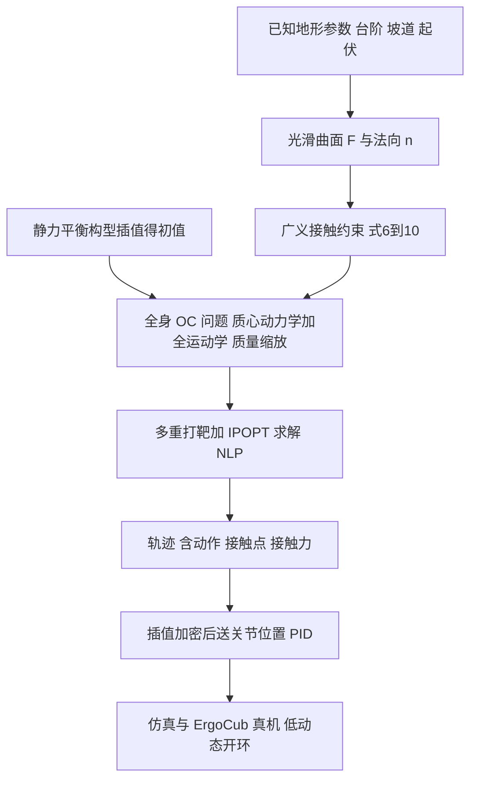

# 接触隐式全身轨迹优化：可参数化不平地形上的动态人形运动（arXiv:2611.05585）

*Contact-Implicit Whole-Body Trajectory Optimization for Dynamic Humanoid Locomotion on Parameterizable Uneven Terrain*，Mauceri、Dafarra、Romualdi、Gabiccini、Pucci，[arXiv:2611.05585](https://arxiv.org/abs/2611.05585)。机构（论文首页）：意大利技术研究院 IIT、曼彻斯特大学（计算机科学系）、比萨大学（土木与工业工程系）。arXiv 为 IEEE RA-L 2025 年 11 月刊（DOI 10.1109/LRA.2025.3614066）的**作者修订版**，2026-11-03 提交，修订仅更正 Eq. (7)-(8) 笔误并微调文字，实现与结果不变（首页脚注）。

## 一句话定义

**一个离线的接触隐式全身轨迹优化器：把台阶、坡道等地形写成可微的光滑曲面，使接触约束适用于任意光滑曲面，让非线性规划同时求出人形机器人的动作、接触位置与接触时序，不预设落脚点与步序。**

这是模型驱动的规划方法，不是强化学习；论文只把 RL 列为未来方向（用生成轨迹作运动先验，第 V 节）。

## 英文缩写速查

| 缩写 | 英文全称 | 简要说明 |
|------|----------|----------|
| TO | Trajectory Optimization | 轨迹优化：在可行轨迹中选使代价最小者 |
| OC | Optimal Control | 最优控制问题，经直接法转成 NLP |
| NLP | Nonlinear Programming | 非线性规划；本文用 IPOPT 求解 |
| CC | Complementarity Condition | 互补条件：编码刚性接触（接触力与离地距离不同时非零） |
| WBD | Whole-Body Dynamics | 全身动力学（Euler-Poincare 方程） |
| CD | Centroidal Dynamics | 质心动力学：只描述总线动量与角动量 |
| MICP | Mixed-Integer Convex Programming | 混合整数凸规划，常用于预设接触的规划 |
| DDP / FDDP | (Feasibility-driven) Differential Dynamic Programming | 微分动态规划及其可行性驱动扩展 |
| GIA | Gravito-Inertia Acceleration | 重力惯性加速度模型（Table I 中 Jen22 所用） |
| IPOPT | Interior Point OPTimizer | 内点法 NLP 求解器 |
| CasADi | — | 符号 / 自动微分的优化建模框架 |
| MTM / CIP | Motor Torque Minimization / Constraint on sole Internal Points | Table II 的两个开关：电机力矩最小化任务 / 鞋底内部点不穿透约束 |
| RA-L | IEEE Robotics and Automation Letters | 发表期刊 |

## 为什么重要

- **作者自述的动机（第 I 节）：** 预设接触位置与时序的 TO 限制规划器自主选接触；接触隐式方法让规划器自由决定，更灵活。
- **作者自述的差异（第 I、IV-A 节）：** 与 Winkler 等 [19] 固定接触事件数的做法相比，本方法在优化内决定接触事件数，但代价是更高计算复杂度与数值困难。Table I 将本文与 Ace17、Win18、Mas20、Ton20、Jen22 逐项对比（地形可微、曲面、动态、模型、优化方法、在线、人形、隐式接触共 9 列，具体勾选见原表）；其中本文动态模型为 WBD、优化方法为 NLP。
- **我的判断：** 对本 wiki 的意义在于它是「模型驱动 / 非 RL」的参照：生成的轨迹可作为运动先验（论文第 V 节同此设想），与学习型控制器形成互补；但它离线求解、真机只验证低动态动作，不能当作已验证的鲁棒落地方案。

## 核心原理

### 方法流程总览

### 1. 可微地形（第 III-A 节）

- 单个元素：f(x)=exp(−g(x)^s)·π(x)，x∈R²；π(x)=aᵀx+h 为任意朝向的平面，g(x)≥0 可微，锐度 s≥2，s→∞ 趋近阶跃。g=0 对应「棱柱」顶面形状，g=1 对应底面。
- 给出矩形 / 椭圆 / 圆 / 正三角形的 g 例子，可用仿射变换平移、旋转、变形；多个元素相加 F(x)=Σf_i(x) 组成台阶、楼梯、倾斜跳跃平台；用任意函数 h(x) 替换平面可得更复杂形状（Fig. 4 的地形）。
- 由 ∇F 得到任意点的切平面与法向 n_Q（Eq. 5），法向是接触约束的关键量。

### 2. 广义接触约束（第 III-B 节，Eq. 6-10）

点接触 + 库仑摩擦，假设刚性接触、静摩擦、非弹性碰撞。五类条件：接触条件、无滑移、摩擦锥、不穿透、单向接触。前两类是互补条件，以松弛区间形式实现（引 [23]），其余为不等式。Fig. 3 展示一个脚顶点在起伏地形行走时松弛后的接触与无滑移量全程未越界（松弛区间分别为 [0, 0.001] N·m 与 [−0.001, +0.001] N·m·s⁻¹）。

### 3. OC 问题（第 III-C 至 III-E 节）

- 状态含质心动量、质心位置、浮动基位姿（单位四元数）、关节位置、接触点位置与接触力；接触点与力用一阶动力学，规划器控制其变化率以获得平滑过渡。
- **质量缩放：** 把质心动量与接触力等除以总质量 m，使质心动力学与 m 无关，仅「质心动量一致性约束」显式含 m；作者观察到这样收敛更快（第 III-C 节，未提供对比数据）。
- 约束含关节位置 / 速度 / 力矩限幅（可折算到电机侧）；每脚 4 个鞋底顶点作接触点（共 8 个）。
- 任务项（构成代价）：状态 / 控制正则、摆动高度、力正则、电机力矩最小化、双脚横向间距（防腿部自穿透）。

### 4. 初值（第 III-F 节）

非凸 NLP 对初值敏感。初值取起止两个静力平衡构型的插值（线性 + 四元数 slerp），行走时双脚接触力交替置零，跳跃时腾空相置零；论文称把初始接触力置零可得到真实感跳跃，起跳与着地阶段的初始接触力取静平衡值的 2 到 15 倍（第 IV-A 节）。

## 工程实践

- **求解栈（第 IV 节）：** 多重打靶 + 显式 Euler；四元数在李代数上积分；IPOPT + mumps / MA57；Python 3.10 + CasADi；搜索空间维度 88(N+1)+78N；笔记本（11th Gen Intel Core i7、32 GB）上耗时几十秒到几分钟。
- **Table II（Fig. 4 四例，原文数值）：**

| 例 | 场景 | T [s] | N | 约束违反 CV | 耗时 CT [s] | 迭代 I |
|----|------|-------|---|-------------|-------------|--------|
| a | 倾斜平台跳跃 | 5.0 | 60 | 1.13×10⁻⁴ | 75.8 | 350 |
| b | 陨石坑行走 | 6.0 | 60 | 3.57×10⁻⁴ | 55.3 | 250 |
| c | 起伏地形行走 | 5.0 | 180 | 1.42×10⁻³ | 186.6 | 250 |
| d | 困难地形行走 | 9.0 | 180 | 4.26×10⁻³ | 173.3 | 250 |

  MTM 与 CIP 两个开关各例是否启用见原表（共 3 个勾选，本页不逐例转述）。
- **生成的动作（第 IV-A 节）：** 上 / 下 20 cm 台阶（质心竖直投影落在支撑多边形外，作者称动态步态）；斜坡与复杂地形行走（沿用平地行走初值，只换地形）；平地 / 平台跳跃，含前空翻。更宽的动作见补充视频（本页未读）。
- **多机器人：** 作者称框架在两种机器人模型上测试，切换只需极小改动（第 IV 节）；正文只具名了 ErgoCub，另一种未在正文说明。
- **真机验证（第 IV-B 节）：** 低动态动作在仿真与 ErgoCub 上测试。轨迹离线生成，经线性插值加密 10 到 20 倍（原采样约 10 Hz）后给关节位置 PID，仅关节层闭环。行走与 **7 cm** 台阶攀爬在仿真与真机上复现，未失去平衡；斜坡接触类轨迹仅在仿真复现；更复杂轨迹在开环下无法充分执行。
- **代码：** 论文与 arXiv 摘要页未给出代码链接（2026-11-09 核查）。

## 局限

**论文自述（第 IV-A、V 节）：**

- 仅当真实地形能被较简单、可参数化的形状近似时有效；依赖显式函数 z=F(x) 描述几何，可表示的地面受限（隐函数可扩展）。
- 要面对未知非结构化地形，需发展从点云生成可微地形的方法。
- 每脚仅 4 个接触点，且无自碰撞检查，限制精度与真实感；凹面处可能出现鞋底内部穿透（只约束 4 个顶点）。
- 相对固定接触事件数的方法，计算更复杂且有数值困难；NLP 有局部极小，依赖初值；离线规划（第 I 节称 NLP 求解耗时、数值不稳，可能限制在线应用）。
- 真机验证只覆盖低动态动作，且无高层闭环，无法保证浮动基位姿跟踪；更复杂轨迹未在真机上执行。

**我看到的未验证之处：**

- 摘要所称「dynamic」的跳跃、前空翻只有规划结果（Fig. 4 与补充视频），本页依据的正文未报告其在仿真闭环或真机上的执行；真机成功的动作是 7 cm 台阶与行走，低于仿真规划的 20 cm 台阶。
- 质量缩放「收敛更快」与初值系数「2 到 15 倍」均无对照 / 消融数据；与 Winkler [19] 的对比是定性的。
- 求解耗时与迭代数只在 Table II 的 4 个例子中给出，没有跨地形 / 跨初值的成功率统计。
- 本页未读补充视频，也未对照 RA-L 正式发表版。

## 关联页面

- [轨迹优化](../methods/trajectory-optimization.md)
- [最优控制](../concepts/optimal-control.md)
- [接触动力学](../concepts/contact-dynamics.md)
- [质心动力学](../concepts/centroidal-dynamics.md)
- [地形适应](../concepts/terrain-adaptation.md)
- [全身控制](../concepts/whole-body-control.md)
- [DSMS 接触隐式多重打靶](../methods/dsms-contact-implicit-multiple-shooting.md)
- [Shooting for Contact](../entities/paper-shooting-for-contact.md)
- [Crocoddyl](../entities/crocoddyl.md)
- [同机构 ErgoCub 论文（Nature Machine Intelligence）](../entities/paper-ergocub-shared-embodied-intelligence.md)
- [运动（locomotion）任务页](../tasks/locomotion.md)

## 参考来源

- [sources/papers/contact-implicit-wbto-uneven-terrain_arxiv_2611_05585.md](../../sources/papers/contact-implicit-wbto-uneven-terrain_arxiv_2611_05585.md)（本次通读归档，含核对范围）
- [arXiv:2611.05585](https://arxiv.org/abs/2611.05585)
- 周报说法（具身运控lab 周报：人形 / 四足）已逐条与论文核对：机构、问题、创新点一致，周报未提论文的质量缩放贡献；见来源归档「对周报说法的核对」。

## 继续阅读

- [arXiv PDF（v1，作者修订版）](https://arxiv.org/pdf/2611.05585v1)
- 论文所基于的前作：Dafarra、Romualdi、Pucci，*Dynamic complementarity conditions and whole-body trajectory optimization for humanoid robot locomotion*，IEEE T-RO 38(6) 2022（论文参考文献 [14]）
- [轨迹优化](../methods/trajectory-optimization.md)、[最优控制](../concepts/optimal-control.md)
