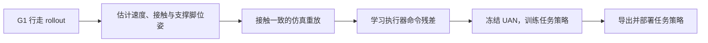
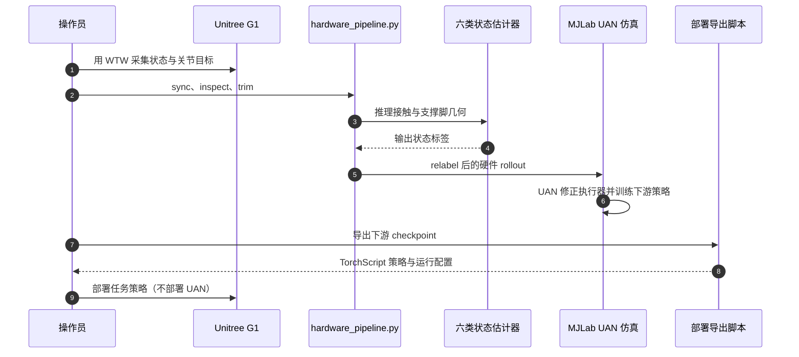

# Contact-UAN（G1 执行器残差 Sim2Real）

**Contact-UAN**（*Unsupervised Actuator Networks as a Residual World Model for Humanoid Control*，[arXiv:2610.18991](https://arxiv.org/abs/2610.18991)）针对人形机器人接触任务的执行器 Sim2Real 差距：从短时真机本体感知数据学习关节命令残差，保留仿真器的刚体、接触和数值积分先验。

## 英文缩写速查

| 缩写 | 英文全称 | 简要说明 |
|---|---|---|
| UAN | Unsupervised Actuator Network | 学习仿真与真机执行器响应差异的残差网络 |
| Sim2Real | Simulation to Real | 将仿真训练策略迁移到真实机器人 |
| G1 | Unitree G1 humanoid robot | 论文使用的 29 自由度人形机器人 |
| WTW | Walk These Ways | Contact-UAN 仓库用来采集行走数据的源策略 |

## 为什么重要

- **执行器误差会变成接触力误差：** 关节扭矩差异会改变支撑力、冲击吸收与物体/地面交互；只让动作外观相似，不足以保证跑步、跳跃或力控制可迁移。
- **把接触状态对齐放在残差学习之前：** 若仿真回放时足端初始高度或姿态不一致，模型会把接触求解器重置误差错学成执行器特性。
- **保留可解释的物理边界：** UAN 只修正执行器命令通道；仿真刚体动力学与接触求解仍由 MuJoCo/MJLab 处理。
- **从行走数据复用到多任务：** 论文报告约 6.5 分钟 G1 行走数据即可训练一个后续冻结的 UAN，支持多种依赖力与冲量的策略训练。

## 流程总览

硬件状态与命令首先经过检查、裁剪和重标，再进入 UAN rollout。下游任务训练冻结 UAN，避免策略利用未经校正的执行器模型。

## 方法栈与工程实践

| 阶段 | 实现要点 |
|---|---|
| 数据采集 | 用 WTW 源策略在 G1 上记录本体状态和最终关节目标；保留状态、动作和时间戳顺序 |
| 状态估计 | 从多帧本体感知分别估计基座线速度、左右足接触、支撑脚高度和方向；足部几何只在支撑样本上回归 |
| 数据重标 | 检查、裁剪有效 rollout 区间，并将估计量写入回放数据；接触一致重置是隔离执行器误差的前提 |
| 残差训练 | UAN 修正基线关节位置目标，模拟下一步硬件状态；将训练好的 UAN 固定后再训练下游策略 |
| 部署 | 将下游策略导出为 TorchScript 并校验关节顺序；UAN 和离线状态估计器不部署到真机 |

### 源码运行时序图

源码路径来自官方 [硬件流程指南](https://github.com/nolie-rolie/contact-uan/blob/main/docs/SIM2REAL.md) 与 [部署指南](https://github.com/nolie-rolie/contact-uan/blob/main/docs/DEPLOYMENT.md)。策略导出和硬件启动仍需按机器人现场配置执行。

## 实验与评测

项目页报告在 Unitree G1 上，单个从行走数据学得的 UAN 支持跑步、全身力控制、极端顺应、本体感知阻抗控制与动态跳跃。论文摘要报告约 43% 的力跟踪误差下降、20% 的运行扭矩使用下降；跑步速度约 3.13 m/s。不同指标对应各自任务协议，不能当作统一成功率。

## 与代表性路线对比

| 路线 | 学习对象 | 优点 | 代价 |
|---|---|---|---|
| 系统辨识 | 显式电机/执行器参数 | 参数可解释 | 受参数化和辨识工况限制 |
| 域随机化 | 参数分布覆盖 | 无需真机残差模型 | 随机范围扩大可能使策略保守 |
| Contact-UAN | 真机 rollout 的执行器命令残差 | 保留物理仿真先验；训练后跨任务复用 | 需要目标机器人的数据与接触一致重放 |

Contact-UAN 对 [执行器网络](../concepts/implicit-explicit-actuator-modeling.md) 与 [Sim2Real](../concepts/sim2real.md) 提供一种结合路径：先用真机数据对齐难建模的执行器通道，再在修正仿真中训练策略。

## 结论

**Contact-UAN 的关键不是“学一个完整世界模型”，而是先消除接触重置误差，再用短时真机数据修正执行器通道。**

1. **先对齐支撑状态再拟合残差** — 否则网络可能学到足端高度、姿态等初始化伪差。
2. **训练期使用 UAN，部署期移除 UAN** — 导出的是真正的任务策略；UAN 只负责仿真训练时的执行器补偿。
3. **一份行走数据可支撑多任务训练** — 论文展示跑步、力控制、顺应、阻抗和跳跃，但不等同于所有任务均已验证。
4. **复现需要自采 G1 数据** — 官方仓库未提供预训练策略和硬件数据；下载代码本身不足以直接复现实验。
5. **明确已知建模边界** — 当前网络逐执行器独立建模，不覆盖跨关节耦合与电机温度效应。

## 局限与风险

- **依赖本体与硬件数据：** 官方说明不附带预训练策略和硬件采集数据，需先准备 G1、采集链路和策略。
- **残差模型有结构边界：** 每个执行器独立建模，未覆盖关节间耦合与电机温度变化。
- **仿真参数仍重要：** UAN 补偿执行器命令差异，不替代正确的接触、地面摩擦和机器人模型；下游训练仍随机化地形、摩擦与外力。
- **结果按论文协议解读：** 论文和项目页数据是研究结果，不构成其他硬件平台的性能保证。

## 关联页面

- [Sim2Real](../concepts/sim2real.md)
- [Physics Fidelity 与 Sim2Real Gap](../concepts/physics-fidelity-sim2real-gap.md)
- [Contact-Rich Manipulation](../concepts/contact-rich-manipulation.md)
- [隐式/显式执行器建模](../concepts/implicit-explicit-actuator-modeling.md)
- [Unitree G1](./unitree-g1.md)
- [执行器驱动链选型闭环知识链](../queries/actuator-drive-chain-selection-loop.md) — Contact-UAN 属其 ③ 执行器建模与辨识层：用少量真机行走数据学执行器残差模型，替代逐关节摩擦/延迟手工辨识。

## 参考来源

- [Contact-UAN 论文来源](../../sources/papers/contact_uan_arxiv_2610_18991.md)
- [Contact-UAN 项目页核查](../../sources/sites/contact-uan-csail-mit-edu.md)
- [Contact-UAN 官方代码](../../sources/repos/nolie-rolie-contact-uan.md)

## 推荐继续阅读

- [Contact-UAN 官方硬件流程](https://github.com/nolie-rolie/contact-uan/blob/main/docs/SIM2REAL.md)
- [Contact-UAN 部署指南](https://github.com/nolie-rolie/contact-uan/blob/main/docs/DEPLOYMENT.md)
- [接触动力学](../concepts/contact-dynamics.md)
