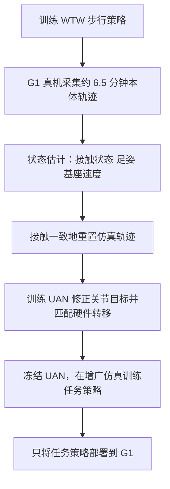
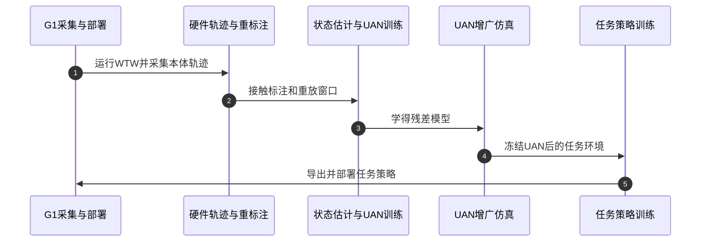

# Contact-UAN：用接触一致重放学习人形执行器残差

**Contact-UAN**（*Unsupervised Actuator Networks as a Residual World Model for Humanoid Control*，arXiv:2610.18991，2026-10-13）提出一种保留仿真物理先验、只修正执行器命令通道的残差世界模型。方法的关键是：有接触的硬件轨迹不能只按关节位置重置仿真，必须先找到能重现支撑接触力的仿真脚姿态。

## 英文缩写速查

| 缩写 | 英文全称 | 简要说明 |
|------|----------|----------|
| UAN | Unsupervised Actuator Network | 通过轨迹重放误差学习关节目标修正的执行器网络 |
| Sim2Real | Simulation-to-Real Transfer | 将仿真中训练的策略迁移到真实机器人 |
| PPO | Proximal Policy Optimization | 论文用于训练重放任务和下游策略的强化学习算法 |
| WTW | Walk These Ways | 用于初始真机数据采集的步行策略范式 |
| DoF | Degrees of Freedom | G1 实验平台的自由度计数单位 |

## 为什么重要

人形策略可以在真机上复现大致动作，却仍可能依赖仿真里不真实的扭矩和接触力，导致耗能、推拉力跟踪或起跳落地失败。广泛域随机化会缓解部分模型误差，但可能使策略过于保守；单纯辨识物理参数也未必能覆盖复杂的执行器非线性。Contact-UAN 将数据学习限制在仿真与真机差异最大的执行器指令通道，同时保留仿真器的刚体动力学和接触求解器。

## 方法栈与流程总览

### 接触一致重放

短时序 IMU、关节状态和上一时刻关节目标提供接触相关线索。估计器先分类哪些脚处于支撑，再只回归支撑脚对应的仿真穿透高度和倾角，并融合到重置所需的根姿态和基座速度。绝对基座高度不作为输入，避免模型简单复制硬件高度，而忽略仿真接触力所需的毫米级穿透差异。

在论文的 MuJoCo 模型中，根高度偏差 +2 mm 会使法向力下降约 50%，俯仰偏差 −2° 会令支撑力矩变化约 45%。因此重放的关键不是几何上“站在地面”，而是生成与硬件相符的接触 wrench。

### 残差模型与策略部署

UAN 输出关节位置目标修正 `δq`，形成 `q_cmd = q_base + δq`。它观察短时关节目标误差与关节速度；同类执行器共享两层 MLP 参数。训练时把硬件记录的命令送入仿真重放并匹配状态转移；下游策略训练时冻结 UAN，以修正后的执行器响应约束策略。部署阶段只运行已训练的任务策略，离线估计器和 UAN 均不需要部署。

## 源码运行时序图

仓库入口以 README 的 Hardware Pipeline Guide、`src/mjlab`、`scripts` 和 `deploy` 为准；官方代码公开，但数据、checkpoint 未随仓库提供。

## 实验与评测

论文在 29 自由度 Unitree G1 上用单一 UAN，从约 6.5 分钟步行数据迁移到跑步、力控、阻抗和跳跃。跑步时策略维持速度跟踪且扭矩用量降低约 20%；3.0 m/s 指令下真机达到 3.13 ± 0.06 m/s。力控制平均跟踪误差降低 42.8 ± 12.1%。接触一致重置在困难的 sim-to-sim 设置中把 20 秒存活率从 49.8% 提高到 96.7%；重放扭矩总量与硬件的相对不匹配降低 69.2%。

真机结果的每条件试验次数有限，且都来自单一 G1 平台。应将这些指标视为方法有效性的初步证据，而非跨型号保证。

## 结论

**Contact-UAN 的主要价值是把“接触重置是否正确”纳入执行器残差学习，让策略优化看到更可信的力和冲击响应。**

1. 采集有支撑和冲击的轨迹前，先确保仿真重放复现接触状态；直接按硬件绝对姿态初始化会污染训练目标。
2. 该方法更适合依赖力生成、承载、柔顺或落地冲击的任务；对准静态任务，复杂执行器残差可能收益有限。
3. 只需少量目标硬件数据是优势，但复现仍需要自有 G1、可信仿真底座和数据采集链。
4. 目前 UAN 未建模跨关节执行器耦合与温度效应，部署到不同执行器或长期热负载场景需要重新验证。

## 与其他执行器建模路线对比

| 路线 | 主要监督/数据 | 学习对象 | 部署含义 |
|------|---------------|----------|----------|
| **Contact-UAN** | 有接触的真机本体轨迹与接触一致仿真重放 | 对关节位置目标的残差，保留仿真动力学 | UAN 用于仿真训练，真机只跑下游任务策略 |
| [Actuator Network](../methods/actuator-network.md) | 经典路线通常用真机驱动器响应轨迹训练 | 近似电机、减速器、驱动器及延迟动态 | 把学习到的执行器模型放入训练仿真 |
| [NeuralActuator](./paper-neuralactuator-neural-actuation-modeling.md) | 关节位置轨迹及可微物理监督 | 关节响应与外力相关预测量 | 更偏向可微动力学建模和力感知用途 |
| 系统辨识 / 域随机化 | 设计激励数据，或指定参数扰动分布 | 物理参数或跨参数鲁棒策略 | 更适合有明确参数化模型或希望覆盖不确定区间时 |

Contact-UAN 的增量在于处理**接触状态会改变重放监督**这一问题，而不是证明所有执行器辨识或域随机化都不再需要。其位置位于[执行器驱动链选型闭环知识链](../queries/actuator-drive-chain-selection-loop.md)的执行器建模环节。

## 局限与风险

方法依赖名义仿真器对刚体和接触动态具有足够的结构正确性；UAN 只补执行器命令误差。接触状态估计假设较平整地面和有效的负载相关本体感觉。开源仓库未附真机数据或训练好的策略，代码可见不等于能无硬件复现论文结果。

## 关联页面

- [Sim2Real](../concepts/sim2real.md)：迁移时的模型差异与数据校准
- [Actuator Network](../methods/actuator-network.md)：学习执行器动态的经典路线
- [执行器驱动链选型闭环知识链](../queries/actuator-drive-chain-selection-loop.md)：执行器建模与验证的工程路径
- [Implicit / Explicit 执行器建模](../concepts/implicit-explicit-actuator-modeling.md)：仿真执行器实现的取舍
- [NeuralActuator](./paper-neuralactuator-neural-actuation-modeling.md)：另一种数据驱动执行器建模工作

## 参考来源

- [Contact-UAN 论文摘录](../../sources/papers/contact_uan_arxiv_2610_18991.md)
- [官方项目页核查](../../sources/sites/contact-uan-csail-mit-edu.md)
- [官方仓库核查](../../sources/repos/contact-uan.md)

## 推荐继续阅读

- [Contact-UAN 论文全文](https://arxiv.org/html/2610.18991v1)
- [Contact-UAN GitHub 仓库](https://github.com/nolie-rolie/contact-uan)
