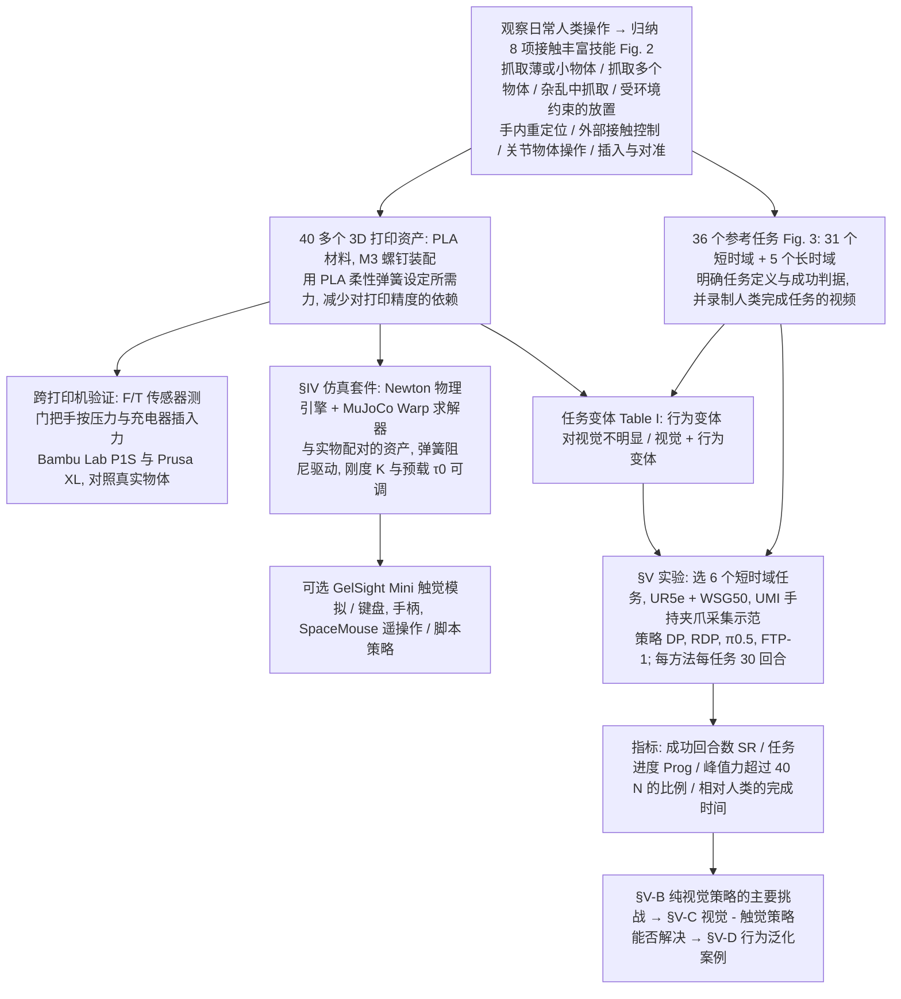

# ContactBench 1.0（arXiv:2610.24512）

**ContactBench 1.0**（*ContactBench 1.0: A Benchmark for Everyday Contact-Rich Robotic Manipulation*，[arXiv:2610.24512](https://arxiv.org/abs/2610.24512)，[项目页](https://jingyi-xiang.github.io/contactbench/)）来自 [具身智能小站 2026-11-01 盘点](../../sources/blogs/wechat_embodied_station_56_papers_libero_dynamic_latency_eval_2026-11-01.md)，属「评测与基准」组。

## 一句话定义

**ContactBench 1.0用可打印物体与可调阻力仿真覆盖日常接触技能；六项实测任务中，加入触觉未带来明显提升，提示传感器与策略利用能力需分别评估。**

## 英文缩写速查

| 缩写 | 英文全称 | 简要说明 |
|------|----------|----------|
| ContactBench 1.0 | ContactBench 1.0: A Benchmark for Everyday Contact-Rich Robotic Manipulation | 本文方法 / 基准的简称 |

## 为什么重要

- 把日常接触技能做成可复现任务。
- 开源结论：**待发布**（步骤 2.5，2026-11-01）。项目页 HTTP 200，仿真代码入口标 Simulation code (coming soon)。
- 同期同组工作见 [动态评测、技能编译与环境潜变量适配：具身智能小站 11-01 期 56 篇阅读坐标](../overview/embodied-station-2026-11-01-56-papers-technology-map.md)。

## 流程总览

图依据：基准构建与评测协议图，论文 Fig. 1-3、§III-A 至 §III-D、Table I、§IV-A 至 §IV-D、§V-A、Table III（指标含义）、§V 开头的三个研究问题与 §V-B 至 §V-D 小节标题。

## 核心机制

| 项 | 内容 |
|----|------|
| **arXiv** | [2610.24512](https://arxiv.org/abs/2610.24512) |
| **开源** | **待发布** |
| **要点** | ContactBench 1.0用可打印物体与可调阻力仿真覆盖日常接触技能；六项实测任务中，加入触觉未带来明显提升，提示传感器与策略利用能力需分别评估。 |
| **文内指标** | 公众号未给具体数字，本页不引用。 |

## 源码运行时序图

**不适用（待发布）** — 项目页 HTTP 200，仿真代码入口标 Simulation code (coming soon)。 不编造运行脚本；代码公开后再补。

## 实验与评测

- 公众号未给具体数字，本页不引用。
- **读法：** 本页为索引级摘要，依据公众号转述的官方摘要与仓库信息整理；逐项数字与 baseline 以原文 PDF 为准。

## 与其他工作对比

- 横向索引见 [动态评测、技能编译与环境潜变量适配：具身智能小站 11-01 期 56 篇阅读坐标](../overview/embodied-station-2026-11-01-56-papers-technology-map.md)；同 arXiv 不重复造页。

## 结论

**把日常接触技能做成可复现任务：ContactBench 1.0用可打印物体与可调阻力仿真覆盖日常接触技能；六项实测任务中，加入触觉未带来明显提升，提示传感器与策略利用能力需分别评估。**

1. 开源边界：**待发布** — 项目页 HTTP 200，仿真代码入口标 Simulation code (coming soon)。
2. 核心机制：ContactBench 1.0用可打印物体与可调阻力仿真覆盖日常接触技能；六项实测任务中，加入触觉未带来明显提升，提示传感器与策略利用能力需分别评估。
3. 复现与选型前核对任务协议、硬件与基准口径，勿直接横比公众号摘录数字。

## 关联页面

- [simulation-evaluation-infrastructure](../concepts/simulation-evaluation-infrastructure.md)
- [vla](../methods/vla.md)
- [manipulation](../tasks/manipulation.md)
- [embodied-station-2026-11-01-56-papers-technology-map](../overview/embodied-station-2026-11-01-56-papers-technology-map.md)
- [具身大模型评测基准选型闭环](../queries/embodied-eval-benchmark-selection-loop.md) — 评测基准在选型闭环中的定位与取舍

## 参考来源

- [contactbench_1_0_arxiv_2610_24512.md](../../sources/papers/contactbench_1_0_arxiv_2610_24512.md)
- [wechat_embodied_station_56_papers_libero_dynamic_latency_eval_2026-11-01.md](../../sources/blogs/wechat_embodied_station_56_papers_libero_dynamic_latency_eval_2026-11-01.md)
- [arXiv:2610.24512](https://arxiv.org/abs/2610.24512)
- [arXiv PDF](https://arxiv.org/pdf/2610.24512)：已通读摘要、§I-§IV、§V-A 实验设置与 Table III 的指标定义；§V-B 至 §V-D 的失败分析与泛化案例、§VI 讨论与附录只读小节标题与总述，未逐段读

## 推荐继续阅读

- [arXiv PDF](https://arxiv.org/pdf/2610.24512)
- [项目页](https://jingyi-xiang.github.io/contactbench/)
