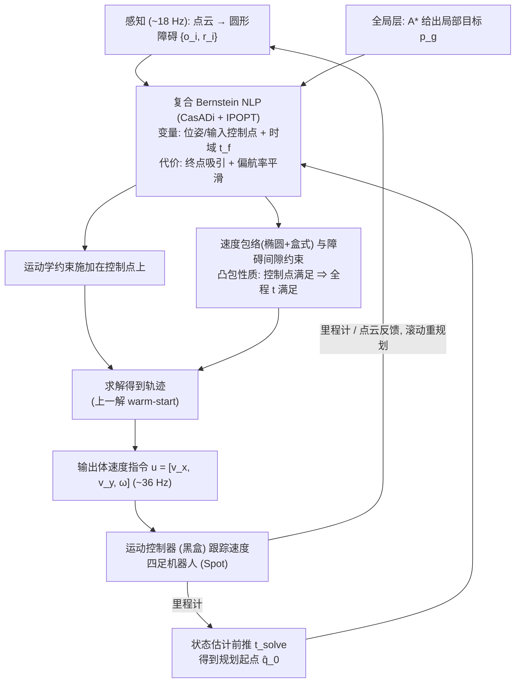

# 连续时间安全规划控制：面向敏捷四足机器人的连续时间安全规划与控制

**连续时间安全规划控制**（*Continuous-Time Safe Planning and Control for Agile Quadrupeds*，[arXiv:2610.35670](https://arxiv.org/abs/2610.35670)）收录于 senlanke「具身运控lab」10-26–10-30 前沿论文动态（人形/四足）。本页依据**周报条目 + arXiv 摘要页**整理，流程图依据论文方法部分（见参考来源），未逐页核对实验数字；指标与结论以论文为准。

## 一句话定义

**连续时间安全规划控制：面向敏捷四足机器人的连续时间安全规划与控制——保留带朝向耦合速度边界的完整 SE(2) 模型，以分段 Bernstein 多项式表示轨迹；利用凸包性质在整个连续时间区间上验证避碰和控制边界。**

## 英文缩写速查

| 缩写 | 英文全称 | 简要说明 |
|------|----------|----------|
| RL | Reinforcement Learning | 强化学习 |
| WBC | Whole-Body Control | 全身控制 |

## 为什么重要

- 周报所述待解决的问题：离散时刻避碰不能排除两个规划点之间的碰撞，简化为单轮车模型又会丢失四足机器人的横向运动能力。

## 流程总览

图依据：论文 §III-D、§IV-A–E / Fig.2（规划管线）

## 核心机制

| 项 | 内容 |
|----|------|
| **arXiv** | [2610.35670](https://arxiv.org/abs/2610.35670) · [PDF](https://arxiv.org/pdf/2610.35670) |
| **作者（arXiv）** | MacLin, Gage, Peterson, Mason, Tabasso, Camilla, Cichella, Venanzio, Migdal, Joshua, Brady, Tye, Padir, Taskin |
| **机构（周报所述，未逐条核实）** | Amazon Fulfillment Technologies & Robotics、爱荷华大学、麻省理工学院 |
| **arXiv 评论栏** | （无） |
| **开源** | arXiv 摘要页与评论未见代码或项目页链接（仅核对 arXiv 摘要页，不代表未发布）（2026-11-02） |
| **周报所述创新点** | 保留带朝向耦合速度边界的完整 SE(2) 模型，以分段 Bernstein 多项式表示轨迹；利用凸包性质在整个连续时间区间上验证避碰和控制边界。 |

### arXiv 摘要节选（英文原文）

> Agile quadruped navigation in dynamic environments demands trajectories that are both dynamically feasible and provably collision-free. Most real-time planners achieve tractability through a convex reduction that requires simplified kinematic models, discarding motion that the robot can readily execute, and certify safety only at discretization points, leaving open possible inter-sample collisions with moving obstacles.

## 源码运行时序图

**不适用**：arXiv 摘要页与评论未见代码或项目页链接（仅核对 arXiv 摘要页，不代表未发布），无可对齐的官方代码流程。

## 实验与评测

- 周报与摘要给出的数字/场景已写入上表「创新点」与摘要节选；其余实验细节、基线与成功率定义请回到论文正文。
- 读法：先对齐任务设定、传感器与成功定义（仿真/真机），再解读 headline 数字，勿跨论文直接比较。

## 与其他工作对比

| 维度 | 读法 |
|------|------|
| **同周对照** | 见 [人形/四足周报技术地图](../overview/senlanke-weekly-2026-10-26-30-humanoid-quadruped-technology-map.md)，按方向浏览同期论文 |
| **开源状态** | arXiv 摘要页与评论未见代码或项目页链接（仅核对 arXiv 摘要页，不代表未发布） |

## 结论

**连续时间安全规划控制：面向敏捷四足机器人的连续时间安全规划与控制。**

1. 本页是入库级摘要，复现前请核对论文正文、附录与代码仓库。
2. 指标须连同实验条件解读。
3. 关注 arXiv 版本更新与代码发布。

## 关联页面

- [senlanke-weekly-2026-10-26-30-humanoid-quadruped-technology-map](../overview/senlanke-weekly-2026-10-26-30-humanoid-quadruped-technology-map.md)
- [locomotion](../tasks/locomotion.md)
- [reinforcement-learning](../methods/reinforcement-learning.md)

## 参考来源

- [continuous-time-safe-planning-agile-quadrupeds_arxiv_2610_35670.md](../../sources/papers/continuous-time-safe-planning-agile-quadrupeds_arxiv_2610_35670.md)
- [wechat_senlanke_weekly_humanoid_quadruped_2026-10-26_30.md](../../sources/blogs/wechat_senlanke_weekly_humanoid_quadruped_2026-10-26_30.md)
- [arXiv:2610.35670](https://arxiv.org/abs/2610.35670)
- [arXiv PDF](https://arxiv.org/pdf/2610.35670)：已通读方法部分（实验与附录以略读为准）：§I–§VI（§III 问题建模、§IV 复合 Bernstein 轨迹优化与连续时间证书、§V 仿真/硬件实验）

## 推荐继续阅读

- [arXiv PDF](https://arxiv.org/pdf/2610.35670)
