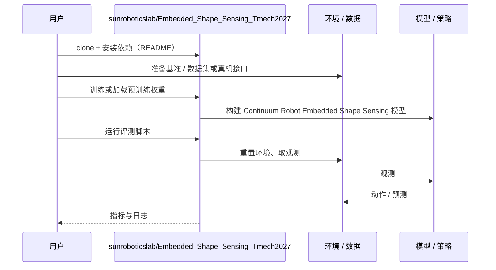

# Continuum Robot Embedded Shape Sensing（arXiv:2610.39055）

**Continuum Robot Embedded Shape Sensing**（*Controlling Continuum Robot Shape in Enclosed Space with Embedded Sensing using IMU and Actuator Feedback*，[arXiv:2610.39055](https://arxiv.org/abs/2610.39055)，[代码](https://github.com/sunroboticslab/Embedded_Shape_Sensing_Tmech2027)）来自 [具身智能小站 2026-10-30 盘点](../../sources/blogs/wechat_embodied_station_28_papers_event2reward_progress_rewards_2026-10-30.md)，属「规划、感知与建图」组。

## 一句话定义

**融合 IMU 与执行器反馈，用神经网络重建连续体机器人形状并闭环控制。**

## 英文缩写速查

| 缩写 | 英文全称 | 简要说明 |
|------|----------|----------|
| Continuum Robot Embedded Shape Sensing | Controlling Continuum Robot Shape in Enclosed Space with Embedded Sensing using IMU and Actuator Feedback | 本文方法 / 基准的简称 |

## 为什么重要

- 封闭空间里，用机载信号估计连续体形状。研究系统比较表征、网络、目标与传感输入，为无法外部观测的空间提供设计依据。
- 开源结论：**已开源**（步骤 2.5，2026-10-30）。仓库可达（git ls-remote）。
- 同期同组工作见 [进度奖励、接触监督与规划验证：具身智能小站 10-30 期 28 篇阅读坐标](../overview/embodied-station-2026-10-30-28-papers-technology-map.md)。

## 核心机制

| 项 | 内容 |
|----|------|
| **arXiv** | [2610.39055](https://arxiv.org/abs/2610.39055) |
| **开源** | **已开源** |
| **要点** | 融合 IMU 与执行器反馈，用神经网络重建连续体机器人形状并闭环控制。 |
| **文内指标** | 公众号转述：研究系统比较表征、网络、目标与传感输入，为无法外部观测的空间提供设计依据。 |

## 源码运行时序图

以下为按仓库入口（`sunroboticslab/Embedded_Shape_Sensing_Tmech2027`）推断的通用运行链路；入库日仅核实仓库可达，未逐文件阅读，具体脚本名以 README 为准。

## 实验与评测

- 公众号转述：研究系统比较表征、网络、目标与传感输入，为无法外部观测的空间提供设计依据。
- **读法：** 本页为索引级摘要，依据公众号转述的官方摘要与仓库信息整理；逐项数字与 baseline 以原文 PDF 为准。

## 与其他工作对比

- 横向索引见 [进度奖励、接触监督与规划验证：具身智能小站 10-30 期 28 篇阅读坐标](../overview/embodied-station-2026-10-30-28-papers-technology-map.md)；同 arXiv 不重复造页。

## 结论

**封闭空间里，用机载信号估计连续体形状：研究系统比较表征、网络、目标与传感输入，为无法外部观测的空间提供设计依据。**

1. 开源边界：**已开源** — 仓库可达（git ls-remote）。
2. 核心机制：融合 IMU 与执行器反馈，用神经网络重建连续体机器人形状并闭环控制。
3. 复现与选型前核对任务协议、硬件与基准口径，勿直接横比公众号摘录数字。

## 关联页面

- [locomotion](../tasks/locomotion.md)
- [vision-language-navigation](../tasks/vision-language-navigation.md)
- [manipulation](../tasks/manipulation.md)
- [embodied-station-2026-10-30-28-papers-technology-map](../overview/embodied-station-2026-10-30-28-papers-technology-map.md)

## 参考来源

- [continuum_robot_embedded_shape_sensing_arxiv_2610_39055.md](../../sources/papers/continuum_robot_embedded_shape_sensing_arxiv_2610_39055.md)
- [wechat_embodied_station_28_papers_event2reward_progress_rewards_2026-10-30.md](../../sources/blogs/wechat_embodied_station_28_papers_event2reward_progress_rewards_2026-10-30.md)
- [arXiv:2610.39055](https://arxiv.org/abs/2610.39055)

## 推荐继续阅读

- [arXiv PDF](https://arxiv.org/pdf/2610.39055)
- [https://github.com/sunroboticslab/Embedded_Shape_Sensing_Tmech2027](https://github.com/sunroboticslab/Embedded_Shape_Sensing_Tmech2027)
