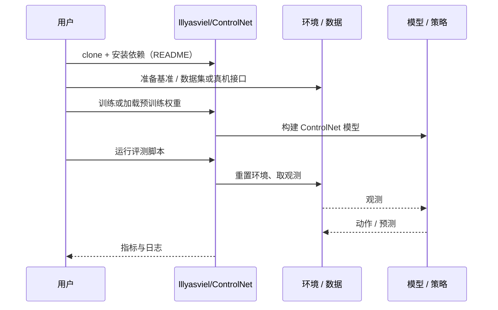

# ControlNet（arXiv:2302.05543）

**ControlNet**（*Adding Conditional Control to Text-to-Image Diffusion Models*，[arXiv:2302.05543](https://arxiv.org/abs/2302.05543)，[代码](https://github.com/lllyasviel/ControlNet)）来自 [深蓝具身智能 2026-11-01 盘点](../../sources/blogs/wechat_shenlan_cv_best_papers_2023_2026_labs.md)，属「视觉推理与可控生成」组。

## 一句话定义

**ControlNet 锁定预训练文生图扩散模型，复用其编码层作骨干，并经零初始化卷积（zero convolution）学习边缘、深度、分割、人体姿态等空间控制条件。**

## 英文缩写速查

| 缩写 | 英文全称 | 简要说明 |
|------|----------|----------|
| ControlNet | Conditional Control Network | 给扩散模型加空间条件的网络结构 |
| SD | Stable Diffusion | 开源文生图扩散模型 |

## 为什么重要

- 让大型扩散模型获得精确的空间可控性，是可控生成的基础组件（公众号归属：斯坦福 Brown 媒体创新研究所）。
- 开源结论：**已开源**（步骤 2.5，2026-11-01）。arXiv 摘要页链接的仓库 lllyasviel/ControlNet 经 git ls-remote 可达。
- 同期同组工作见 [从视觉编程到 4D 重建：CV 三大会 2023–2026 Best Paper 阅读坐标](../overview/cv-best-papers-2023-2026-technology-map.md)。

## 核心机制

| 项 | 内容 |
|----|------|
| **arXiv** | [2302.05543](https://arxiv.org/abs/2302.05543) |
| **开源** | **已开源** |
| **要点** | 冻结生产级扩散模型，复制编码层作可训练分支，用零卷积逐步增加参数以避免有害噪声破坏微调（arXiv 摘要）。 |
| **文内指标** | arXiv 摘要称在 Stable Diffusion 上用单条件或多条件、带或不带文本提示测试多种控制；具体数字未在本页转录。 |

## 源码运行时序图

以下为按仓库入口（`lllyasviel/ControlNet`）推断的通用运行链路；入库日仅核实仓库可达，未逐文件阅读，具体脚本名以 README 为准。

## 实验与评测

- arXiv 摘要称在 Stable Diffusion 上用单条件或多条件、带或不带文本提示测试多种控制；具体数字未在本页转录。
- **读法：** 本页为索引级摘要，依据公众号转述的官方摘要与仓库信息整理；逐项数字与 baseline 以原文 PDF 为准。

## 与其他工作对比

- 横向索引见 [从视觉编程到 4D 重建：CV 三大会 2023–2026 Best Paper 阅读坐标](../overview/cv-best-papers-2023-2026-technology-map.md)；同 arXiv 不重复造页。

## 结论

**ControlNet：锁住大模型、旁路学习条件控制。**

1. 开源边界：**已开源** — arXiv 摘要页链接的仓库 lllyasviel/ControlNet 经 git ls-remote 可达。
2. 核心机制：冻结生产级扩散模型，复制编码层作可训练分支，用零卷积逐步增加参数以避免有害噪声破坏微调（arXiv 摘要）。
3. 复现与选型前核对任务协议、硬件与基准口径，勿直接横比公众号摘录数字。

## 关联页面

- [generative-world-models](../methods/generative-world-models.md)
- [cv-best-papers-2023-2026-technology-map](../overview/cv-best-papers-2023-2026-technology-map.md)

## 参考来源

- [controlnet_arxiv_2302_05543.md](../../sources/papers/controlnet_arxiv_2302_05543.md)
- [wechat_shenlan_cv_best_papers_2023_2026_labs.md](../../sources/blogs/wechat_shenlan_cv_best_papers_2023_2026_labs.md)
- [arXiv:2302.05543](https://arxiv.org/abs/2302.05543)

## 推荐继续阅读

- [arXiv PDF](https://arxiv.org/pdf/2302.05543)
- [https://github.com/lllyasviel/ControlNet](https://github.com/lllyasviel/ControlNet)
