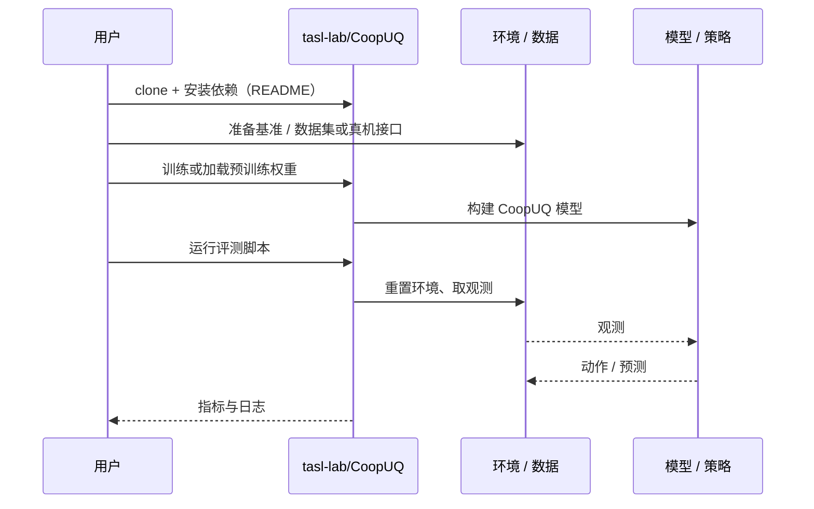

# CoopUQ（arXiv:2610.26852）

**CoopUQ**（*CoopUQ: Robust Multi-Robot Social Navigation via Uncertainty-Aware Cooperative Forecasting*，[arXiv:2610.26852](https://arxiv.org/abs/2610.26852)，[项目页](https://coopuq.github.io/)，[代码](https://github.com/tasl-lab/CoopUQ)）来自 [具身智能小站 2026-10-31 盘点](../../sources/blogs/wechat_embodied_station_50_papers_scenerig_photo_to_sim_2026-10-31.md)，属「导航、感知与多机器人」组。

## 一句话定义

**CoopUQ融合多机观测预测占据与不确定性，将高风险区域纳入约束强化学习；仿真分布外与真机导航均评估，目前聚焦同类二维激光机器人。**

## 英文缩写速查

| 缩写 | 英文全称 | 简要说明 |
|------|----------|----------|
| CoopUQ | CoopUQ: Robust Multi-Robot Social Navigation via Uncertainty-Aware Cooperative Forecasting | 本文方法 / 基准的简称 |

## 为什么重要

- 多机器人共享预测，也共享不确定性。
- 开源结论：**已开源**（步骤 2.5，2026-10-31）。仓库可达（git ls-remote）。项目页 HTTP 200。
- 同期同组工作见 [单图重建仿真、VLA 适配评测与跨形态世界模型：具身智能小站 10-31 期 50 篇阅读坐标](../overview/embodied-station-2026-10-31-50-papers-technology-map.md)。

## 核心机制

| 项 | 内容 |
|----|------|
| **arXiv** | [2610.26852](https://arxiv.org/abs/2610.26852) |
| **开源** | **已开源** |
| **要点** | CoopUQ融合多机观测预测占据与不确定性，将高风险区域纳入约束强化学习；仿真分布外与真机导航均评估，目前聚焦同类二维激光机器人。 |
| **文内指标** | 公众号未给具体数字，本页不引用。 |

## 源码运行时序图

以下为按仓库入口（`tasl-lab/CoopUQ`）推断的通用运行链路；入库日仅核实仓库可达，未逐文件阅读，具体脚本名以 README 为准。

## 实验与评测

- 公众号未给具体数字，本页不引用。
- **读法：** 本页为索引级摘要，依据公众号转述的官方摘要与仓库信息整理；逐项数字与 baseline 以原文 PDF 为准。

## 与其他工作对比

- 横向索引见 [单图重建仿真、VLA 适配评测与跨形态世界模型：具身智能小站 10-31 期 50 篇阅读坐标](../overview/embodied-station-2026-10-31-50-papers-technology-map.md)；同 arXiv 不重复造页。

## 结论

**多机器人共享预测，也共享不确定性：CoopUQ融合多机观测预测占据与不确定性，将高风险区域纳入约束强化学习；仿真分布外与真机导航均评估，目前聚焦同类二维激光机器人。**

1. 开源边界：**已开源** — 仓库可达（git ls-remote）。项目页 HTTP 200。
2. 核心机制：CoopUQ融合多机观测预测占据与不确定性，将高风险区域纳入约束强化学习；仿真分布外与真机导航均评估，目前聚焦同类二维激光机器人。
3. 复现与选型前核对任务协议、硬件与基准口径，勿直接横比公众号摘录数字。

## 关联页面

- [vision-language-navigation](../tasks/vision-language-navigation.md)
- [locomotion](../tasks/locomotion.md)
- [sim2real](../concepts/sim2real.md)
- [embodied-station-2026-10-31-50-papers-technology-map](../overview/embodied-station-2026-10-31-50-papers-technology-map.md)

## 参考来源

- [coopuq_arxiv_2610_26852.md](../../sources/papers/coopuq_arxiv_2610_26852.md)
- [wechat_embodied_station_50_papers_scenerig_photo_to_sim_2026-10-31.md](../../sources/blogs/wechat_embodied_station_50_papers_scenerig_photo_to_sim_2026-10-31.md)
- [arXiv:2610.26852](https://arxiv.org/abs/2610.26852)

## 推荐继续阅读

- [arXiv PDF](https://arxiv.org/pdf/2610.26852)
- [项目页](https://coopuq.github.io/)
- [https://github.com/tasl-lab/CoopUQ](https://github.com/tasl-lab/CoopUQ)
